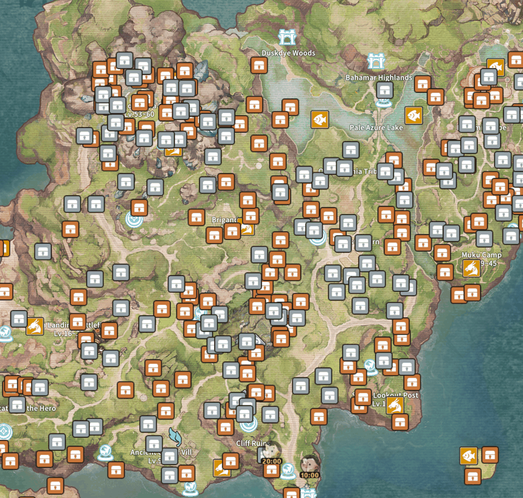

# Atlas

Peta bersama untuk peti, koleksi, dan makhluk ajaib Asteria Plains. Atlas menampilkan yang terdekat di sekitarmu
beserta arah dan jaraknya, lalu memasang penanda panduan milik game di titik yang kamu pilih. Titik yang kamu
nyalakan juga muncul di peta besar dan minimap game.

## Memulai

1. Pasang plugin-nya lalu jalankan game dalam mode **Dengan mod**.
2. Masuk ke karakter, lalu buka ubin **Atlas** di peluncur Stellar.
3. Pertama kali, Atlas menampilkan pemberitahuan **Atlas adalah peta bersama** yang menjelaskan apa saja yang
   dibagikan (lihat *Berbagi dan privasi* di bawah). Tekan **Mengerti** untuk mulai. Tidak ada yang dibagikan
   sebelum kamu menekannya.
4. Di **TAMPILKAN**, nyalakan apa yang ingin kamu lihat.

Bagian atas jendela menunjukkan peta, line kamu, dan berapa peti yang diketahui Atlas di peta ini. Kalau server
Atlas tidak bisa dihubungi, tertulis **Offline** dan Atlas tetap berjalan dari salinan yang tersimpan dari
kunjungan terakhirmu.

## Peti dan koleksi

**TAMPILKAN** (klik chip untuk menyalakan atau mematikan; pilihanmu disimpan per karakter)

- **Peti**: **Biasa**, **Epik**, **Legenda**, dan **Lainnya**.
- **Koleksi**: **Buku**.
- **Makhluk ajaib**: satu chip untuk tiap makhluk (lihat di bawah). Semuanya mati secara bawaan.

**TERDEKAT** berisi titik terdekat dari jenis yang kamu nyalakan, beserta arah (**U**, **TL**, …) dan jaraknya.
Daftarnya menggabungkan peta Atlas bersama dengan apa yang sedang ditampilkan game kepadamu. Label di tiap baris
menunjukkan asalnya:

- **Terlihat**: game sedang menampilkannya kepadamu saat ini.
- **Data peta**: dari peta Atlas bersama.
- **Belum pasti**: dilaporkan pemain lain, tapi belum dipastikan.
- **Dibuka**: baru saja kamu buka. Barisnya hilang dari daftar sesaat kemudian.

**Klik baris untuk dipandu ke sana.** Penanda panduan milik game muncul di titik itu beserta jaraknya. Penanda hilang
sendiri saat kamu sampai, dan **Stop pandu** menghapusnya kapan saja. Kalau kamu membuka peti yang sedang dipandu,
panduan pindah ke titik terdekat berikutnya yang kamu nyalakan.

Peti yang kamu buka hilang dari daftar, hanya untuk karakter itu. Peti yang kamu buka sebelum memasang Atlas akan
hilang sendiri begitu kamu berdiri di dekat titiknya dan tidak ada apa-apa di sana. Kalau game menampilkannya lagi di
sana, peti itu kembali ke daftar. Catatan ini disimpan di PC-mu saja dan tidak pernah dibagikan.

Buku yang sudah kamu baca juga hilang dari daftar, hanya untuk karakter itu, termasuk buku yang kamu baca sebelum
memasang Atlas. Atlas memakai catatan game sendiri tentang buku yang sudah dibaca karakter itu.

Kalau di suatu peta belum ada yang diketahui, daftarnya akan memberi tahu. Peti yang kamu temukan ditambahkan untuk
semua orang.

## Makhluk ajaib

Atlas menampilkan lima makhluk ajaib Asteria Plains: **Golden Nappo**, **Silver Nappo**, **Loyal Boarlet**,
**Lovely Boarlet**, dan **Breezy Boarlet**. Nyalakan salah satunya di **TAMPILKAN**, dan panel **MAKHLUK AJAIB**
muncul di atas **TERDEKAT** dengan satu baris per makhluk:

- **Di line kamu** atau **Line 7** / **Di 3 line**: line tempat ia ada (line kamu lebih dulu), dengan lokasi,
  HP, dan jaraknya.
- **Terlihat**: sedang terlihat saat ini, dengan posisi tepat dan HP-nya (dan **sedang dilawan** kalau ada yang
  sedang melawannya).
- **Tidak ada**: Lovely Boarlet dan Breezy Boarlet muncul sesuai jadwal tetap. Selama belum ada, barisnya
  menampilkan waktu **muncul lagi** dan berapa lama lagi.
- **Dilihat pemain**: pemain Atlas lain melihatnya, dengan line-nya dan kapan.

**Klik makhluk untuk membuka daftar line-nya.**

- **Hanya yang ada** menampilkan line tempat ia ada. **Semua N** menampilkan semua line di server, dengan **Belum
  terlihat** atau waktu muncul berikutnya untuk line lainnya.
- Setiap line menunjukkan lokasi, HP, dan kapan terakhir diperbarui. Line kamu diberi garis tepi.
- Pilih line, lalu tekan **Pandu ke sana**. Penanda panduan game pindah ke titik itu. Dari peta lain, penanda lebih
  dulu menunjuk ke jalan keluar menuju Asteria Plains (**Memandu kamu ke arah …**). Kalau tidak ada jalan keluar yang
  bisa ditunjuk, panduan dimulai begitu kamu tiba.
- Pindah line kamu lakukan sendiri: Atlas hanya menunjukkan ke mana harus pergi.

Status semua line diperbarui sekitar setiap 30 detik selama kamu berada di Asteria Plains atau jendela sedang terbuka.

**Status langsung semua line baru tersedia untuk server SEA.** Di server lain kamu melihat makhluk yang ditemukan
pemain Atlas lain, dan ada catatan di bawah daftar yang menjelaskannya.

## Ikon di peta

- Setiap titik yang kamu nyalakan di **TAMPILKAN** muncul di peta besar dan minimap game. Matikan chip-nya, dan
  ikonnya hilang.
- Kamu bisa memilih ikon Atlas di peta besar dan memakai tombol milik game untuk menuju ke sana.
- Makhluk ajaib tampil sebagai ikon kepala bulat: lingkar hijau kalau ia ada di line kamu, lencana line (misalnya
  **7**) kalau ada di line lain, dan sedikit pudar dengan waktu muncul berikutnya selama Boarlet berjadwal belum ada.

## Berbagi dan privasi

**Atlas adalah peta bersama.** Selama Atlas berjalan, temuanmu dan lokasinya (peti, sumber daya, dan makhluk ajaib)
dibagikan ke server Atlas agar peta tetap lengkap untuk semua.

- Nama, UID, dan chat kamu **tidak pernah** dikirim.
- Tidak ada yang dibagikan sebelum kamu menekan **Mengerti** di pemberitahuan pertama.
- Bagian bawah jendela selalu mengingatkan: *Peta bersama · temuanmu dan lokasinya dibagikan. Tanpa nama.*
- **Untuk berhenti berbagi, matikan Atlas di launcher.**

## Tips dan FAQ

- **Daftarnya kosong.** Nyalakan sebuah jenis di **TAMPILKAN**. Kalau peta itu belum punya peti yang diketahui, peti
  yang kamu temukan akan ditambahkan.
- **Ada peti di daftar, tapi tidak ada di tempatnya.** Kemungkinan sudah pernah dibuka oleh karakter ini. Berdirilah
  di dekat titik itu sebentar, dan Atlas menyembunyikannya untuk karakter itu.
- **Tertulis Offline.** Atlas sedang tidak bisa menghubungi servernya. Peti tetap berfungsi dari salinan tersimpan,
  dan status makhluk langsung kembali setelah tersambung lagi.
- **Saya tidak di SEA.** Makhluk tetap muncul saat pemain Atlas lain melihatnya, tapi tanpa status langsung semua
  line.
- Atlas hanya bisa dibuka saat kamu berada di dunia game, dan jendelanya tertutup saat kamu logout.
