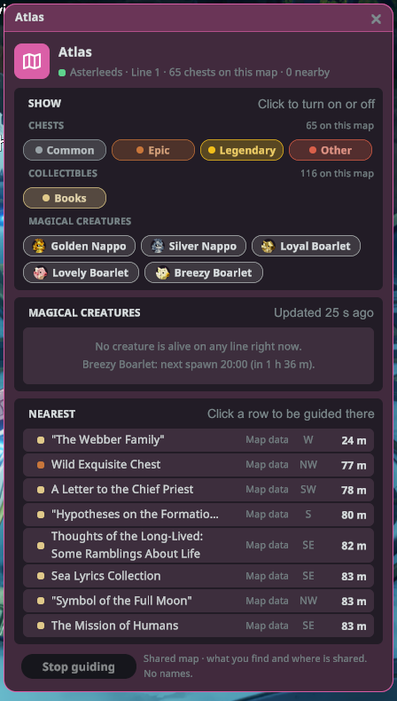

# 아틀라스

상자, 수집품, 그리고 Asteria Plains의 마법 생물을 담은 공유 지도입니다. 내 주변에서 가장 가까운 곳을 방향과 거리와 함께 보여 주고, 고른 곳에 게임의 길 안내 표시를 띄웁니다. 켜 둔 지점은 게임의 큰 지도와 미니맵에도 표시됩니다.

## 시작하기

1. 플러그인을 설치하고 게임을 **모드 적용**으로 실행하세요.
2. 캐릭터로 로그인한 뒤 Stellar 런처의 **아틀라스** 타일을 엽니다.
3. 처음에는 **아틀라스는 공유 지도입니다**라는 안내가 나와 무엇이 공유되는지 설명합니다(아래 "공유와 개인정보" 참고). **확인**을 누르면 시작됩니다. 누르기 전에는 아무것도 공유되지 않습니다.
4. **표시**에서 보고 싶은 것을 켭니다.

헤더에는 지금 있는 지도, 내 라인, 그리고 아틀라스가 이 지도에서 알고 있는 상자 수가 표시됩니다. 아틀라스 서버에 연결할 수 없으면 **오프라인**이라고 나오고, 마지막으로 저장된 사본으로 계속 사용할 수 있습니다.

## 상자와 수집품

**표시** (칩을 클릭해서 켜거나 끕니다. 선택은 캐릭터별로 저장됩니다)

- **상자**: **일반**, **에픽**, **전설**, **기타**.
- **수집품**: **책**.
- **마법 생물**: 생물마다 칩이 하나씩 있습니다(아래 참고). 처음에는 모두 꺼져 있습니다.

**가까운 곳**에는 켜 둔 종류 중 가장 가까운 지점이 방향(**북**, **북동** …)과 거리와 함께 나옵니다. 공유된 아틀라스 지도와 지금 게임이 보여 주는 정보를 합쳐서 보여 줍니다. 각 행의 태그는 정보의 출처입니다.

- **직접 확인**: 지금 게임에 보이고 있습니다.
- **지도 정보**: 공유된 아틀라스 지도에서 온 정보입니다.
- **미확인**: 다른 플레이어가 알려 주었지만 아직 확인되지 않았습니다.
- **열림**: 방금 연 상자입니다. 잠시 후 목록에서 사라집니다.

**행을 클릭하면 그곳으로 안내합니다.** 게임의 길 안내 표시가 거리와 함께 그 위치에 나타납니다. 도착하면 저절로 사라지고, **안내 중지**로 언제든 지울 수 있습니다. 안내 중인 상자를 열면, 켜 둔 지점 중 다음으로 가까운 곳으로 안내가 넘어갑니다.

연 상자는 그 캐릭터의 목록에서만 사라집니다. 아틀라스를 설치하기 전에 연 상자도 그 위치 근처에 서 있을 때 아무것도 없으면 저절로 사라집니다. 게임이 그 자리에 다시 상자를 보여 주면 목록에 돌아옵니다. 이 기록은 내 PC에만 저장되며 공유되지 않습니다.

읽은 책도 그 캐릭터의 목록에서 사라집니다. 아틀라스를 설치하기 전에 읽은 책도 마찬가지입니다. 아틀라스는 그 캐릭터가 읽은 책에 대한 게임 자체의 기록을 확인합니다.

아직 알려진 것이 없는 지도에서는 목록에 그렇게 표시됩니다. 내가 찾은 상자는 모두를 위해 추가됩니다.

## 마법 생물

아틀라스는 Asteria Plains의 마법 생물 다섯 종을 보여 줍니다: **Golden Nappo**, **Silver Nappo**, **Loyal Boarlet**, **Lovely Boarlet**, **Breezy Boarlet**. **표시**에서 아무거나 켜면 **가까운 곳** 위에 **마법 생물** 패널이 나타나고, 생물마다 한 줄씩 표시됩니다.

- **내 라인** 또는 **라인 7** / **3개 라인**: 출현 중인 라인(내 라인이 먼저)과 위치, HP, 거리.
- **직접 확인**: 지금 시야 안에 있습니다. 정확한 위치와 HP가 나옵니다(누군가 싸우고 있으면 **전투 중**).
- **없음**: Lovely Boarlet과 Breezy Boarlet은 정해진 시간에 출현합니다. 없는 동안에는 **다음 출현** 시각과 남은 시간이 표시됩니다.
- **플레이어 목격**: 다른 아틀라스 플레이어가 발견한 생물입니다. 라인과 얼마 전인지가 나옵니다.

**생물을 클릭하면 라인 목록이 열립니다.**

- **출현 중만**은 출현 중인 라인만 보여 줍니다. **전체 N**은 서버의 모든 라인을 보여 주고, 나머지 라인에는 **미확인** 또는 다음 출현 시각이 표시됩니다.
- 라인마다 위치, HP, 마지막 갱신 시각이 나옵니다. 내 라인은 테두리로 표시됩니다.
- 라인을 고르고 **길 안내**를 누르면 게임의 길 안내 표시가 그 위치로 갑니다. 다른 지도에 있다면 먼저 Asteria Plains로 가는 출구를 가리킵니다(**… 방향으로 안내 중**). 가리킬 출구가 없으면 도착했을 때 안내가 시작됩니다.
- 라인 이동은 직접 하세요. 아틀라스는 어디로 가야 하는지만 알려 줍니다.

모든 라인의 상태는 Asteria Plains에 있거나 창을 열어 둔 동안 약 30초마다 새로 고쳐집니다.

**모든 라인의 실시간 상태는 현재 SEA 서버에서만 제공됩니다.** 다른 서버에서는 다른 아틀라스 플레이어가 발견한 생물이 표시되며, 목록 아래에 그 안내가 나옵니다.

## 지도 아이콘

- **표시**에서 켠 모든 지점은 게임의 큰 지도와 미니맵에 표시됩니다. 칩을 끄면 그 아이콘도 사라집니다.
- 큰 지도에서 아틀라스 아이콘을 고르고 게임 자체 버튼으로 그곳에 갈 수도 있습니다.
- 마법 생물은 둥근 얼굴 아이콘으로 나옵니다. 내 라인에 있으면 초록 테두리, 다른 라인에 있으면 라인 배지(예: **7**)가 붙고, 정해진 시간에 나오는 Boarlet이 없는 동안에는 조금 흐려지며 다음 출현 시각이 표시됩니다.

## 공유와 개인정보

**아틀라스는 공유 지도입니다.** 아틀라스가 켜져 있는 동안 발견한 것과 그 위치(상자, 자원, 마법 생물)가 아틀라스 서버와 공유되어 모두의 지도가 완전하게 유지됩니다.

- 이름, UID, 채팅은 **절대** 전송되지 않습니다.
- 처음 안내에서 **확인**을 누르기 전에는 아무것도 공유되지 않습니다.
- 창 아래쪽에도 *공유 지도 · 찾은 것과 위치가 공유됩니다. 이름은 보내지 않습니다.*라고 표시됩니다.
- **공유를 멈추려면 런처에서 아틀라스를 끄세요.**

## 팁과 자주 묻는 질문

- **목록이 비어 있어요.** **표시**에서 종류를 켜세요. 아직 알려진 상자가 없는 지도라면, 내가 찾은 상자가 추가됩니다.
- **목록에 있는 상자가 그 자리에 없어요.** 이 캐릭터로 예전에 연 상자일 가능성이 높습니다. 그 위치 근처에 잠시 서 있으면 그 캐릭터에서는 숨겨집니다.
- **오프라인이라고 나와요.** 지금은 아틀라스 서버에 연결할 수 없습니다. 상자는 저장된 사본으로 계속 쓸 수 있고, 마법 생물의 실시간 상태는 다시 연결되면 돌아옵니다.
- **SEA 서버가 아니에요.** 다른 아틀라스 플레이어가 발견한 생물은 표시되지만, 모든 라인의 실시간 상태는 없습니다.
- 아틀라스는 월드에 있을 때만 열리며, 로그아웃하면 창이 닫힙니다.
