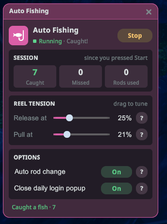

# 自動釣り

釣りのミニゲームをキャストから釣果まで完全自動化し、放置したまま運用できます。

## 使い方

1. プラグインをインストールし、ゲームを**Mod有効**で起動します。
2. ロッドを装備した状態で釣り場へ行き、Stellar メニューから**自動釣り**を開きます。
3. **開始**を押します。プラグインがキャスト、テンションのミニゲーム、釣果の回収までを自動で行い、終わるとまた最初から繰り返します。止めるときは**停止**を押すか、ウィンドウを閉じます。

## ウィンドウ

- タイトルの下の**状態表示**：「釣り場へ移動すると開始できます」「準備完了」「実行中」（現在の段階付き）、ポップアップを閉じている間は「一時停止」。釣り場にいない間は**開始**が押せない表示になります。
- **セッション**には、開始を押してから釣った数・逃した数・使ったロッドの数が表示されます。
- 釣果・取り逃し・ロッド交換のたびに、下部に短いメッセージが表示されます。

## 設定

- **緩める値** — リール中にテンションゲージがこの値に達すると、糸が切れないようロッドを緩めます。低いほど安全ですが時間がかかります。初期値 25%。
- **引く値** — テンションがこの値まで下がると、再びロッドを引きます。「緩める値」より低くしてください。初期値 8%。
- **ロッド自動交換** — ロッドが壊れたときや未装備のときに、バッグから最良のロッドを装備します。オフの場合は、自分で装備するまで釣りを待機します。
- **ログイン報酬を閉じる** — デイリーログインカードや報酬のポップアップが表示されたら閉じ、少し待ってから釣りを再開します。
- 各設定の横の **?** を押すと短い説明が表示されます。

