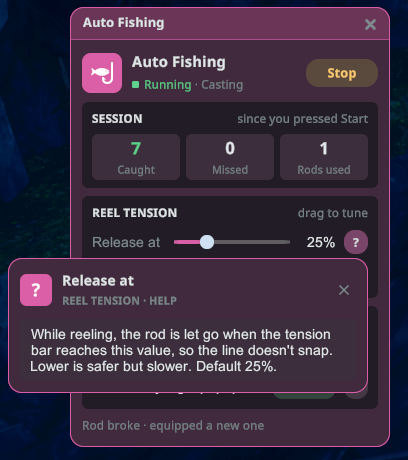

# 자동 낚시

캐스팅부터 포획까지 낚시 미니게임을 완전히 자동화하여, 지켜보지 않아도 그대로 돌아가게 둘 수 있습니다.

## 사용 방법

1. 플러그인을 설치하고 게임을 **모드 적용**으로 실행합니다.
2. 낚싯대를 장착한 상태로 낚시터에 가서 Stellar 메뉴에서 **자동 낚시**를 엽니다.
3. **시작**을 누릅니다. 플러그인이 캐스팅, 장력 미니게임, 포획까지 알아서 진행하고 다시 처음부터 반복합니다. 멈추려면 **중지**를 누르거나 창을 닫습니다.

## 창

- 제목 아래 **상태 표시**: "낚시터로 이동하면 시작할 수 있습니다", "준비 완료", 현재 단계가 함께 표시되는 "실행 중", 팝업을 닫는 동안은 "일시 정지". 낚시터에 있지 않으면 **시작**이 흐리게 표시됩니다.
- **세션**에는 시작을 누른 후 낚은 물고기, 놓친 물고기, 사용한 낚싯대 수가 표시됩니다.
- 물고기를 낚거나 놓치거나 낚싯대를 교체할 때마다 아래쪽에 짧은 메시지가 표시됩니다.

## 설정

- **놓기 시점** — 릴을 감는 중 장력 게이지가 이 값에 도달하면 줄이 끊어지지 않도록 낚싯대를 놓습니다. 낮을수록 안전하지만 느려집니다. 기본값 25%.
- **당기기 시점** — 장력이 이 값까지 떨어지면 다시 낚싯대를 당깁니다. '놓기 시점'보다 낮아야 합니다. 기본값 8%.
- **낚싯대 자동 교체** — 낚싯대가 부러지거나 장착되어 있지 않으면 가방에서 가장 좋은 낚싯대를 장착합니다. 끄면 직접 장착할 때까지 낚시가 대기합니다.
- **로그인 팝업 닫기** — 일일 로그인 카드와 보상 팝업이 뜨면 닫고, 잠시 후 낚시를 재개합니다.
- 설정 옆의 **?**를 누르면 짧은 설명이 표시됩니다.

