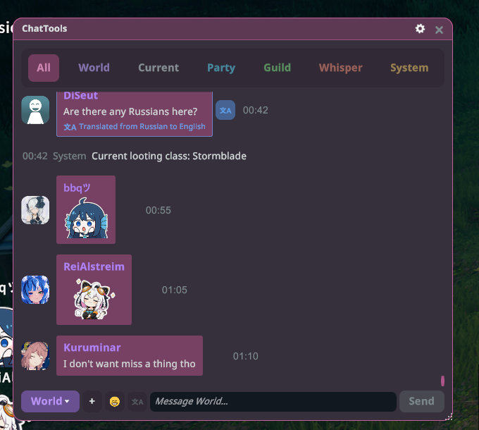
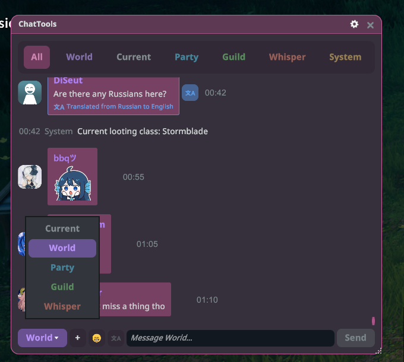
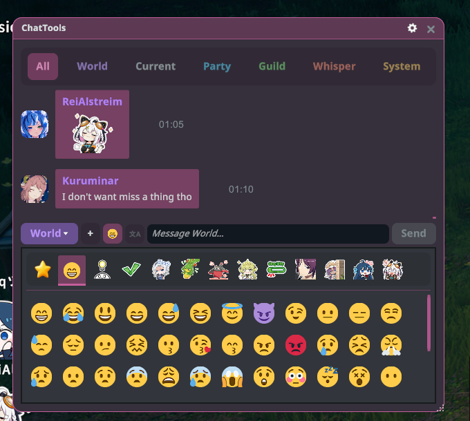
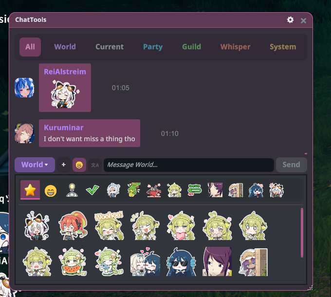
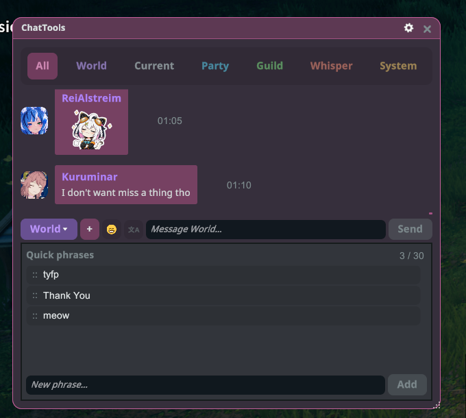
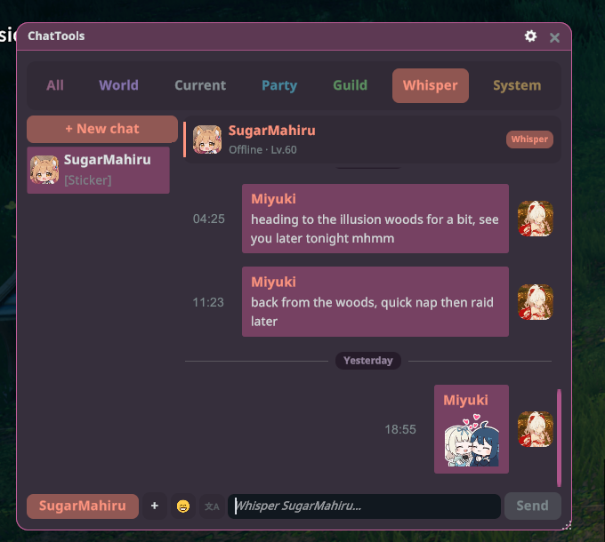
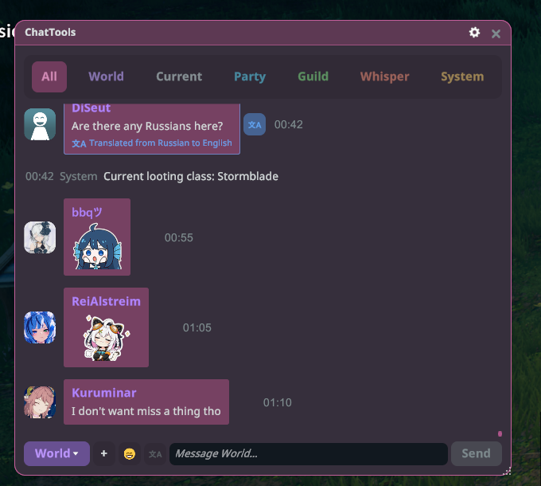
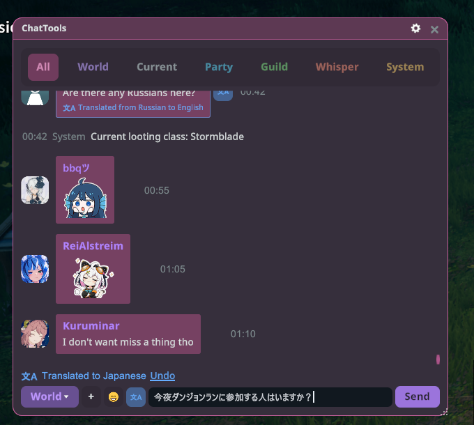
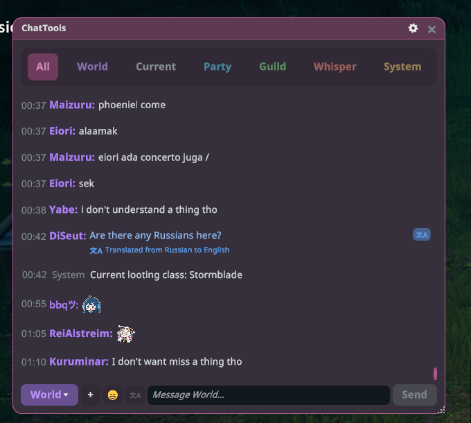
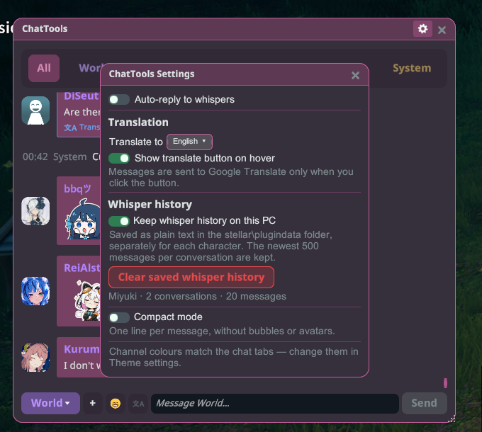

# ChatTools

Chat game dalam jendela yang bisa kamu pindahkan, ubah ukurannya, dan biarkan terbuka di mana saja, lengkap dengan tab kanal, stiker, bisikan, dan terjemahan.

## Memulai

1. Pasang plugin-nya lalu jalankan game dalam mode **Dengan mod** (butuh Stellar 2.27.1 atau yang lebih baru).
2. Tekan **F12** atau buka ChatTools dari menu Stellar.
3. Seret bilah judul untuk memindahkan jendela, dan sudut kanan bawah untuk mengubah ukurannya.

## Tab kanal

Semua, Dunia, Sekitar, Party, Guild, Bisikan, dan Sistem masing-masing punya tab, dan titik menandai pesan yang belum dibaca. Gulir ke atas untuk membaca pesan lama; bilah "pesan baru" membawamu kembali ke pesan terbaru. Klik avatar pemain untuk membuka kartu namanya, atau klik kanan pesan untuk menyalinnya.

## Mengirim pesan

Ketik di kolom bagian bawah lalu tekan **Enter** atau **Kirim**. Tombol di sebelah kiri untuk memilih kanal.

## Stiker dan emoji

Klik ☺ untuk membuka pemilih. Klik stiker untuk langsung mengirimnya, atau klik emoji untuk menambahkannya di posisi kursormu. Klik kanan stiker untuk menambahkannya ke tab favorit ★, lalu seret favorit untuk mengubah urutannya.

## Frasa cepat

Klik ＋ untuk membuka frasa cepatmu. Klik salah satunya untuk mengirimnya. Untuk menyimpan frasa baru, ketik di "Frasa baru…" lalu klik **Tambah**. Seret untuk mengubah urutan, atau arahkan kursor lalu klik ✕ untuk menghapus (maksimal 30).

## Bisikan

Tab Bisikan menyimpan satu percakapan per orang, dengan titik status online dan jumlah pesan yang belum dibaca. Klik **+ Obrolan baru** untuk berbisik ke seseorang dari daftar temanmu.

## Terjemahan

**Pesan orang lain:** arahkan kursor ke pesan lalu klik 文A untuk menerjemahkannya ke bahasamu (pilih bahasanya di Pengaturan → Terjemahkan ke).

**Pesanmu sendiri:** ketik pesanmu, klik 文A di samping kolom obrolan, lalu pilih bahasa. Klik **Urungkan** untuk mengembalikan teks aslimu.

Teks hanya dikirim ke Google Terjemahan saat kamu mengeklik.

## Mode ringkas

Nyalakan **Mode ringkas** di Pengaturan untuk menampilkan satu baris per pesan, tanpa gelembung atau avatar.

## Pengaturan

Klik ikon roda gigi di bilah judul.

- **Balas otomatis bisikan:** nyalakan lalu tulis balasanmu. Selama kamu pergi, setiap orang yang membisikimu akan menerima balasan itu, paling sering sekali setiap 30 detik.
- **Tab Semua:** pilih kanal yang tampil di tab Semua. Klik kanal untuk mematikannya; pesanmu sendiri selalu tampil.
- **Terjemahan:** bahasamu, dan apakah tombol terjemahan muncul saat kursor diarahkan ke pesan.
- **Riwayat bisikan:** simpan bisikan di PC ini (500 pesan terbaru per percakapan, terpisah untuk tiap karakter), atau hapus.
- **Mode ringkas:** satu baris per pesan, tanpa gelembung atau avatar.

Warna kanal mengikuti tab chat; ubah di pengaturan Tema Stellar.

## Hotkey

Ubah di pengaturan hotkey Stellar.

- **Alihkan jendela ChatTools:** F12.
- **Fokus/lepas fokus kolom obrolan:** Enter. Tekan sekali untuk mengetik, dan sekali lagi untuk kembali ke game. Hanya saat ChatTools terbuka.
- **Tab obrolan berikutnya / sebelumnya:** tanpa tombol sampai kamu memilihnya. Hanya saat ChatTools terbuka.
