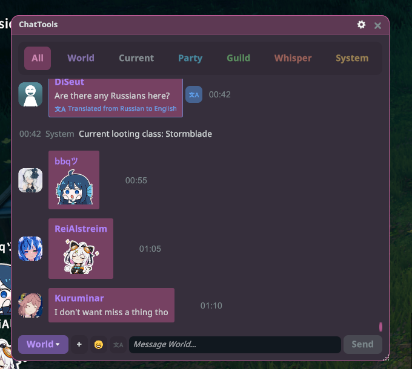
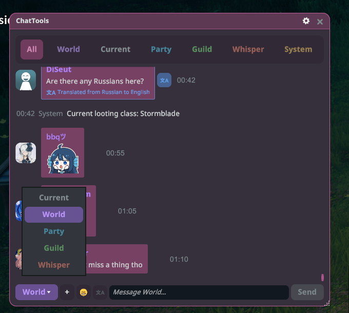
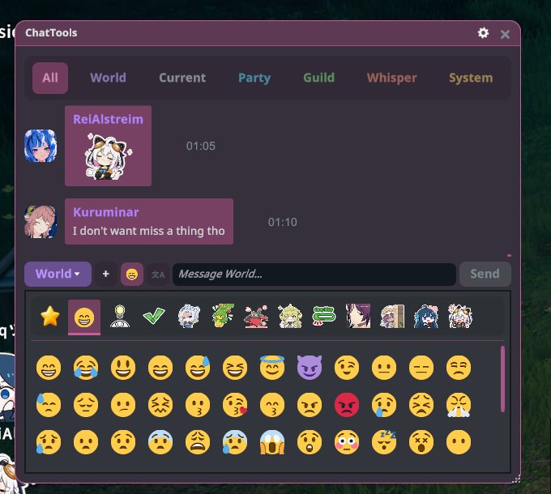
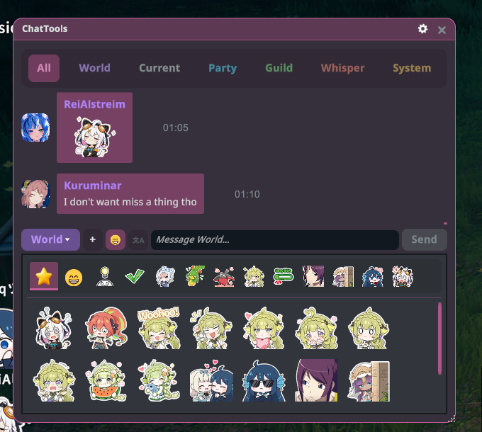
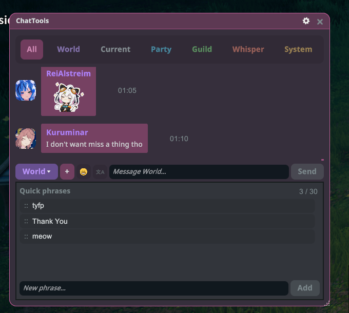
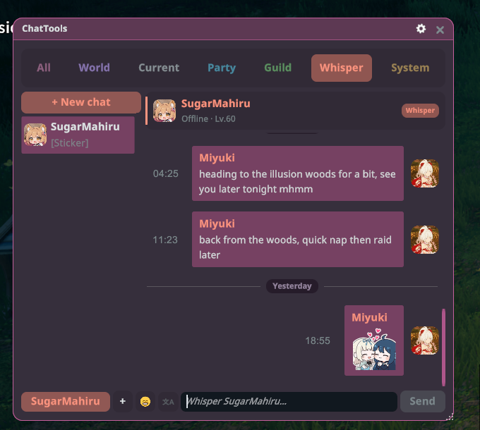
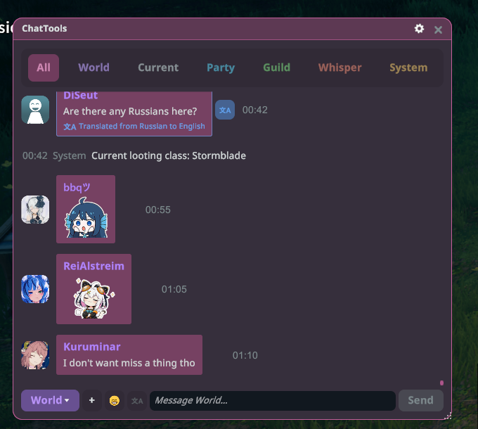
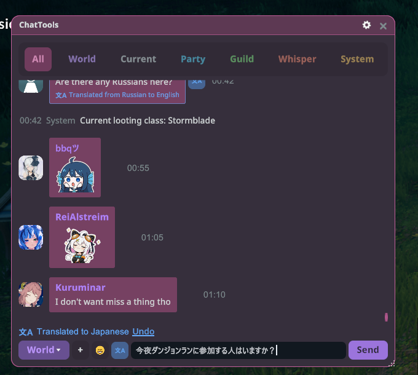
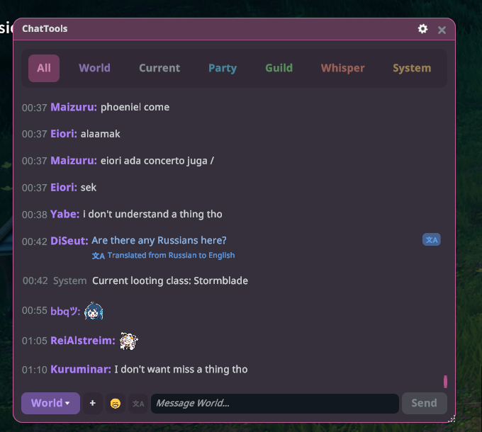
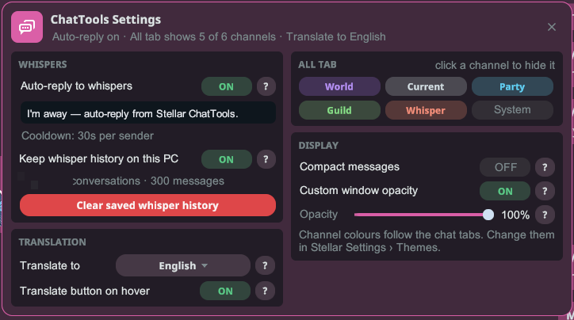

# ChatTools

ゲームのチャットを、移動・サイズ変更ができて、どこにでも開いておけるウィンドウで使えます。チャンネルタブ、スタンプ、ウィスパー、翻訳に対応しています。

## はじめに

1. プラグインをインストールし、ゲームを**Mod有効**で起動します（Stellar 2.27.1以降が必要）。
2. **F12**を押すか、StellarメニューからChatToolsを開きます。
3. タイトルバーをドラッグするとウィンドウを移動でき、右下の角をドラッグするとサイズを変更できます。

## チャンネルタブ

すべて、ワールド、周辺、パーティ、ギルド、ウィスパー、システムにそれぞれタブがあり、未読メッセージがあると点が付きます。上にスクロールすると過去のメッセージを読めます。「新着メッセージ」バーを押すと最新のメッセージに戻ります。プレイヤーのアバターをクリックすると名刺が開き、メッセージを右クリックするとコピーできます。

## メッセージを送る

下の入力欄に入力し、**Enter**を押すか**送信**をクリックします。左のボタンで送信先のチャンネルを選べます。Enterでメッセージが1回送信され、キーボード操作はゲームに戻ります。

## スタンプと絵文字

☺をクリックするとピッカーが開きます。スタンプはクリックするとそのまま送信され、絵文字はカーソルの位置に入ります。スタンプを右クリックすると★お気に入りタブに追加でき、お気に入りはドラッグで並べ替えられます。

## 定型文

＋をクリックすると定型文が開きます。定型文をクリックすると送信されます。新しく保存するには「新しい定型文…」に入力して**追加**をクリックします。ドラッグで並べ替え、マウスを乗せて✕をクリックすると削除できます（最大30件）。

## ウィスパー

ウィスパータブでは相手ごとに1つの会話にまとまり、オンライン表示の点と未読数が付きます。**+ 新しいチャット**をクリックすると、フレンドリストから相手を選んでウィスパーできます。

## 翻訳

**他の人のメッセージ：** メッセージにマウスを乗せて文Aをクリックすると、自分の言語に翻訳されます（言語は 設定 → 翻訳先 で選びます）。

**自分のメッセージ：** 入力してから、入力欄の横の文Aをクリックして言語を選びます。**元に戻す**をクリックすると元の文章に戻ります。

テキストがGoogle翻訳に送信されるのは、クリックしたときだけです。

## コンパクト表示

設定で**コンパクト表示**をオンにすると、吹き出しやアバターなしで1メッセージを1行で表示します。

## 設定

タイトルバーの歯車をクリックします。各設定の **?** ボタンで説明を見られます。

- **ウィスパー**
  - **ウィスパーに自動返信：** オンにして返信文を書きます。離席中にウィスパーしてきた相手に自動で返信します（同じ相手には最大30秒に1回）。
  - **個人チャット履歴をPCに保存：** 会話ごとに最新500件を、キャラクターごとに別々に保存します。**保存した個人チャット履歴を消去**は、**削除**か**キャンセル**で確認します。
- **翻訳：** **翻訳先**で自分の言語を選びます。**ホバーで翻訳ボタン表示**をオンにすると、メッセージにマウスを乗せたときに文Aボタンが出ます。
- **「すべて」タブ：** 「すべて」タブに表示するチャンネルを選びます。チャンネルをクリックするとオフになります。自分のメッセージは常に表示されます。
- **表示**
  - **コンパクト表示：** 吹き出しやアバターなしで、1メッセージを1行で表示します。
  - **ウィンドウ不透明度を変更：** チャットウィンドウの背景の透明度を個別に設定します（30〜100%）。オフのときはStellarの不透明度を使います。文字やボタンははっきり表示されたままです。

チャンネルの色はチャットのタブと同じです。Stellarの設定 › テーマで変更できます。

## ホットキー

Stellarのホットキー設定で変更できます。

- **ChatToolsウィンドウの表示切替：** F12。
- **チャット入力欄のフォーカス切替：** Enter。押すと入力できます。文字がある状態でEnterを押すと送信してゲームに戻り、空のときはそのままゲームに戻ります。ChatToolsを開いているときのみ。
- **次のチャットタブ／前のチャットタブ：** 自分でキーを設定するまで未割り当てです。ChatToolsを開いているときのみ。
