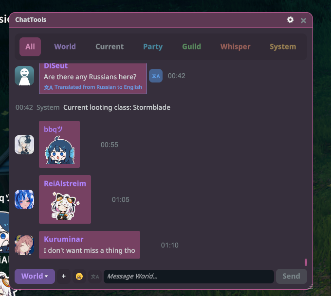
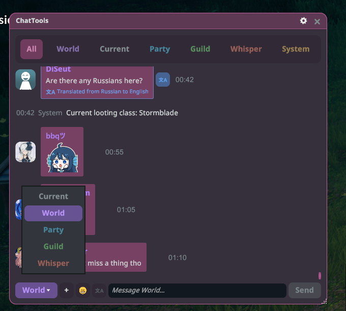
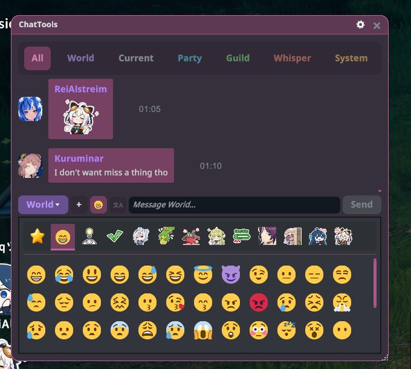
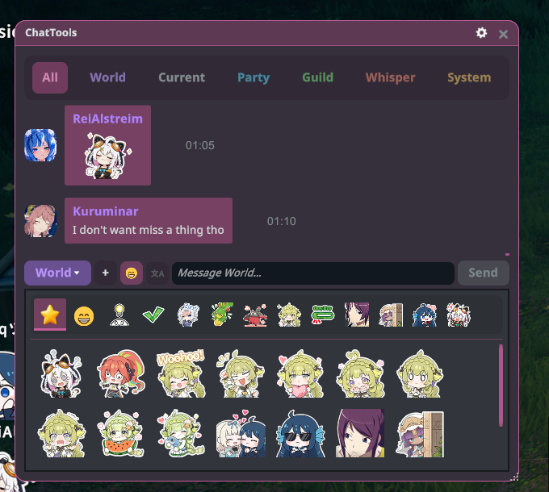
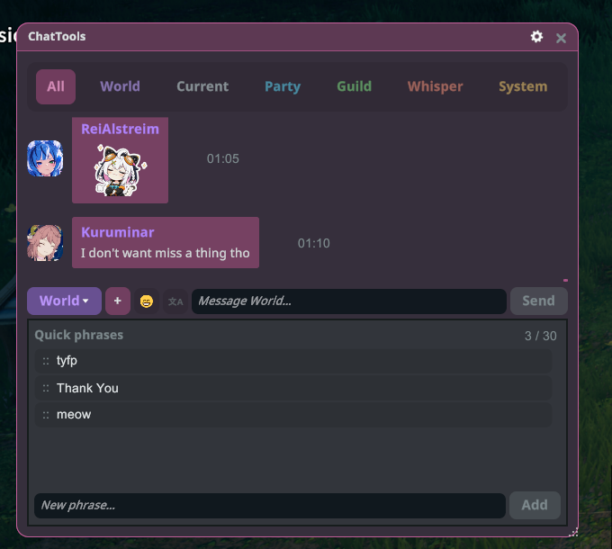
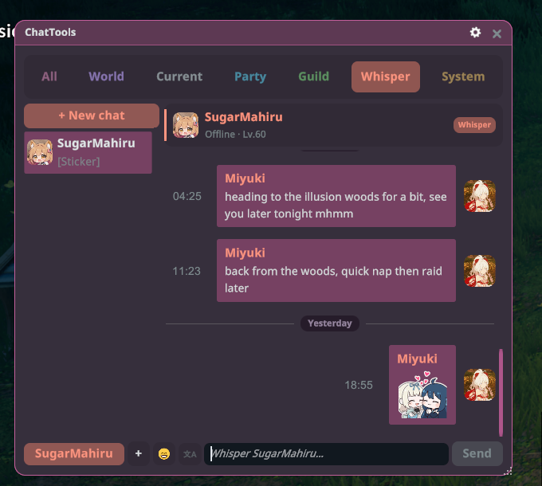
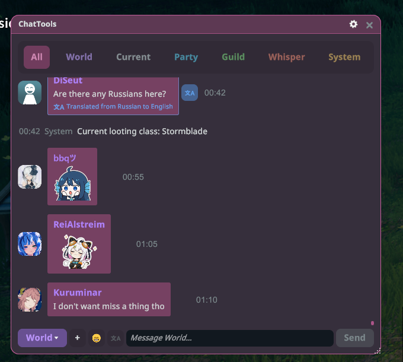
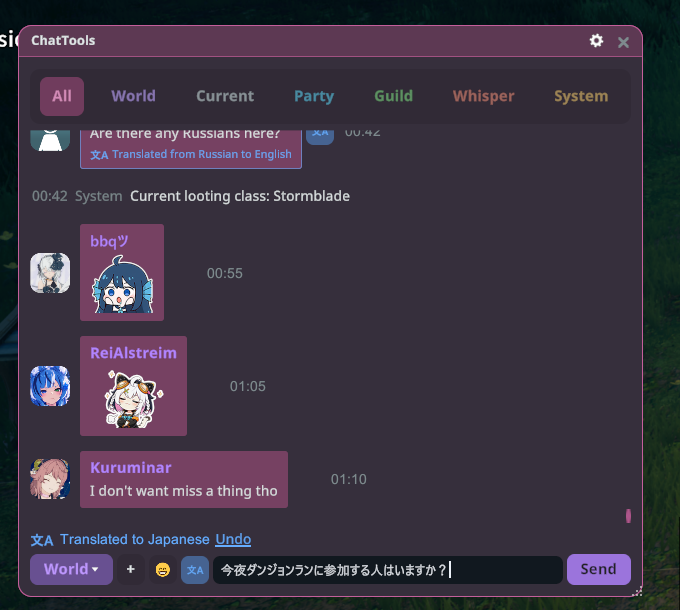
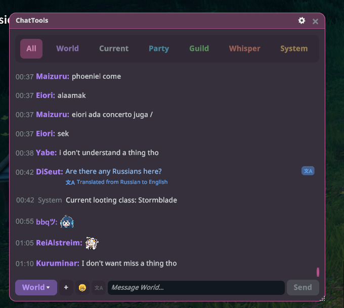
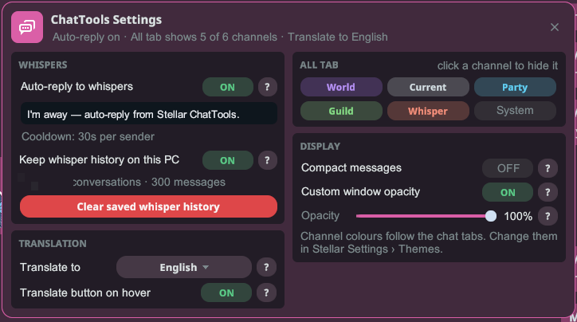

# ChatTools

The game's chat in a window you can move, resize and keep open anywhere, with channel tabs, stickers, whispers and translation.

## Getting started

1. Install the plugin and launch the game **Modded** (needs Stellar 2.27.1 or newer).
2. Press **F12** or open ChatTools from the Stellar menu.
3. Drag the title bar to move the window, and the bottom-right corner to resize it.

## Channel tabs

All, World, Current, Party, Guild, Whisper and System each have a tab, and a dot marks unread messages. Scroll up to read older messages; a "new messages" bar takes you back to the newest. Click a player's avatar to open their name card, or right-click a message to copy it.

## Sending messages

Type in the box at the bottom and press **Enter** or **Send**. The button on the left picks the channel. Enter sends your message once and gives the keyboard back to the game.

## Stickers and emoji

Click ☺ to open the picker. Click a sticker to send it, or an emoji to add it where your cursor is. Right-click a sticker to add it to the ★ favourites tab, and drag favourites to reorder them.

## Quick phrases

Click ＋ to open your quick phrases. Click one to send it. To save a new one, type it in "New phrase…" and click **Add**. Drag to reorder, or hover and click ✕ to delete (up to 30).

## Whispers

The Whisper tab keeps one conversation per person, with online dots and unread counts. Click **+ New chat** to whisper someone from your friends list.

## Translation

**Other people's messages:** hover a message and click 文A to translate it into your language (choose it under Settings → Translate to).

**Your message:** type it, click 文A next to the chat box and pick a language. Click **Undo** to get your original text back.

Text is sent to Google Translate only when you click.

## Compact messages

Turn on **Compact messages** in Settings to show one line per message, without bubbles or avatars.

## Settings

Click the gear in the title bar. Every setting has a **?** button that explains it.

- **Whispers**
  - **Auto-reply to whispers:** turn it on and write your reply. While you're away, each person who whispers you gets it back, at most once every 30 seconds.
  - **Keep whisper history on this PC:** the newest 500 messages per conversation, separately for each character. **Clear saved whisper history** asks you to confirm with **Delete** or **Cancel**.
- **Translation:** **Translate to** picks your language; **Translate button on hover** shows the 文A button when you point at a message.
- **All tab:** choose which channels the All tab shows. Click a channel to turn it off; your own messages always show.
- **Display**
  - **Compact messages:** one line per message, without bubbles or avatars.
  - **Custom window opacity:** give the chat window its own background transparency (30–100%). When it is off, the window uses Stellar's opacity. Text and buttons stay solid.

Channel colours follow the chat tabs; change them in Stellar Settings › Themes.

## Hotkeys

Change them in Stellar's hotkey settings.

- **Show/Hide ChatTools:** F12.
- **Focus chat input:** Enter. Press it to start typing. With text in the box, Enter sends it and goes back to the game; with an empty box, it just goes back. Only while ChatTools is open.
- **Next / Previous chat tab:** no key until you choose one. Only while ChatTools is open.
