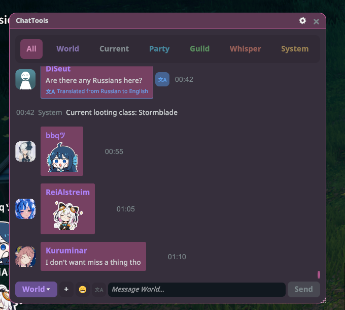
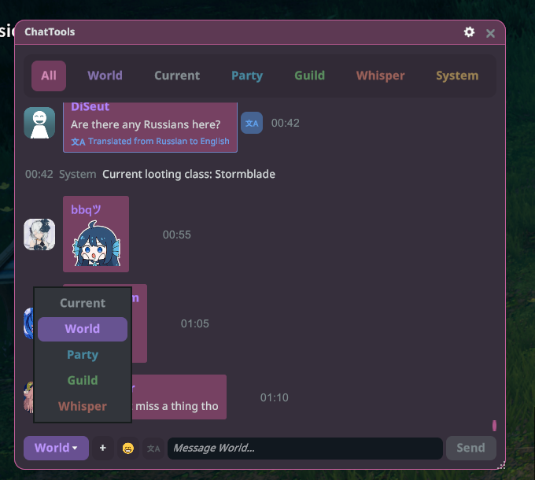
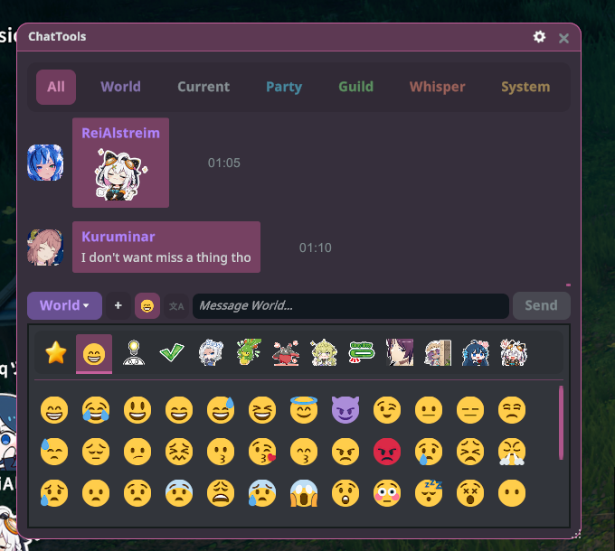
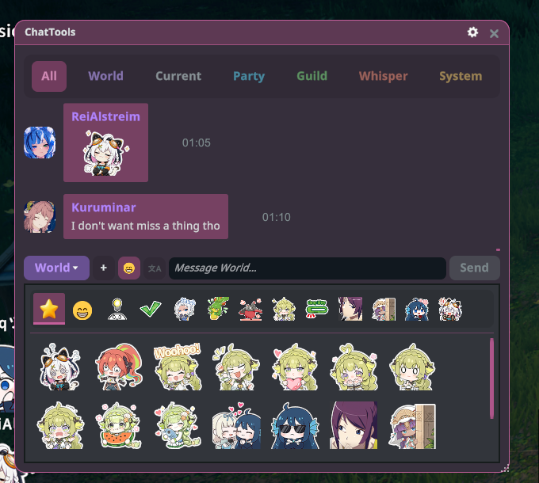
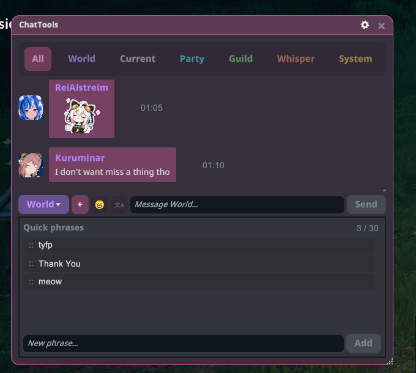
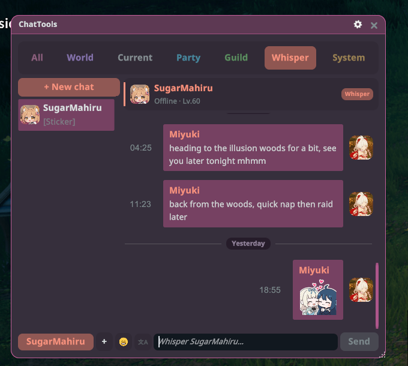
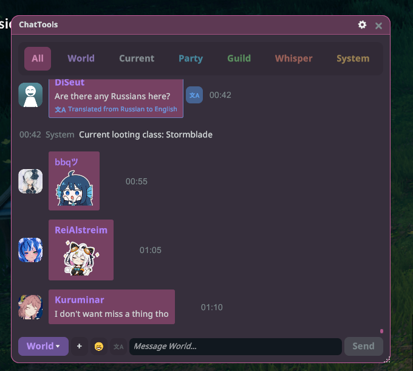
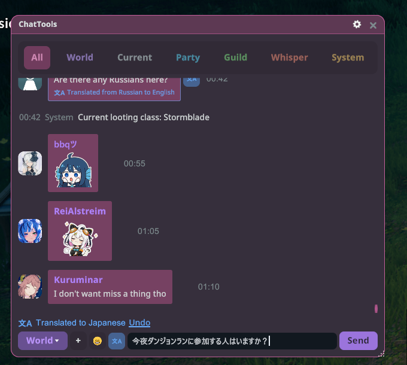
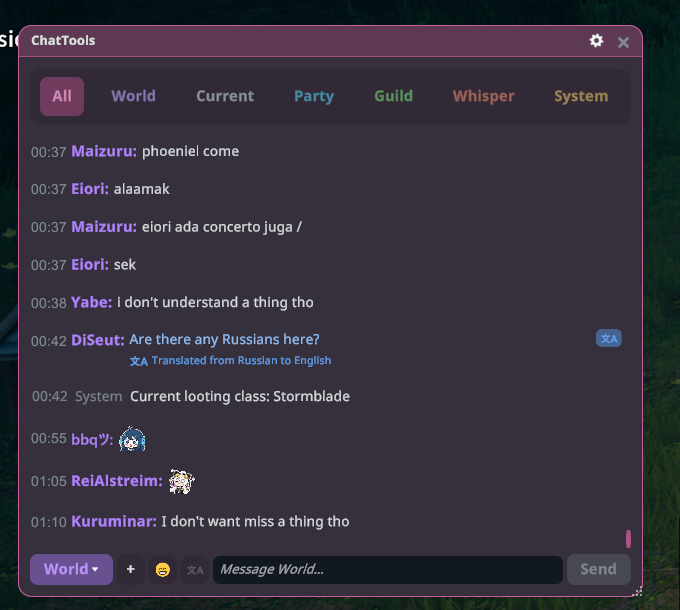
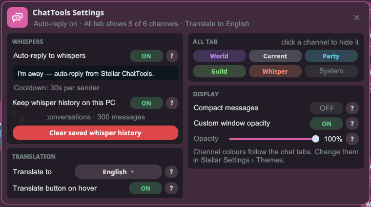

# ChatTools

แชทของเกมในหน้าต่างที่ย้าย ปรับขนาด และเปิดค้างไว้ตรงไหนก็ได้ พร้อมแท็บแชนเนล สติกเกอร์ กระซิบ และการแปล

## เริ่มต้นใช้งาน

1. ติดตั้งปลั๊กอินแล้วเปิดเกมแบบ **ใช้ม็อด** (ต้องใช้ Stellar 2.27.1 ขึ้นไป)
2. กด **F12** หรือเปิด ChatTools จากเมนู Stellar
3. ลากแถบชื่อเพื่อย้ายหน้าต่าง และลากมุมขวาล่างเพื่อปรับขนาด

## แท็บแชนเนล

ทั้งหมด, โลก, รอบตัว, ปาร์ตี้, กิลด์, กระซิบ และระบบ มีแท็บของตัวเอง และจะมีจุดแสดงเมื่อมีข้อความที่ยังไม่อ่าน เลื่อนขึ้นเพื่ออ่านข้อความเก่า แถบ "ข้อความใหม่" จะพาคุณกลับไปที่ข้อความล่าสุด คลิกรูปโปรไฟล์ของผู้เล่นเพื่อเปิดนามบัตรของเขา หรือคลิกขวาที่ข้อความเพื่อคัดลอก

## การส่งข้อความ

พิมพ์ในช่องด้านล่างแล้วกด **Enter** หรือ **ส่ง** ปุ่มทางซ้ายใช้เลือกแชนเนล กด Enter แล้วข้อความจะถูกส่งครั้งเดียว และคีย์บอร์ดจะกลับไปที่เกม

## สติกเกอร์และอีโมจิ

คลิก ☺ เพื่อเปิดตัวเลือก คลิกสติกเกอร์เพื่อส่งทันที หรือคลิกอีโมจิเพื่อแทรกตรงตำแหน่งเคอร์เซอร์ คลิกขวาที่สติกเกอร์เพื่อเพิ่มลงในแท็บรายการโปรด ★ และลากเพื่อจัดลำดับรายการโปรด

## ข้อความสำเร็จรูป

คลิก ＋ เพื่อเปิดข้อความสำเร็จรูป แล้วคลิกข้อความที่ต้องการเพื่อส่ง หากต้องการบันทึกข้อความใหม่ ให้พิมพ์ในช่อง "ข้อความใหม่…" แล้วคลิก **เพิ่ม** ลากเพื่อจัดลำดับ หรือชี้เมาส์แล้วคลิก ✕ เพื่อลบ (สูงสุด 30 ข้อความ)

## กระซิบ

แท็บกระซิบจะแยกบทสนทนาละหนึ่งคน พร้อมจุดแสดงสถานะออนไลน์และจำนวนข้อความที่ยังไม่อ่าน คลิก **+ แชทใหม่** เพื่อกระซิบหาคนในรายชื่อเพื่อน

## การแปล

**ข้อความของคนอื่น:** ชี้เมาส์ที่ข้อความแล้วคลิก 文A เพื่อแปลเป็นภาษาของคุณ (เลือกภาษาได้ที่ ตั้งค่า → แปลเป็น)

**ข้อความของคุณ:** พิมพ์ข้อความ แล้วคลิก 文A ข้างช่องพิมพ์และเลือกภาษา คลิก **เลิกทำ** เพื่อกลับไปใช้ข้อความเดิม

ข้อความจะถูกส่งไปยัง Google แปลภาษา เฉพาะเมื่อคุณคลิกเท่านั้น

## ข้อความแบบกะทัดรัด

เปิด **ข้อความแบบกะทัดรัด** ในการตั้งค่า เพื่อแสดงข้อความละหนึ่งบรรทัด ไม่มีกรอบข้อความหรือรูปโปรไฟล์

## ตั้งค่า

คลิกรูปเฟืองบนแถบชื่อ ทุกการตั้งค่ามีปุ่ม **?** ที่อธิบายวิธีใช้

- **กระซิบ**
  - **ตอบกลับกระซิบอัตโนมัติ:** เปิดแล้วเขียนข้อความตอบกลับ ระหว่างที่คุณไม่อยู่ ทุกคนที่กระซิบมาจะได้รับข้อความนี้ คนละไม่เกินหนึ่งครั้งทุก 30 วินาที
  - **เก็บประวัติกระซิบไว้ในพีซีเครื่องนี้:** เก็บ 500 ข้อความล่าสุดต่อบทสนทนา แยกตามตัวละคร ปุ่ม **ล้างประวัติกระซิบที่บันทึกไว้** จะถามยืนยันด้วย **ลบ** หรือ **ยกเลิก**
- **การแปล:** **แปลเป็น** ใช้เลือกภาษาของคุณ ส่วน **ปุ่มแปลเมื่อชี้เมาส์** จะแสดงปุ่ม 文A เมื่อชี้เมาส์ที่ข้อความ
- **แท็บทั้งหมด:** เลือกแชนเนลที่จะแสดงในแท็บทั้งหมด คลิกแชนเนลเพื่อปิด ข้อความของคุณเองจะแสดงเสมอ
- **การแสดงผล**
  - **ข้อความแบบกะทัดรัด:** ข้อความละหนึ่งบรรทัด ไม่มีกรอบข้อความหรือรูปโปรไฟล์
  - **กำหนดความทึบของหน้าต่างเอง:** ตั้งความโปร่งใสของพื้นหลังหน้าต่างแชทแยกได้ (30–100%) เมื่อปิดไว้ หน้าต่างจะใช้ความทึบของ Stellar ข้อความและปุ่มยังคงชัดเจน

สีของแชนเนลตรงกับแท็บแชท เปลี่ยนได้ใน Stellar ตั้งค่า › ธีม

## ปุ่มลัด

เปลี่ยนได้ในการตั้งค่าปุ่มลัดของ Stellar

- **สลับหน้าต่าง ChatTools:** F12
- **โฟกัส/เลิกโฟกัสช่องพิมพ์แชท:** Enter กดเพื่อเริ่มพิมพ์ ถ้ามีข้อความในช่อง กด Enter จะส่งแล้วกลับไปที่เกม ถ้าช่องว่างจะกลับไปที่เกมเลย ใช้ได้เฉพาะตอนที่เปิด ChatTools อยู่
- **แท็บแชทถัดไป / แท็บแชทก่อนหน้า:** ไม่มีปุ่มจนกว่าคุณจะตั้งเอง ใช้ได้เฉพาะตอนที่เปิด ChatTools อยู่
