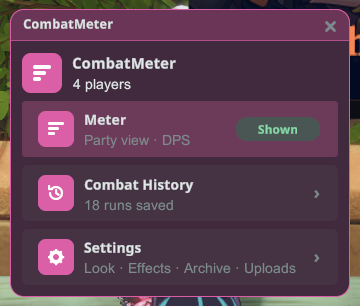
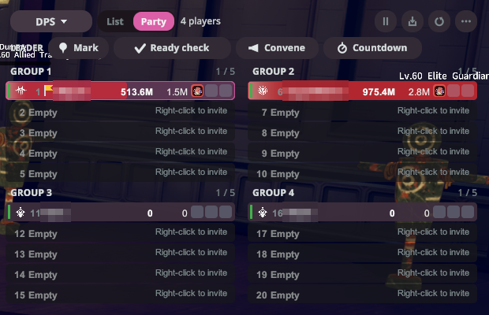

# CombatMeter

Real-time na party combat meter para sa Star Resonance: live na **DPS**, **HPS** at **natanggap
na damage** para sa bawat isa sa party mo, may kulay ayon sa papel at sagisag ng class para
mabasa mo ang grupo nang isang tingin lang.

## Pagsisimula

1. I-install ang plugin at i-launch ang laro nang **May mod**.
2. Lalabas ang meter bilang isang overlay window kapag nasa mundo ka na. I-drag ang header nito
   para ilipat — natatandaan ang posisyon. Ipinapakita o itinatago ito ng **F9**.
3. Pumasok sa labanan: lalabas ang mga row kada miyembro ng party at nag-a-update nang live.

## Ang CombatMeter hub

I-click ang **CombatMeter** tile sa Stellar launcher para buksan ang hub. Ipinapakita ng header
nito ang kasalukuyang status ng meter, at may tatlong card ito:

- **Meter** — i-click para ipakita o itago ang meter (pareho ng F9). Sinasabi ng chip sa kanan
  kung **Nakikita** o **Nakatago**; ipinapakita ng linya sa ilalim ang kasalukuyang view at
  metric.
- **Kasaysayan ng Laban** — ilang run ang naka-save. I-click para buksan (o pindutin ang
  **Shift+F9**).
- **Mga Setting** — binubuksan ang window ng Mga Setting.

## Pagbasa sa meter

- Nasa header ang menu ng metric (**DPS** / **HPS** / **Taken**), ang switch na **Listahan |
  Party**, isang live na status line (timer ng laban, bilang ng player), at apat na bilog na
  button: **I-pause**, **I-archive**, **I-reset** at **⋯** (iba pa).
- Pinapahinto ng **I-pause** ang pagbilang ng meter; nagiging amber ang button at **Naka-pause**
  ang nakasulat sa status line. I-click ulit para ituloy.
- Sine-save agad ng **I-archive** ang kasalukuyang laban sa Kasaysayan ng Laban. Naka-gray ito
  hangga't wala pang naitatala, at may berdeng ✓ kapag na-save na ang laban.
- Nagbubukas ang **⋯** ng maliit na menu: sa Listahan na view, piliin kung sino ang ipapakita
  (**Sarili** / **Party** / **Lahat**); sa Party view, puwedeng palitan ng leader ang **Laki ng
  party** sa 5 o 20. May shortcut din ito papunta sa Kasaysayan ng Laban at Mga Setting.
- Bawat row ay isang player. Ang kulay ng row ay sumusunod sa **papel** ng miyembro (tank /
  healer / DPS); ipinapakita ng sagisag ang kanyang class. May icon ang mga buff at debuff sa
  row: ang icon ng skill kapag galing sa skill ang effect, kung hindi ay icon ng kategorya.
- Sa Party view, may **Leader** na linya ang party leader sa ilalim ng header, may **Marka**,
  **Ready check**, **Tipunin** at **Countdown** (ang pull timer ng laro para sa buong party).

## Laki ng hilera

Piliin kung gaano kalaki ang espasyo ng bawat player sa **Mga Setting → Itsura → Hilera → Laki
ng hilera**:

- **Normal** — dalawang linya bawat player, kumpleto ang detalye.
- **Compact** — isang linya bawat player, nasa likod ng text ang bar. Mas kaunti ang espasyong
  kinukuha ng raid na 20.
- **Mini** — bar lang, may rank, pangalan at numero.

May sariling laki at itsura ang bawat view (**Listahan**, **Party (5)**, **Party (20)**): piliin
ang view na babaguhin sa **Ine-edit** sa itaas ng tab na Itsura. Nagiging gray ang mga setting
na hindi iginuguhit ng napiling laki, pero naiiwan ang value nila.

## Mga Setting

Iisang window ng Mga Setting na may limang tab. Ipinapaliwanag ng **?** sa tabi ng bawat setting
kung para saan ito.

- **Itsura** — ang ipinapakita ng bawat row (rank, sagisag, kasunod ng pangalan, ability score,
  bahagi, kabuuan, kada segundo…), **Laki ng hilera**, Mga Bar, Battle Imagine at Mga numero. Sa
  **Window ng meter**, may tatlong slider na para sa lahat ng view:
  - **Background** — bilugang panel sa likod ng meter. Sa 0 %, see-through pa rin ang meter.
  - **Background ng row** — pinapalabo lang ang madilim na likod ng bawat row, kaya mas makikita
    mo ang laro sa likod nito. Hindi nagbabago ang bar, pangalan at numero.
  - **Foreground** — pinapalabo ang buong meter (hindi bababa sa 20 %, kaya hindi ito mawawala).
- **Effects** — ang mga buff at debuff na ipinapakita sa mga row. Piliin ang **Lahat maliban sa
  naka-tsek** o **Naka-tsek lang**, tapos i-tsek ang mga effect sa listahan ng Buffs at Debuffs
  (may search). I-on ang **Mga nakatagong effect** para isama rin ang mga effect na karaniwang
  hindi ipinapakita ng laro. Hanggang 3 effect lang sa Compact na row; wala sa Mini na row.
- **Archive** — kailan awtomatikong sine-save ang mga laban (tingnan sa ibaba) at ilang run ang
  itinatago ng Kasaysayan.
- **Uploads** — kung ano ang ina-upload sa StellarLogs (**Auto** / **Manual** / **Off** kada uri
  ng content), at opsyonal na Discord webhook na nagpo-post ng mga run mo.
- **Account** — i-link ang character na ito sa StellarLogs account mo gamit ang code mula sa
  site.

## Kasaysayan ng Laban

- Nasa kaliwa ang **Mga run**, pinakabago muna, may search box. Pumili ng run para makita ito
  sa kanan.
- Ipinapakita ng panel ng run ang status ng upload (**na-upload** / **Hindi pa na-upload**),
  **I-upload segment**, **I-upload lahat**, at mga bilog na button na **Kopyahin ang link** at
  **Burahin**. Sa ilalim nito ang **Mga segment** ng run (trash clear, boss kill, run end…) —
  pumili ng isa para makita ito.
- Napapalitan ang chart sa **DPS**, **HPS** at **Taken**; i-click ang isang player sa talahanayan
  para idagdag ang linya niya.
- Sa talahanayan ng player, binubuksan ng **›** ang Detalye ng Skill ng player na iyon at
  ipinapakita ng **⌕** ang gear at stats niya sa labang iyon.
- Laging nagtatanong muna ang **Burahin lahat**, **Burahin** at **I-upload lahat** bago kumilos.
  Nananatili sa StellarLogs ang binurang run kung na-upload na ito.

## Detalye ng Skill

Buksan ito gamit ang **›** sa isang player sa Kasaysayan ng Laban.

- **Kabuuan** — kabuuan, DPS, CRIT %, LUCK %, pinakamalaking tama, hits, kills, uptime, heal at
  iba pa, kasama ang **Natanggap** (ang damage na natanggap ng player na iyon).
- **Mga Skill** — bawat skill kasama ang damage, bahagi, CRIT at LUCK nito. May nababasang
  pangalan na ang mga skill na walang pangalan sa laro, sa halip na numero.
- Kapag binuksan mula sa **Taken** na chart, ipinapakita nito ang natanggap na damage kada skill.

## Mga archive — pag-save ng labanan

Ang isang *archive* ay nag-a-archive ng kasalukuyang labanan sa Kasaysayan ng Laban at
nire-reset ang live na view.

- Ang **manual na archive** (ang **I-archive** button sa header ng meter) ay **palaging
  na-save**, kahit ano pa mangyari — laging may nakikitang feedback na na-archive ito.
- Puwedeng mag-archive ang **awtomatikong archive** ng mga laban para sa iyo. Kontrolin ito sa
  **Mga Setting → Archive**: master on/off, kung kailan mag-a-archive (team wipe, yugto ng boss,
  idle sa laban, pagpalit ng dungeon stage), pinakamaliit na agwat sa pagitan ng mga archive,
  settle, palugit ng revive sa wipe, at huwag pansinin kapag solo.
- Ang **"panatilihin bago" ng yugto ng boss** ay nagpapahintulot ng ilang segundong takbo bago
  ang unang tama ng boss na isama sa segment ng boss (naka-off bilang default = puputol mismo sa
  unang tama).
- Nilalaktawan lang ang awtomatikong archive kapag talagang walang nangyari (lahat ng row ay
  zero). Walang binubura ang nilaktawang archive — lahat ay dala sa susunod na archive.

## Mga upload at run replay

Ang mga na-archive na run ay ina-upload sa [Stellar Logs](https://logs.stellarresonance.app),
kung saan makukuha mo ang buong run page: mga chart ng damage, detalye ng skill, yugto ng boss —
at isang **movement replay** ng buong run, mula sa sandaling pumasok ka sa dungeon hanggang sa
pagpatay.

- Ang **Kopyahin ang link** sa Kasaysayan ng Laban ay naglalagay ng maikling URL ng run sa
  clipboard mo para ibahagi sa party mo.
- Pinapanatili ng **Kasaysayan ng Laban** ang mga na-archive mong run kahit pagkatapos
  mag-relaunch. Ang muling pag-upload ng na-archive na run ay muling gagawa mismo ng orihinal na
  upload — buod, buong detalye ng labanan, at ang movement track — kahit nawala na ang data sa
  server.

## Mga tip

- Gumagana ang meter kahit hindi pa na-load ang data ng propesyon — hinuhulaan ang kulay ng
  papel at sagisag mula sa spec mo hanggang mapuno ang roster.
- Kung hindi ma-upload ang link ng run, subukang muli mula sa Kasaysayan ng Laban: ang run na
  na-upload na ay babalik sa kasalukuyan niyang link sa halip na mabigo.
