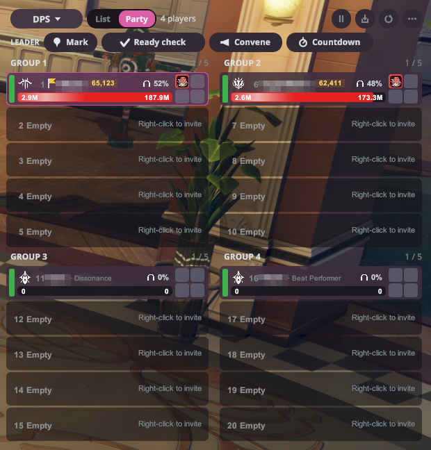
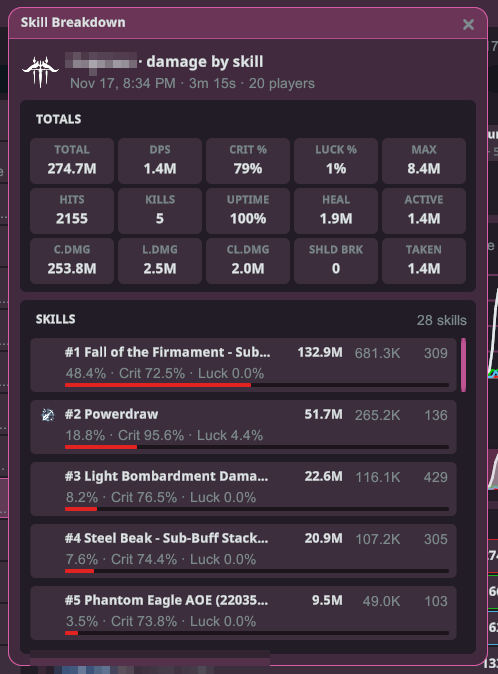

# CombatMeter

Meter pertempuran party real-time untuk Star Resonance: **DPS**, **HPS** dan **damage yang
diterima** untuk semua orang di party-mu, dengan warna peran dan lambang kelas supaya kamu bisa
membaca kondisi party sekilas.

## Memulai

1. Pasang plugin-nya lalu jalankan game dalam mode **Dengan mod**.
2. Meter akan muncul sebagai jendela overlay setelah kamu masuk ke dunia. Seret header-nya untuk
   memindahkannya — posisinya akan diingat. **F9** menampilkan atau menyembunyikannya.
3. Masuk pertempuran: baris akan muncul per anggota party dan ter-update secara real-time.

## Hub CombatMeter

Klik tile **CombatMeter** di launcher Stellar untuk membuka hub. Header-nya menampilkan status
meter saat ini, dan ada tiga kartu:

- **Meter** — klik untuk menampilkan atau menyembunyikan meter (sama dengan F9). Chip di kanan
  menunjukkan **Tampil** atau **Sembunyi**; baris di bawahnya menunjukkan tampilan dan metrik
  yang sedang dipakai.
- **Riwayat Pertempuran** — jumlah run yang tersimpan. Klik untuk membukanya (atau tekan
  **Shift+F9**).
- **Pengaturan** — membuka jendela Pengaturan.

## Membaca meter

- Header berisi menu metrik (**DPS** / **HPS** / **Diterima**), sakelar **Daftar | Party**, baris
  status (timer pertarungan, jumlah pemain), dan empat tombol bulat: **Jeda**, **Arsip**,
  **Atur ulang**, dan **⋯** (lainnya).
- **Jeda** menghentikan hitungan meter; tombolnya berubah oranye dan baris status bertuliskan
  **Dijeda**. Klik lagi untuk melanjutkan.
- **Arsip** langsung menyimpan pertarungan saat ini ke Riwayat Pertempuran. Tombolnya redup
  sampai ada yang terekam, dan menampilkan ✓ hijau saat pertarungan tersimpan.
- **⋯** membuka menu kecil: di tampilan Daftar, pilih siapa yang ditampilkan (**Diri** /
  **Party** / **Semua**); di tampilan Party, ketua bisa mengganti **Ukuran party** antara 5 dan
  20. Ada juga pintasan ke Riwayat Pertempuran dan Pengaturan.
- Setiap baris adalah satu pemain. Warna baris mengikuti **peran** anggota (tank / healer /
  DPS); lambangnya menunjukkan kelasnya. Buff dan debuff di baris menampilkan ikon: ikon
  skill-nya jika efek berasal dari skill, selain itu ikon kategori.
- Di tampilan Party, ketua party mendapat baris **Ketua** di bawah header berisi **Tanda**,
  **Cek siap**, **Kumpulkan**, dan **Hitung mundur** (timer pull game untuk seluruh party).

## Ukuran baris

Pilih seberapa besar tempat untuk tiap pemain di **Pengaturan → Tampilan → Baris → Ukuran
baris**:

- **Normal** — dua baris per pemain, dengan semua detail.
- **Ringkas** — satu baris per pemain, dengan bar di belakang teks. Raid 20 orang memakan jauh
  lebih sedikit tempat.
- **Mini** — hanya bar berisi peringkat, nama, dan angka.

Tiap tampilan (**Daftar**, **Party (5)**, **Party (20)**) punya ukuran dan gayanya sendiri:
pilih tampilan yang ingin diubah di **Mengedit** di bagian atas tab Tampilan. Pengaturan yang
tidak digambar oleh ukuran terpilih jadi abu-abu dan nilainya tetap tersimpan.

## Pengaturan

Satu jendela Pengaturan dengan lima tab. Tombol **?** di samping setiap pengaturan menjelaskan
fungsinya.

- **Tampilan** — apa yang ditampilkan tiap baris (peringkat, lambang, teks setelah nama, skor
  kemampuan, persentase, total, per detik…), **Ukuran baris**, Bilah, Battle Imagine, dan
  Angka. Di bawah **Jendela meter**, tiga slider berlaku untuk semua tampilan:
  - **Latar** — panel bulat di belakang meter. 0 % membuat meter tetap tembus pandang.
  - **Latar baris** — memudarkan hanya latar gelap tiap baris, jadi game di belakangnya lebih
    terlihat. Bar, nama, dan angka tetap pekat.
  - **Latar depan** — memudarkan seluruh meter (minimum 20 %, jadi meter tidak pernah hilang).
- **Efek** — buff dan debuff yang tampil di baris. Pilih **Semua kecuali dicentang** atau **Hanya
  dicentang**, lalu centang efek di daftar Buff dan Debuff (bisa dicari). Nyalakan **Efek
  tersembunyi** untuk ikut menampilkan efek yang biasanya tidak ditampilkan game. Baris Ringkas
  menampilkan hingga 3 efek; baris Mini tidak menampilkan efek.
- **Arsip** — kapan pertarungan disimpan otomatis (lihat di bawah) dan berapa run yang disimpan
  Riwayat.
- **Unggahan** — apa yang diunggah ke StellarLogs (**Otomatis** / **Manual** / **Mati** per jenis
  konten), plus webhook Discord opsional untuk memposting run-mu.
- **Akun** — tautkan karakter ini ke akun StellarLogs-mu dengan kode dari situsnya.

## Riwayat Pertempuran

- **Run** ada di kiri, terbaru di atas, dengan kotak pencarian. Pilih run untuk melihatnya di
  kanan.
- Panel run menampilkan status unggahan (**Terunggah** / **Belum diunggah**), **Unggah segmen**,
  **Unggah semua**, dan tombol bulat **Salin tautan** serta **Hapus**. Di bawahnya ada **Segmen**
  run itu (bersih-bersih trash, boss kill, akhir run…) — pilih untuk melihatnya.
- Grafik bisa diganti antara **DPS**, **HPS**, dan **Diterima**; klik pemain di tabel untuk
  menambahkan garisnya.
- Di tabel pemain, **›** membuka Rincian Skill pemain itu dan **⌕** menampilkan gear serta
  statnya dari pertarungan itu.
- **Hapus semua**, **Hapus**, dan **Unggah semua** selalu meminta konfirmasi dulu. Run yang
  dihapus tetap ada di StellarLogs jika sudah diunggah.

## Rincian Skill

Buka dengan **›** pada pemain di Riwayat Pertempuran.

- **Total** — total, DPS, CRIT %, LUCK %, hit terbesar, jumlah hit, kill, uptime, healing, dan
  lainnya, termasuk **Diterima** (damage yang diterima pemain itu).
- **Skill** — setiap skill dengan damage, persentase, CRIT, dan LUCK-nya. Skill yang tidak
  dinamai game mendapat nama yang mudah dibaca, bukan angka.
- Jika dibuka dari grafik **Diterima**, yang ditampilkan adalah damage yang diterima, per skill.

## Arsip — menyimpan pertarungan

*Arsip* menyimpan pertarungan saat ini ke Riwayat Pertempuran dan mereset tampilan real-time.

- **Arsip manual** (tombol **Arsip** di header meter) **selalu disimpan**, apa pun yang terjadi
  — kamu selalu mendapat umpan balik yang terlihat bahwa pertarungannya sudah tersimpan.
- **Arsip otomatis** bisa menyimpan pertarungan untukmu. Atur di **Pengaturan → Arsip**: on/off
  utama, kapan mengarsipkan (tim tumbang, fase bos, diam bertarung, pergantian tahap dungeon),
  jeda minimum antar arsip, waktu tunggu penyelesaian, tenggang bangkit saat tim tumbang, dan
  abaikan saat solo.
- **"Simpan sebelum" fase bos** membuat beberapa detik sebelum serangan pertamamu ke bos ikut
  masuk ke segmen bos (default mati = dipotong tepat di serangan pertama).
- Arsip otomatis hanya dilewati jika benar-benar tidak terjadi apa-apa (semua baris nol). Arsip
  yang dilewati tidak menghapus apa pun — semuanya terbawa ke arsip berikutnya.

## Unggahan dan replay run

Run yang diarsipkan diunggah ke [Stellar Logs](https://logs.stellarresonance.app), di mana kamu
mendapat halaman run lengkap: grafik damage, detail skill, fase bos — dan **replay pergerakan**
seluruh run, dari saat kamu masuk dungeon sampai bos dikalahkan.

- **Salin tautan** di Riwayat Pertempuran menyalin URL pendek run ke clipboard untuk dibagikan
  ke party-mu.
- **Riwayat Pertempuran** menyimpan run yang diarsipkan meski game dijalankan ulang. Mengunggah
  ulang run yang diarsipkan akan mereproduksi unggahan aslinya persis — ringkasan, detail
  pertempuran lengkap, dan jejak pergerakan — bahkan jika data di sisi server hilang.

## Tips

- Meter tetap bekerja meski data profesi belum dimuat — warna peran dan lambang ditebak dari
  spec-mu sampai daftar anggota terisi.
- Jika tautan run gagal diunggah, coba lagi dari Riwayat Pertempuran: run yang sudah diunggah
  akan memakai tautan yang sudah ada, bukan gagal.
