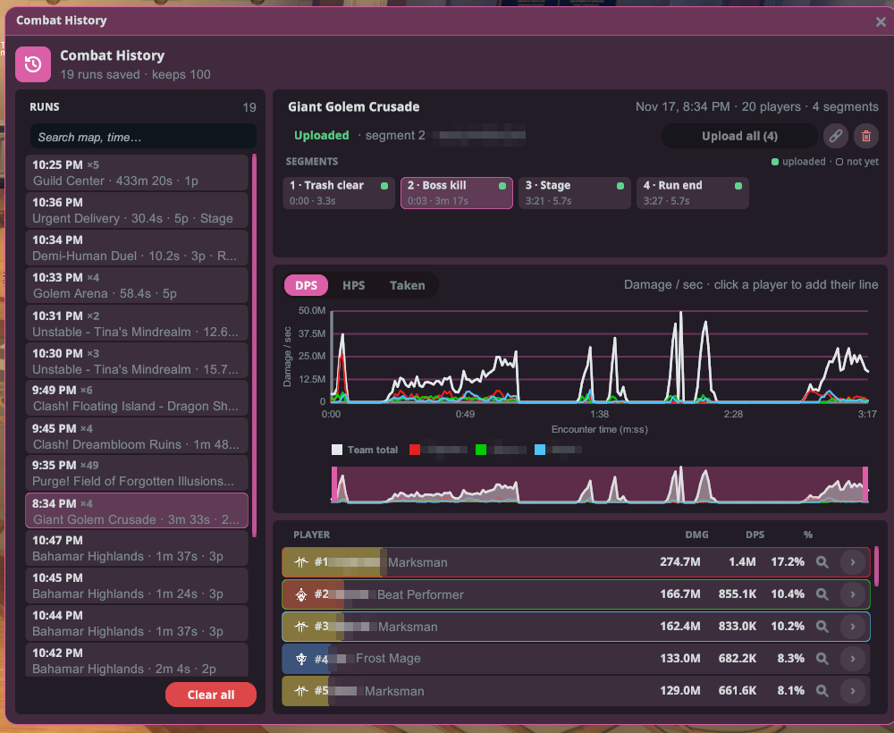

# CombatMeter

Star Resonance 向けのリアルタイムパーティ戦闘メーター: パーティの全員について**DPS**、**HPS**、**被ダメージ**をロールカラーとクラス紋章付きで表示するので、一目でパーティの状況が分かります。

## はじめに

1. プラグインをインストールし、ゲームを**Mod有効**で起動します。
2. ワールドに入るとメーターがオーバーレイウィンドウとして表示されます。ヘッダーをドラッグすると移動でき、位置は記憶されます。**F9** で表示/非表示を切り替えます。
3. 戦闘に入ると、パーティメンバーごとに行が表示され、リアルタイムで更新されます。

## CombatMeter ハブ

Stellar ランチャーの **CombatMeter** タイルをクリックするとハブが開きます。ヘッダーにはメーターの現在の状態が表示され、3枚のカードがあります:

- **メーター** — クリックでメーターの表示/非表示を切り替えます(F9 と同じ)。右側のチップに**表示中**または**非表示**、その下に現在の表示モードと指標が表示されます。
- **戦闘履歴** — 保存されているランの数。クリックで開きます(**Shift+F9** でも開けます)。
- **設定** — 設定ウィンドウを開きます。

## メーターの見方

- ヘッダーには指標メニュー(**DPS** / **HPS** / **被ダメージ**)、**リスト | パーティ** の切り替え、現在の状態(戦闘タイマー、人数)、そして4つの丸ボタン **一時停止**・**アーカイブ**・**リセット**・**⋯**(その他)があります。
- **一時停止**するとメーターのカウントが止まり、ボタンがオレンジ色になって状態表示が**一時停止中**になります。もう一度押すと再開します。
- **アーカイブ**は現在の戦闘をすぐに戦闘履歴へ保存します。何も記録されていない間はグレー表示で、保存されると緑の ✓ が表示されます。
- **⋯** で小さなメニューが開きます: リスト表示では表示する対象(**自分** / **パーティ** / **すべて**)、パーティ表示ではリーダーが**パーティ人数**を 5 / 20 で切り替えられます。戦闘履歴と設定へのショートカットもあります。
- 各行は1人のプレイヤーです。行の色はメンバーの**ロール**(タンク / ヒーラー / DPS)に従い、紋章でクラスが分かります。行のバフ・デバフにはアイコンが表示されます: スキルによる効果はそのスキルのアイコン、それ以外はカテゴリのアイコンです。
- パーティ表示では、パーティリーダーのヘッダーの下に**リーダー**行が表示され、**マーク**・**準備確認**・**集合**・**カウントダウン**(パーティ全体のゲームのプルタイマー)を使えます。

## 行のサイズ

**設定 → 外観 → 行 → 行のサイズ**で、1人あたりの表示の大きさを選べます:

- **標準** — 1人2行で、すべての情報を表示します。
- **コンパクト** — 1人1行で、バーを文字の背景に表示します。20人のレイドでも場所を大きく取りません。
- **ミニ** — バーに順位・名前・数値だけを表示します。

表示モード(**リスト**、**パーティ (5)**、**パーティ (20)**)ごとにサイズと見た目が別々に保存されます。外観タブ上部の**編集中**で、変更する表示モードを選んでください。選んだサイズで表示されない設定はグレーになり、値はそのまま残ります。

## 設定

設定はタブ付きの1つのウィンドウです。各設定の横の **?** で内容の説明を確認できます。

- **外観** — 各行に表示する内容(順位、紋章、名前の後ろの表示、能力スコア、割合、合計、秒間値など)、**行のサイズ**、バー、バトルイマジン、数値。**メーターウィンドウ**の3つのスライダーはすべての表示モードに適用されます:
  - **背景** — メーターの後ろに角丸のパネルを表示します。0 % なら透過のままです。
  - **行の背景** — 各行の暗い下地だけを薄くし、後ろのゲーム画面を見やすくします。バー、名前、数値はそのままです。
  - **前景** — メーター全体を薄くします(メーターが消えないよう最低 20 %)。
- **効果** — 行に表示するバフ・デバフ。**チェック以外すべて**か**チェックのみ**を選び、バフ/デバフの一覧(検索付き)でチェックします。**隠し効果**をオンにすると、ゲームが通常表示しない効果も一覧に出ます。コンパクト行の効果表示は最大3つ、ミニ行には表示されません。
- **アーカイブ** — 戦闘を自動保存するタイミング(下記参照)と、履歴に残すランの数。
- **アップロード** — StellarLogs にアップロードする内容(コンテンツごとに**自動** / **手動** / **オフ**)と、ランを投稿する Discord Webhook(任意)。
- **アカウント** — サイトで発行したコードで、このキャラクターを StellarLogs アカウントにリンクします。

## 戦闘履歴

- 左側の**ラン**は新しい順で、検索欄があります。ランを選ぶと右側に表示されます。
- ランのパネルにはアップロード状況(**アップロード済み** / **未アップロード**)、**セグメントをアップロード**、**すべてアップロード**、丸ボタンの**リンクをコピー**と**削除**があります。その下にランの**セグメント**(雑魚処理、ボス撃破、ラン終了など)が並び、選ぶとその区間を表示します。
- グラフは **DPS** / **HPS** / **被ダメージ** を切り替えられます。テーブルのプレイヤーをクリックすると、そのプレイヤーのラインが追加されます。
- プレイヤーテーブルの **›** でそのプレイヤーのスキル内訳を、**⌕** でその戦闘時の装備とステータスを表示します。
- **すべてクリア**・**削除**・**すべてアップロード**は、実行前に必ず確認が表示されます。削除したランも、アップロード済みなら StellarLogs に残ります。

## スキル内訳

戦闘履歴のプレイヤーの **›** から開きます。

- **合計** — 総量、DPS、会心 %、幸運 %、最大、ヒット数、キル数、稼働率、回復量など。そのプレイヤーが受けたダメージ(**被ダメージ**)も表示されます。
- **スキル** — スキルごとのダメージ、割合、会心、幸運。ゲーム上で名前のないスキルにも、番号ではなく読みやすい名前が付きます。
- **被ダメージ** のグラフから開くと、受けたダメージをスキルごとに表示します。

## アーカイブ — 戦闘を保存する

*アーカイブ* は現在の戦闘を戦闘履歴に保存し、リアルタイム表示をリセットします。

- **手動アーカイブ**(メーターのヘッダーの**アーカイブ**ボタン)は、何があっても**必ず保存**されます — 保存されたことは常に目に見えるフィードバックで分かります。
- **自動アーカイブ**は戦闘を自動で保存できます。**設定 → アーカイブ**で制御します: マスターオン/オフ、アーカイブする条件(全滅、ボスフェーズ、戦闘アイドル、ダンジョンのステージ変化)、アーカイブ間の最小間隔、確定待ち、全滅時の蘇生猶予、ソロ時は無視。
- **ボスフェーズの「前を保持」**を使うと、最初のボスヒットの数秒前からの助走をボスセグメントに含められます(デフォルトはオフ = 最初のヒットで正確にカットされます)。
- 自動アーカイブは、文字通り何も起きなかった場合(全行がゼロ)のみスキップされます。スキップされたアーカイブは何も消去しません — すべて次のアーカイブに引き継がれます。

## アップロードとランリプレイ

アーカイブされたランは [Stellar Logs](https://logs.stellarresonance.app) にアップロードされ、ダメージチャート、スキル詳細、ボスフェーズ、そしてダンジョンに入った瞬間から討伐までの全ランの**ムーブメントリプレイ**を含む完全なランページが手に入ります。

- 戦闘履歴の**リンクをコピー**で、ランの短縮URLがクリップボードにコピーされ、パーティと共有できます。
- **戦闘履歴**はアーカイブされたランを再起動後も保持します。アーカイブ済みのランを再アップロードすると、サーバー側のデータが失われていた場合でも、要約・完全な戦闘詳細・ムーブメントトラックを含む元のアップロードをそのまま再現します。

## ヒント

- 職業データがまだ読み込まれていなくてもメーターは動作します — ロスターが埋まるまでは、ロールカラーと紋章はスペックから推測されます。
- ランのリンクのアップロードに失敗した場合は、戦闘履歴から再試行してください: アップロード済みのランは失敗せず既存のリンクに解決されます。
