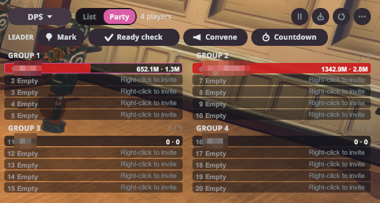

# CombatMeter

Star Resonance를 위한 실시간 파티 전투 미터입니다: 파티의 모든 사람에 대해 **DPS**, **HPS**,
**받은 피해**를 역할 색상과 클래스 문장으로 표시해, 한눈에 파티 상황을 파악할 수 있습니다.

## 시작하기

1. 플러그인을 설치하고 게임을 **모드 적용**으로 실행하세요.
2. 월드에 들어가면 미터가 오버레이 창으로 나타납니다. 헤더를 드래그하면 이동할 수 있으며 —
   위치가 기억됩니다. **F9**로 표시하거나 숨길 수 있습니다.
3. 전투에 진입하면 파티원별로 행이 나타나고 실시간으로 갱신됩니다.

## CombatMeter 허브

Stellar 런처의 **CombatMeter** 타일을 클릭하면 허브가 열립니다. 헤더에는 미터의 현재 상태가
표시되고, 카드 세 장이 있습니다:

- **미터** — 클릭하면 미터를 표시하거나 숨깁니다(F9와 같음). 오른쪽 칩에 **표시됨** 또는
  **숨김**이 표시되고, 아래 줄에 현재 보기와 지표가 표시됩니다.
- **전투 기록** — 저장된 공략 수. 클릭하면 열립니다(**Shift+F9**로도 열 수 있습니다).
- **설정** — 설정 창을 엽니다.

## 미터 읽는 법

- 헤더에는 지표 메뉴(**DPS** / **HPS** / **받은 피해**), **목록 | 파티** 전환, 현재 상태 줄(전투
  타이머, 인원 수), 그리고 둥근 버튼 네 개 **일시정지**, **보관**, **초기화**, **⋯**(더 보기)가
  있습니다.
- **일시정지**를 누르면 미터가 집계를 멈추고, 버튼이 주황색으로 바뀌며 상태 줄에
  **일시정지**가 표시됩니다. 다시 누르면 재개합니다.
- **보관**은 현재 전투를 바로 전투 기록에 저장합니다. 기록된 것이 없을 때는 회색으로 비활성화되고,
  저장되면 초록색 ✓가 표시됩니다.
- **⋯**를 누르면 작은 메뉴가 열립니다: 목록 보기에서는 표시할 대상(**나** / **파티** / **전체**)을,
  파티 보기에서는 파티장이 **파티 인원**을 5 / 20으로 바꿀 수 있습니다. 전투 기록과 설정으로 가는
  바로가기도 있습니다.
- 각 행은 플레이어 한 명입니다. 행 색상은 파티원의 **역할**(탱커 / 힐러 / 딜러)을 따르며, 문장으로
  클래스를 알 수 있습니다. 행의 버프와 디버프에는 아이콘이 표시됩니다: 스킬에서 온 효과는 그 스킬의
  아이콘, 그 밖에는 분류 아이콘입니다.
- 파티 보기에서 파티장에게는 헤더 아래에 **파티장** 줄이 표시되며 **표식**, **준비 확인**,
  **소집**, **카운트다운**(파티 전체의 게임 풀 타이머)을 쓸 수 있습니다.

## 행 크기

**설정 → 모양 → 행 → 행 크기**에서 플레이어 한 명이 차지하는 공간을 고를 수 있습니다:

- **보통** — 플레이어당 두 줄로, 모든 정보를 표시합니다.
- **컴팩트** — 플레이어당 한 줄로, 막대를 글자 뒤에 깔아 줍니다. 20인 레이드도 훨씬 적은 공간을
  차지합니다.
- **미니** — 순위·이름·수치만 있는 막대입니다.

보기(**목록**, **파티 (5)**, **파티 (20)**)마다 크기와 모양이 따로 저장됩니다. 모양 탭 맨 위의
**편집 중**에서 바꿀 보기를 고르세요. 선택한 크기에서 그리지 않는 설정은 회색으로 바뀌며 값은
유지됩니다.

## 설정

설정은 탭 다섯 개가 있는 하나의 창입니다. 각 설정 옆의 **?**를 누르면 어떤 설정인지 설명이 나옵니다.

- **모양** — 각 행에 표시할 내용(순위, 문장, 이름 뒤 표시, 능력치 점수, 비중, 합계, 초당 수치 등),
  **행 크기**, 바, Battle Imagine, 숫자. **미터 창**의 슬라이더 세 개는 모든 보기에 적용됩니다:
  - **배경** — 미터 뒤에 둥근 패널을 그립니다. 0 %면 미터가 투명한 그대로입니다.
  - **행 배경** — 각 행의 어두운 바탕만 흐리게 해, 뒤의 게임 화면이 더 잘 보입니다. 막대, 이름,
    숫자는 그대로입니다.
  - **전경** — 미터 전체를 흐리게 합니다(최소 20 %라 미터가 사라지지 않습니다).
- **효과** — 행에 표시할 버프와 디버프. **체크한 것 빼고 모두** 또는 **체크한 것만**을 고른 뒤, 버프와
  디버프 목록(검색 가능)에서 효과를 체크하세요. **숨겨진 효과**를 켜면 게임이 평소 표시하지 않는
  효과도 목록에 나옵니다. 컴팩트 행은 효과를 최대 3개까지, 미니 행은 표시하지 않습니다.
- **보관** — 전투를 자동으로 저장할 시점(아래 참고)과 기록에 남길 공략 수.
- **업로드** — StellarLogs에 업로드할 내용(콘텐츠별 **자동** / **수동** / **끔**)과, 공략을 올려 주는
  Discord 웹후크(선택).
- **계정** — 사이트에서 받은 코드로 이 캐릭터를 StellarLogs 계정에 연동합니다.

## 전투 기록

- 왼쪽 **공략** 목록은 최신순이며 검색 칸이 있습니다. 공략을 고르면 오른쪽에 표시됩니다.
- 공략 패널에는 업로드 상태(**업로드됨** / **업로드 안 됨**), **구간 업로드**, **전체 업로드**, 둥근
  버튼 **링크 복사**와 **삭제**가 있습니다. 그 아래에 공략의 **구간**(잡몹 정리, 보스 처치, 공략
  종료 등)이 있으며, 고르면 해당 구간을 볼 수 있습니다.
- 그래프는 **DPS**, **HPS**, **받은 피해**로 전환할 수 있고, 표에서 플레이어를 클릭하면 그
  플레이어의 선이 추가됩니다.
- 플레이어 표의 **›**는 그 플레이어의 스킬별 상세를, **⌕**는 그 전투 당시의 장비와 능력치를
  보여 줍니다.
- **모두 지우기**, **삭제**, **전체 업로드**는 실행 전에 항상 확인을 받습니다. 삭제한 공략도 이미
  업로드했다면 StellarLogs에 남아 있습니다.

## 스킬별 상세

전투 기록에서 플레이어의 **›**를 눌러 엽니다.

- **합계** — 총량, DPS, 치명타 %, 행운 %, 최대, 타격 수, 처치 수, 유지율, 치유량 등과 함께, 그
  플레이어가 받은 피해(**받은 피해**)도 표시됩니다.
- **스킬** — 스킬마다 피해량, 비중, 치명타, 행운. 게임에서 이름이 없는 스킬도 번호 대신 알아보기
  쉬운 이름으로 표시됩니다.
- **받은 피해** 그래프에서 열면 받은 피해를 스킬별로 보여 줍니다.

## 보관 — 전투 저장하기

*보관* 은 현재 전투를 전투 기록에 저장하고 실시간 화면을 초기화합니다.

- **수동 보관**(미터 헤더의 **보관** 버튼)은 무슨 일이 있어도 **항상 저장** 됩니다 — 보관되었다는
  것을 항상 눈에 보이는 피드백으로 알 수 있습니다.
- **자동 보관**은 전투를 자동으로 저장할 수 있습니다. **설정 → 보관**에서 제어하세요: 마스터
  켜짐/꺼짐, 보관 조건(파티 전멸, 보스 페이즈, 비전투 대기, 던전 단계 변경), 보관 사이의 최소 간격,
  전투 종료 대기, 전멸 시 부활 유예 시간, 솔로일 때 무시.
- **보스 페이즈의 "선행 시간"**을 사용하면 첫 보스 피격 전 몇 초의 준비 과정을 보스 구간에 포함시킬 수
  있습니다(기본값 꺼짐 = 첫 피격 시점에 정확히 자릅니다).
- 자동 보관은 말 그대로 아무 일도 일어나지 않았을 때(모든 행이 0)만 건너뜁니다. 건너뛴 보관은 아무것도
  지우지 않습니다 — 모든 것이 다음 보관으로 이어집니다.

## 업로드와 공략 리플레이

보관된 공략은 [Stellar Logs](https://logs.stellarresonance.app)에 업로드되며, 그곳에서 피해량 차트,
스킬 상세, 보스 페이즈, 그리고 던전에 들어간 순간부터 처치까지 전체 공략의 **이동 리플레이**를 포함한
전체 공략 페이지를 볼 수 있습니다.

- 전투 기록의 **링크 복사**는 공략의 짧은 URL을 클립보드에 복사해 파티와 공유할 수 있게 합니다.
- **전투 기록**은 재접속 후에도 보관된 공략을 유지합니다. 보관된 공략을 다시 업로드하면 서버 측
  데이터가 유실되었더라도 요약, 전체 전투 상세, 이동 궤적을 포함한 원본 업로드를 그대로 재현합니다.

## 팁

- 직업 데이터가 아직 로드되지 않아도 미터는 작동합니다 — 로스터가 채워지기 전까지는 역할 색상과 문장을
  전문화로 추정합니다.
- 공략 링크 업로드가 실패하면 전투 기록에서 다시 시도하세요: 이미 업로드된 공략은 실패하지 않고 기존
  링크로 연결됩니다.
