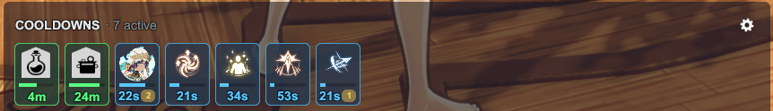
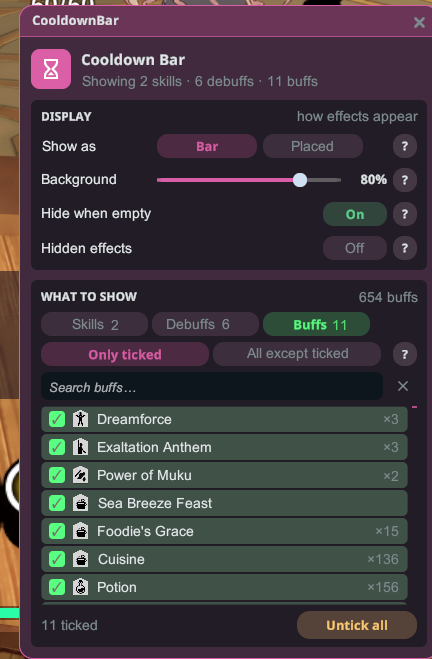
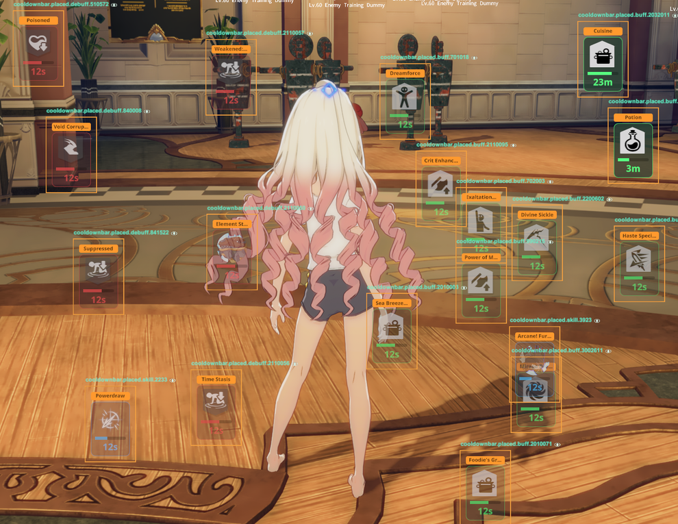

# CooldownBar

Ang mga cooldown ng skill, debuff at buff mo sa isang tingin, para makita mo kung ano ang
parating na muli nang hindi nakatitig sa hotbar. Ipakita silang lahat sa iisang bar, o bigyan
ang bawat effect ng sariling tile kahit saan sa screen.

## Paano gamitin

1. I-install ang plugin at i-launch ang laro nang **May mod**.
2. Lalabas ang bar bilang isang overlay. I-drag ito kahit saan mo gusto — natatandaan ang
   posisyon.
3. Bawat aktibong effect ay isang tile: cyan para sa cooldown ng skill, pula para sa debuff,
   berde para sa buff. Ipinapakita ng fill bar at ng numero ang natitirang oras; ipinapakita ng
   maliit na chip ang bilang ng stack o charge.
4. Pindutin ang **F8**, i-click ang gear sa bar, o buksan ang CooldownBar mula sa Stellar menu
   para buksan ang **Mga setting**. Bumubukas ito sa gitna ng bar.

## Mga setting

- **Skills / Debuffs / Buffs** — lumipat sa tatlong listahan. Ipinapakita ng bawat chip kung
  ilan ang napili mo.
- **Mga napili lang / Lahat maliban sa napili** — ipakita lang ang mga pinili mo, o lahat
  maliban sa kanila. May sariling pagpili ang bawat listahan.
- **Maghanap** sa listahan; binubura ng clear button ang laman ng kahon. Kapag may pinili ka,
  kumikislap ang row at kinukumpirma ito ng note sa ibaba.
- Humihingi muna ng kumpirmasyon ang **Alisin lahat** bago nito linisin ang listahan.
- **Ipakita bilang** — **Bar** (iisang panel ng lahat ng aktibong effect) o **Nakahiwalay**
  (isang tile bawat effect, tingnan sa ibaba).
- Itinatakda ng **Background** (Bar) kung gaano kasolido ang panel ng bar. Sumusunod ang kulay
  nito sa iyong theme.
- Itinatago ng **Itago kung walang laman** (Bar, naka-off bilang default) ang bar habang walang
  aktibo. Bumabalik ito sa susunod na cooldown o effect, at laging lumalabas sa HUD layout
  editor. Habang nakatago ito, buksan ang Mga setting gamit ang **F8** o mula sa Stellar menu.
- Pindutin ang **?** sa tabi ng isang opsyon para sa maikling paliwanag.

## Nakahiwalay na mode

1. Sa Mga setting, itakda ang **Ipakita bilang** sa **Nakahiwalay**.
2. Piliin ang mga effect na gusto mo, hanggang 30. Nagiging sariling tile ang bawat isa. Laging
   ang mga napiling effect lang ang ipinapakita sa Nakahiwalay na mode.
3. Buksan ang HUD layout editor. Lumalabas doon ang lahat ng tile, kaya i-drag ang bawat isa kung
   saan mo gusto.
4. Sa labas ng editor, lumalabas lang ang tile habang aktibo ang effect nito.
5. Itinatakda ng **Laki** ang lahat ng tile sa 75%, 100%, 125%, 150% o 200%. Para bigyan ng
   sariling laki ang isang tile, i-click ang size chip sa row nito sa listahan.

## Mga tip

- Ang natitirang oras ay nasa segundo hanggang 99 s (may decimal kapag mas mababa sa 10 s),
  tapos nasa minuto (hal. "8m"), tapos nasa oras. Ang stack ay hanggang 99, tapos "99+".
- Ang mga buff na nagre-refresh ng timer nito sa bagong stack ay nananatiling makikita na may
  tamang countdown para sa buong tagal na na-refresh.
