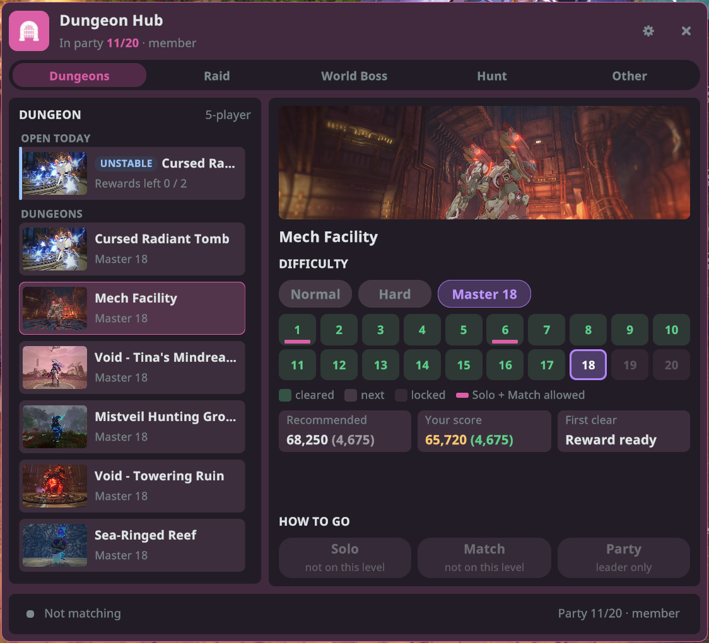
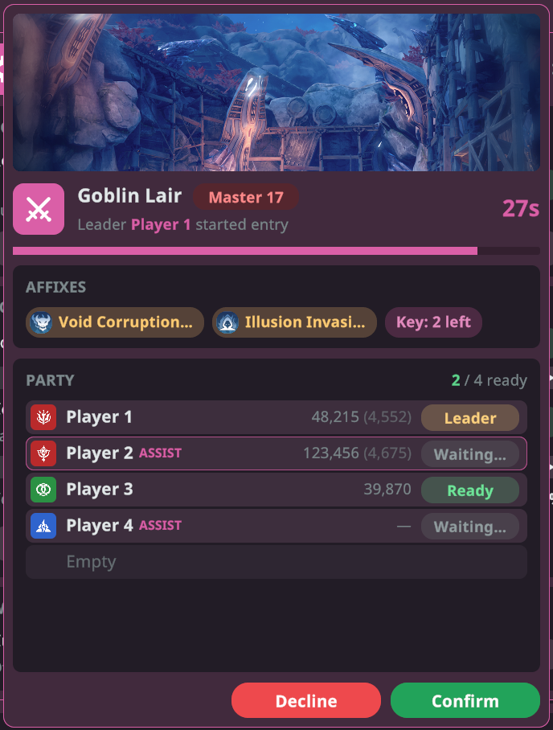
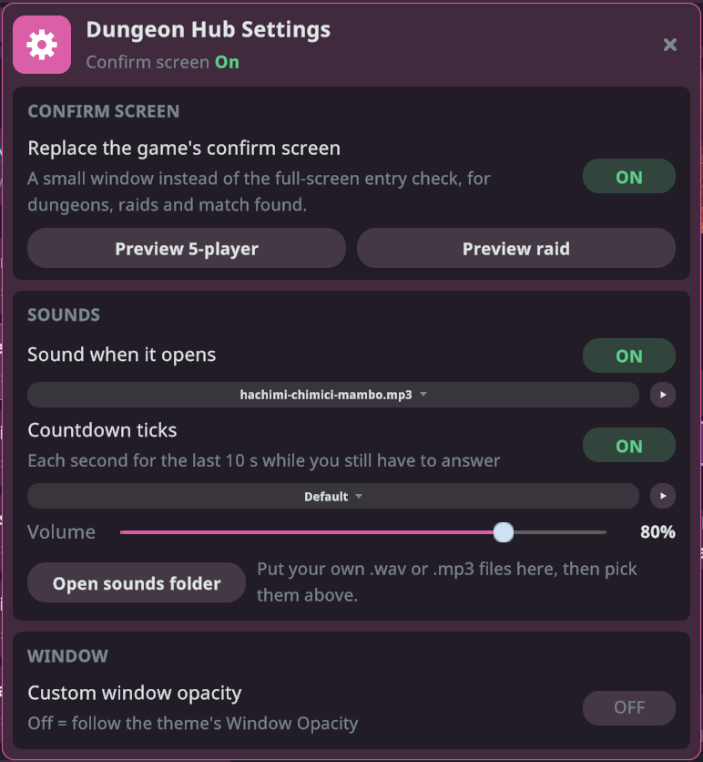

# 던전 허브

모든 던전을 창 하나에 모았습니다. 던전과 난이도를 고른 뒤 솔로로 입장하거나, 매칭을 시작하거나, 파티와 함께 입장하세요. NPC까지 걸어갈 필요가 없습니다. 또한 게임의 전체 화면 입장 확인을 누가 준비됐는지 보여 주는 작은 창으로 바꿉니다.

## 시작하기

1. 플러그인을 설치하고 게임을 **모드 적용**으로 실행하세요.
2. 캐릭터로 로그인한 뒤 다음 중 하나로 **던전 허브**를 엽니다.
   - 게임 Esc 메뉴 오른쪽의 **던전 허브** 버튼
   - Stellar 런처의 **던전 허브** 타일
   - 직접 지정한 단축키(아래 "단축키" 참고)
3. 탭을 고르고, 왼쪽에서 던전을 고른 뒤, 오른쪽에서 난이도와 **참가 방법**을 고릅니다.

헤더에는 솔로인지 파티 중인지(파티장인지도) 표시됩니다. 창은 마지막으로 사용한 탭으로 열립니다.

## 던전 고르기

허브에는 탭이 다섯 개 있습니다: **던전**, **레이드**, **월드 보스**, **토벌**, **기타**.

**던전**

- 맨 위의 **오늘 개방**에는 오늘 열린 불안정 던전이 **불안정** 표시와 함께 나옵니다. 일반 던전은 그 아래 **던전**에 이어집니다. 오늘 열린 불안정 던전이 없으면 제목 줄은 표시되지 않습니다.
- **난이도**에서 **노멀**, **하드**, **마스터** 중 하나를 고릅니다. **마스터**를 고르면 20개 레벨이 나옵니다.
  - 초록 = 클리어, 기본색 = 다음에 깰 레벨, 흐림 = 잠김
  - 색 밑줄은 **솔로**와 **매칭**을 모두 쓸 수 있는 레벨 표시입니다.

**레이드**

- 지금 게임에서 열려 있는 모든 레이드. 레이드에 있는 난이도에 따라 **이지**, **하드**, **나이트메어**를 고를 수 있습니다.

**타일 보는 법**

- **권장**: 이 난이도에 게임이 권장하는 점수.
- **내 점수**: 권장 점수에 도달하면 초록, 모자라면 주황으로 표시됩니다.
- **최초 클리어**: 최초 클리어 보상을 아직 받을 수 있는지(**수령 가능**), 이미 **수령 완료**인지.
- **남은 보상**: 보상을 받을 수 있는 남은 횟수. 0이어도 입장은 할 수 있지만 보상은 없습니다.

## 참가 방법

패널 아래에 버튼이 세 개 있습니다.

- **솔로**: 봇과 함께 혼자 입장합니다.
- **매칭**: 자동 매칭입니다. 매칭 중에는 아래 바에 **매칭 중**과 경과 시간, **취소** 버튼이 표시됩니다.
- **파티**: 파티와 함께 입장합니다.

지금 쓸 수 없는 버튼은 회색이 되고, 그 아래에 이유가 나옵니다. 예를 들어 "파티 없음"이나 "파티원 3명 이상 필요 (현재 1명) - 매칭을 이용하세요" 같은 식입니다. 파티에서는 파티장만 입장이나 매칭을 시작할 수 있습니다.

## 월드 보스, 토벌, 기타

- **월드 보스**: 이번 주 보스, 남은 보상, 이벤트가 열려 있는지, 다음에 언제 열리는지 보여 줍니다. 월드 보스는 **매칭**만 가능합니다.
- **토벌**: 주간 토벌과 **길드 토벌**. 길드 토벌은 열려 있고 길드에 가입되어 있으면 여기서 바로 입장할 수 있습니다(노멀 또는 하드, **솔로** 또는 **파티**).
- **기타**: 맨 위는 **개척국 의뢰**입니다. 일일 퀘스트를 수락하고, 오늘의 이벤트와 완료한 개수를 확인하고, 이벤트에 바로 **입장**할 수 있습니다. **게시판으로 이동**을 누르면 개척국 게시판으로 갑니다.
- 나머지 활동에는 **열기** 버튼이 있어서 게임의 해당 활동 페이지를 엽니다.

## 입장 확인

파티가 입장을 시작하거나 매칭이 성사되면, 게임은 보통 화면 전체를 덮고 모두에게 확인을 요청합니다. 던전 허브는 그 대신 작은 창을 띄웁니다. 5인 던전, 레이드, 매칭 성공 모두에서 작동합니다.

- 위쪽에 던전, 난이도, 카운트다운.
- **특성**: 던전에 특성이 있을 때 표시됩니다.
- **파티**(또는 네 그룹으로 나뉜 **레이드**): 각 플레이어의 클래스, 점수, 상태(**준비 완료**, **대기 중…**, **거절**). 내 줄은 테두리로 표시됩니다.
- 아래쪽에 **확인**과 **거절**. 매칭 성공일 때는 실수로 누르지 않도록 **거절**이 한 번 더 묻습니다(**거절할까요?**). 파티장으로서 입장을 시작했다면 대신 **입장 취소**가 나옵니다.
- 모두 준비되면 창이 닫히고 입장합니다. 누군가 거절하거나 시간이 다 되면, 누구였는지 보여 준 뒤 저절로 닫힙니다.
- 이 창은 다른 Stellar 창보다 항상 위에 표시되어 뒤에 가려지지 않습니다.

## 설정

던전 허브 헤더의 톱니바퀴 버튼(**⚙**)을 누르면 **던전 허브 설정**이 열립니다.

**입장 확인 화면**

- **게임의 입장 확인 화면 대체**: 작은 창을 켜거나 끕니다. 기본값은 켜짐입니다. 끄면 게임의 전체 화면 확인이 나옵니다.
- **5인 미리보기** / **레이드 미리보기**: 파티 없이도 예시 플레이어로 창을 확인할 수 있습니다. 미리보기의 버튼은 창을 닫기만 합니다.

**사운드**(작은 입장 확인 창에서만 재생됩니다)

- **열릴 때 사운드**: 입장 확인 창이 뜰 때 나는 소리.
- **카운트다운 효과음**: 아직 응답하지 않은 동안 마지막 10초 동안 매초 나는 소리.
- **음량**: 두 소리 모두에 적용됩니다. 소리 옆의 **▶**를 누르면 들어 볼 수 있습니다.
- **사운드 폴더 열기**: 원하는 .wav 또는 .mp3 파일을 이 폴더에 넣고 사운드 목록에서 고르세요. **기본**을 고르면 내장 사운드로 돌아갑니다. 재생할 수 없는 파일이면 기본 사운드가 나고, 설정에 어떤 파일인지 표시됩니다.
- 이 소리는 게임 소리를 꺼 두었거나 게임이 백그라운드에 있어도 들립니다.

**창**

- **창 불투명도 직접 설정**: 꺼짐 = 던전 허브 창들이 테마의 창 불투명도를 따릅니다. 켜짐 = 모든 창에 직접 정한 **불투명도**를 씁니다.

## 단축키

둘 다 기본적으로 지정되어 있지 않습니다. **Stellar 설정 → 단축키**에서 키를 지정하세요.

- **던전 허브 창 열기/닫기**: 허브를 열거나 닫습니다.
- **던전: 입장 확인 대체 전환**: 작은 입장 확인 창을 켜거나 끕니다.

## 참고

- 던전 허브는 월드에 있을 때만 열리며, 로그아웃하면 창이 닫힙니다.
- 작은 창으로 입장 요청을 표시하지 못하면, 평소처럼 게임의 입장 확인 화면이 나옵니다.
