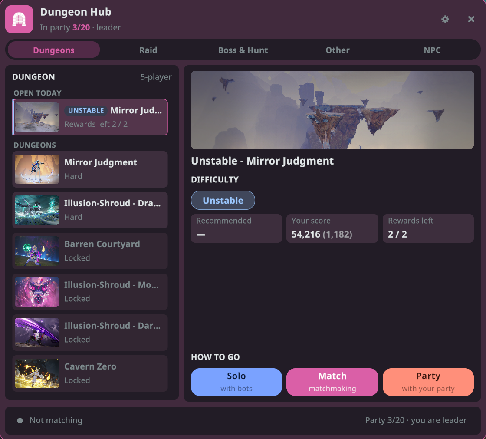
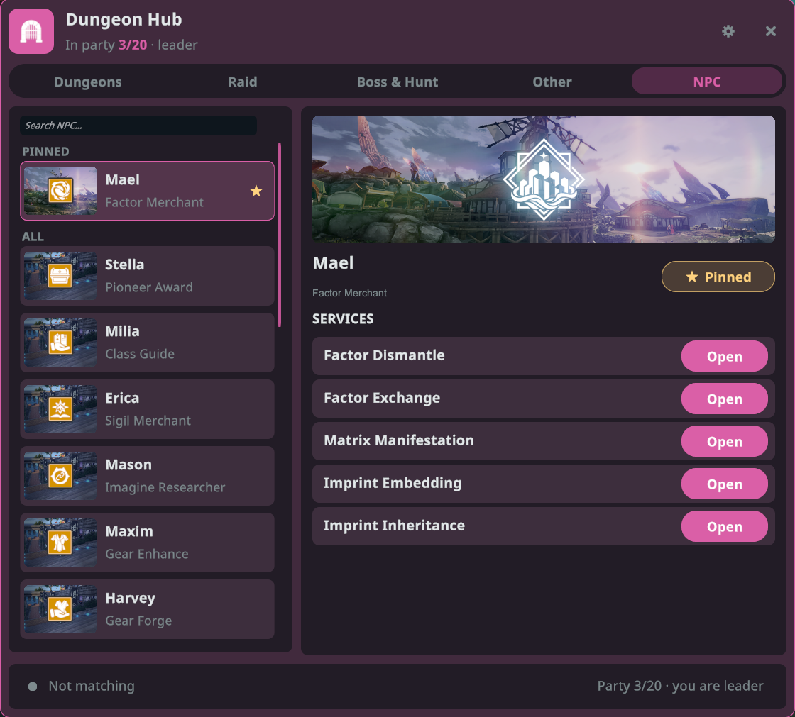
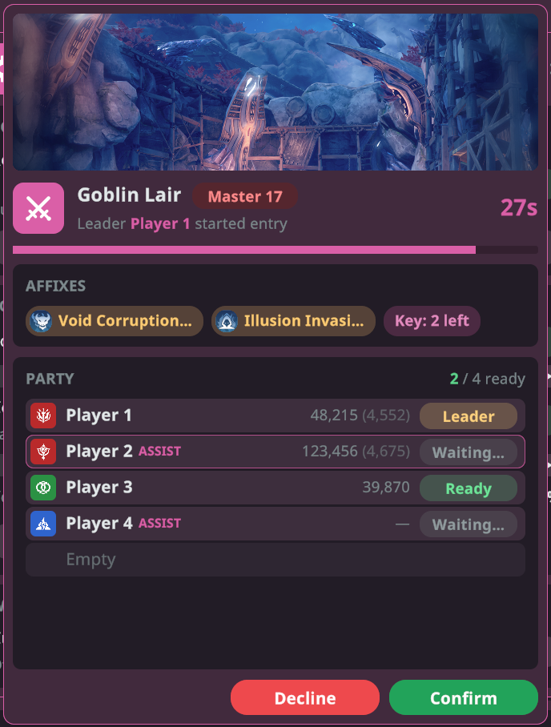
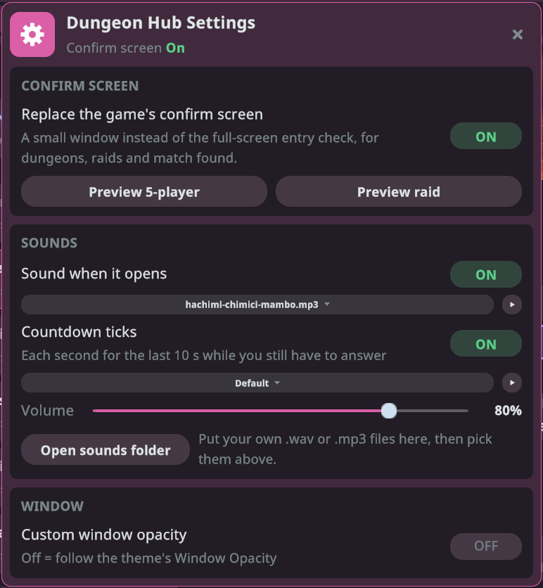

# ศูนย์ดันเจี้ยน

ทุกดันเจี้ยนรวมอยู่ในหน้าต่างเดียว เลือกดันเจี้ยนและความยาก แล้วเข้าแบบเดี่ยว เริ่มจับคู่ หรือเข้ากับปาร์ตี้ของคุณ โดยไม่ต้องเดินไปหา NPC นอกจากนี้ยังเปลี่ยนหน้าจอยืนยันเข้าดันเจี้ยนแบบเต็มจอของเกมเป็นหน้าต่างเล็กที่บอกว่าใครพร้อมแล้ว

## เริ่มต้นใช้งาน

1. ติดตั้งปลั๊กอินแล้วเปิดเกมแบบ **ใช้ม็อด**
2. ล็อกอินเข้าตัวละคร แล้วเปิด **ศูนย์ดันเจี้ยน** ได้ด้วยวิธีใดวิธีหนึ่ง:
   - ปุ่ม **ศูนย์ดันเจี้ยน** ทางด้านขวาของเมนู Esc ในเกม
   - ไทล์ **ศูนย์ดันเจี้ยน** ในตัวเรียกใช้ Stellar
   - ปุ่มลัดที่คุณกำหนดเอง (ดู "ปุ่มลัด" ด้านล่าง)
3. เลือกแท็บ เลือกดันเจี้ยนทางซ้าย แล้วเลือกความยากและ **วิธีเข้าร่วม** ทางขวา

ส่วนหัวจะแสดงว่าคุณเล่นเดี่ยวหรืออยู่ในปาร์ตี้ (และเป็นหัวหน้าหรือไม่) หน้าต่างจะเปิดที่แท็บที่คุณใช้ครั้งล่าสุด

## เลือกดันเจี้ยน

ศูนย์ดันเจี้ยนมี 5 แท็บ: **ดันเจี้ยน**, **เรด**, **บอส & ล่า**, **อื่นๆ** และ **NPC**

**ดันเจี้ยน**

- **เปิดวันนี้** ด้านบนสุดแสดงดันเจี้ยนไม่เสถียรที่เปิดวันนี้ โดยมีป้าย **ไม่เสถียร** ดันเจี้ยนปกติจะอยู่ถัดลงมาใต้หัวข้อ **ดันเจี้ยน** ถ้าวันนี้ไม่มีดันเจี้ยนไม่เสถียรเปิด รายการจะไม่มีหัวข้อ
- ใต้ **ความยาก** ให้เลือก **ปกติ**, **ยาก** หรือ **มาสเตอร์** เมื่อเลือก **มาสเตอร์** จะแสดงทั้ง 20 ระดับ:
  - สีเขียว = เคลียร์แล้ว, สีปกติ = ระดับถัดไปที่ต้องเคลียร์, สีจาง = ล็อก
  - เส้นใต้สีหมายถึงระดับที่ใช้ได้ทั้ง **เดี่ยว** และ **จับคู่**

**เรด**

- ทุกเรดที่เกมเปิดอยู่ตอนนี้ พร้อม **ง่าย**, **ยาก** และ **ฝันร้าย** ตามที่เรดนั้นมี

**ไทล์บอกอะไรบ้าง**

- **แนะนำ**: คะแนนที่เกมแนะนำสำหรับความยากนี้
- **คะแนนของคุณ**: เป็นสีเขียวเมื่อถึงคะแนนที่แนะนำ และสีส้มเมื่อยังต่ำกว่า
- **เคลียร์ครั้งแรก**: รางวัลเคลียร์ครั้งแรกยังรอให้รับอยู่ (**รับรางวัลได้**) หรือ **รับแล้ว**
- **รางวัลคงเหลือ**: จำนวนรอบที่ยังได้รางวัล ถ้าเหลือ 0 ก็ยังเข้าได้ แต่จะไม่ได้รางวัล

## วิธีเข้าร่วม

มีปุ่มสามปุ่มที่ด้านล่างของแผง:

- **เดี่ยว**: เข้าคนเดียวกับบอท
- **จับคู่**: จับคู่อัตโนมัติ ระหว่างจับคู่ แถบด้านล่างจะแสดง **กำลังจับคู่** พร้อมเวลาที่ผ่านไปและปุ่ม **ยกเลิก**
- **ปาร์ตี้**: เข้ากับปาร์ตี้ของคุณ

ปุ่มที่ใช้ไม่ได้ในตอนนี้จะเป็นสีเทา และมีบรรทัดด้านล่างบอกเหตุผล เช่น "ไม่ได้อยู่ในปาร์ตี้" หรือ "ต้องมีสมาชิก 3 คนขึ้นไป (มี 1) - ใช้จับคู่" เมื่ออยู่ในปาร์ตี้ มีแค่หัวหน้าปาร์ตี้ที่เริ่มเข้าดันเจี้ยนหรือเริ่มจับคู่ได้

## บอส & ล่า และอื่นๆ

- **บอส & ล่า**:
  - **World Boss Crusade**: บอสของสัปดาห์นี้ รางวัลคงเหลือ อีเวนต์เปิดอยู่หรือไม่ และจะเปิดครั้งถัดไปเมื่อไร เวิลด์บอสใช้ได้เฉพาะ **จับคู่**
  - **Stimen Vaults**: การล่ารายสัปดาห์
  - **ล่ากิลด์**: เข้าจากที่นี่ได้เลย (ปกติหรือยาก, **เดี่ยว** หรือ **ปาร์ตี้**) เมื่อเปิดอยู่และคุณอยู่ในกิลด์
- **อื่นๆ**: อันดับแรกคือ **งานสำนัก** รับเควสต์รายวัน ดูกิจกรรมของวันนี้และจำนวนที่ทำเสร็จแล้ว และกด **เข้า** กิจกรรมได้โดยตรง ปุ่ม **ไปที่บอร์ด** จะพาคุณไปที่บอร์ดของสำนักผู้บุกเบิก
- กิจกรรมอื่นๆ มีปุ่ม **เปิด** ที่พาไปยังหน้าของกิจกรรมนั้นในเกม
- กิจกรรมที่ไม่มีให้เล่นในซีซันนี้ (เช่น Slumberdream Valley) จะเป็นสีเทาและแสดงว่า **ไม่มีในซีซันนี้** และจะกลับมาเองเมื่อซีซันใหม่เพิ่มกิจกรรมนั้นอีกครั้ง

## NPC

ใช้บริการของ NPC ได้จากทุกที่ โดยไม่ต้องเดินไปหา

- เลือก NPC ทางซ้าย บริการแต่ละอย่างของ NPC นั้นจะมีปุ่ม **เปิด** ของตัวเองทางขวา
- **ค้นหา NPC…** ด้านบนใช้หา NPC จากชื่อหรือจากสิ่งที่ NPC ทำ (เช่น "อุปกรณ์") กด **✕** เพื่อล้างการค้นหา
- **ปักหมุด** จะย้าย NPC ไปไว้ในกลุ่ม **ปักหมุดไว้** ด้านบนสุดของรายการ พร้อมเครื่องหมาย ★ กด **ปักหมุดแล้ว** เพื่อเลิกปักหมุด หมุดของคุณจะถูกบันทึกไว้
- บริการจากอีเวนต์จำกัดเวลาจะแสดงเฉพาะตอนที่อีเวนต์นั้นจัดอยู่ ถ้าบริการใดใช้ไม่ได้ในตอนนี้ จะมีข้อความบอกเหตุผล

## ยืนยันเข้าดันเจี้ยน

เมื่อปาร์ตี้เริ่มเข้าดันเจี้ยนหรือจับคู่สำเร็จ ปกติเกมจะแสดงหน้าจอเต็มเพื่อให้ทุกคนยืนยัน ศูนย์ดันเจี้ยนจะแสดงหน้าต่างเล็กแทน ใช้ได้กับดันเจี้ยน 5 คน เรด และเมื่อจับคู่สำเร็จ

- ด้านบนแสดงดันเจี้ยน ความยาก และการนับถอยหลัง
- **คุณสมบัติพิเศษ**: แสดงเมื่อดันเจี้ยนมีคุณสมบัติพิเศษ
- **ปาร์ตี้** (หรือ **เรด** ที่แบ่งเป็นสี่กลุ่ม): ผู้เล่นทุกคนพร้อมคลาส คะแนน และสถานะ: **พร้อม**, **รอ…** หรือ **ปฏิเสธ** แถวของคุณเองจะมีกรอบ
- ด้านล่างมี **ยืนยัน** และ **ปฏิเสธ** เมื่อจับคู่สำเร็จ ปุ่มปฏิเสธจะถามซ้ำอีกครั้ง (**ปฏิเสธ?**) เพื่อกันกดพลาด ถ้าคุณเป็นหัวหน้าที่เริ่มเข้าดันเจี้ยน จะเห็นปุ่ม **ยกเลิกการเข้า** แทน
- **ลักพาตัว** (เฉพาะหัวหน้าปาร์ตี้ ไม่ใช้กับการจับคู่): ส่งการยอมรับแทนสมาชิกทุกคนที่ยังไม่ **พร้อม** เพื่อให้เข้าดันเจี้ยนได้โดยไม่ต้องกดยืนยันเอง กดซ้ำได้จนกว่าหน้าต่างยืนยันจะปิด
- เมื่อทุกคนพร้อม หน้าต่างจะปิดและคุณจะเข้าดันเจี้ยน ถ้ามีคนปฏิเสธหรือหมดเวลา หน้าต่างจะบอกว่าเป็นใคร แล้วปิดเอง
- หน้าต่างนี้จะอยู่เหนือหน้าต่าง Stellar อื่นๆ เสมอ จึงไม่ถูกบัง

## การตั้งค่า

คลิกปุ่มรูปเฟือง (**⚙**) ที่ส่วนหัวของศูนย์ดันเจี้ยน เพื่อเปิด **ตั้งค่าศูนย์ดันเจี้ยน**

**หน้าจอยืนยัน**

- **แทนที่หน้าจอยืนยันของเกม**: เปิดหรือปิดหน้าต่างเล็ก ค่าเริ่มต้นคือเปิด ถ้าปิด คุณจะเห็นหน้าจอยืนยันแบบเต็มจอของเกมเอง
- **ดูตัวอย่าง 5 คน** / **ดูตัวอย่างเรด**: ดูหน้าต่างพร้อมผู้เล่นตัวอย่างได้โดยไม่ต้องมีปาร์ตี้ ปุ่มในตัวอย่างแค่ปิดหน้าต่าง

**เสียง** (เล่นเฉพาะบนหน้าต่างยืนยันขนาดเล็ก)

- **เสียงเมื่อเปิด**: เสียงที่ดังเมื่อหน้าต่างยืนยันปรากฏ
- **เสียงนับถอยหลัง**: เสียงทุกวินาทีใน 10 วินาทีสุดท้ายขณะที่คุณยังไม่ได้ตอบ
- **ระดับเสียง**: ใช้กับทั้งสองเสียง กด **▶** ข้างเสียงเพื่อฟังตัวอย่าง และกด **■** เพื่อหยุด
- **เปิดโฟลเดอร์เสียง**: ใส่ไฟล์ .wav หรือ .mp3 ของคุณไว้ในโฟลเดอร์นี้ แล้วเลือกจากรายการเสียง **ค่าเริ่มต้น** คือกลับไปใช้เสียงที่มากับปลั๊กอิน ถ้าไฟล์เล่นไม่ได้ จะเล่นเสียงค่าเริ่มต้นแทน และการตั้งค่าจะบอกว่าเป็นไฟล์ไหน
- คุณจะได้ยินเสียงเหล่านี้แม้ปิดเสียงเกมหรือเกมอยู่เบื้องหลัง

**หน้าต่าง**

- **กำหนดความทึบของหน้าต่างเอง**: ปิด = หน้าต่างของศูนย์ดันเจี้ยนใช้ความทึบหน้าต่างตามธีม เปิด = ตั้ง **ความทึบ** ของคุณเองให้ทุกหน้าต่าง

## ปุ่มลัด

ทั้งสองอย่างยังไม่ได้กำหนดปุ่มไว้ กำหนดปุ่มได้ที่ **การตั้งค่า Stellar → ปุ่มลัด**:

- **เปิด/ปิดหน้าต่างศูนย์ดันเจี้ยน**: เปิดหรือปิดศูนย์ดันเจี้ยน
- **ดันเจี้ยน: สลับหน้าจอยืนยันแบบใหม่**: เปิดหรือปิดหน้าต่างยืนยันขนาดเล็ก

## หมายเหตุ

- ศูนย์ดันเจี้ยนเปิดได้เฉพาะตอนที่คุณอยู่ในโลกของเกม และหน้าต่างจะปิดเมื่อคุณล็อกเอาต์
- ระหว่างที่ศูนย์ดันเจี้ยนเปิดอยู่ เคอร์เซอร์เมาส์จะใช้งานได้อิสระ คุณจึงคลิกได้โดยไม่ต้องกดปุ่มค้างไว้
- ถ้าหน้าต่างเล็กแสดงคำขอเข้าดันเจี้ยนไม่ได้ หน้าจอยืนยันของเกมจะปรากฏตามปกติ
