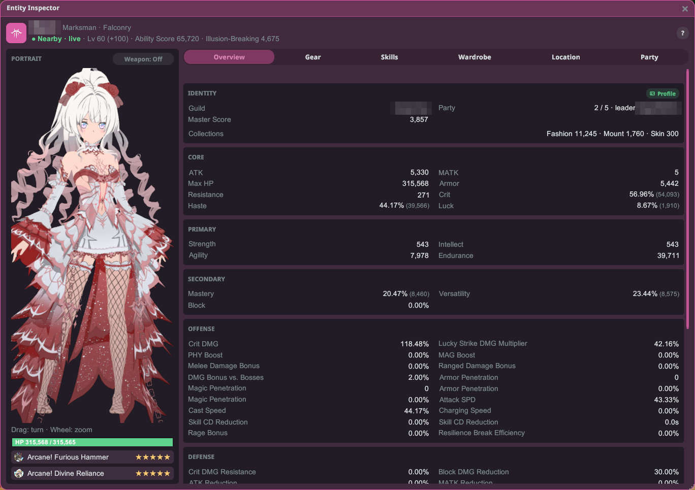
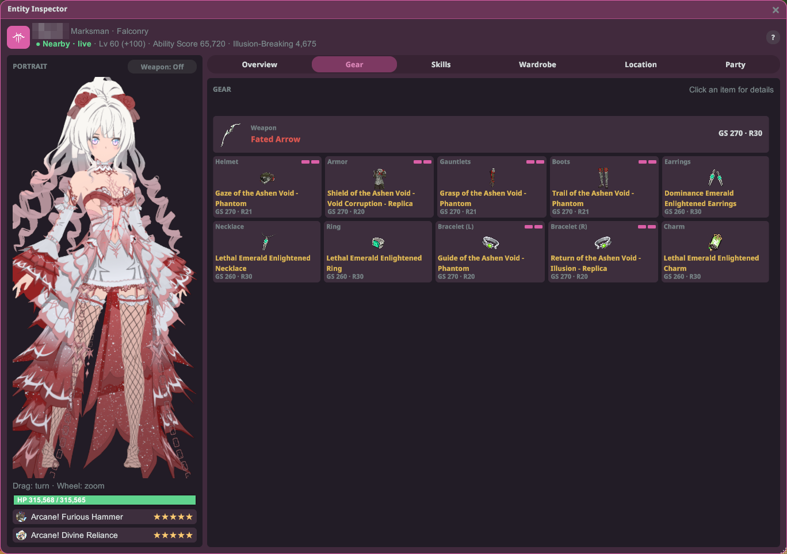
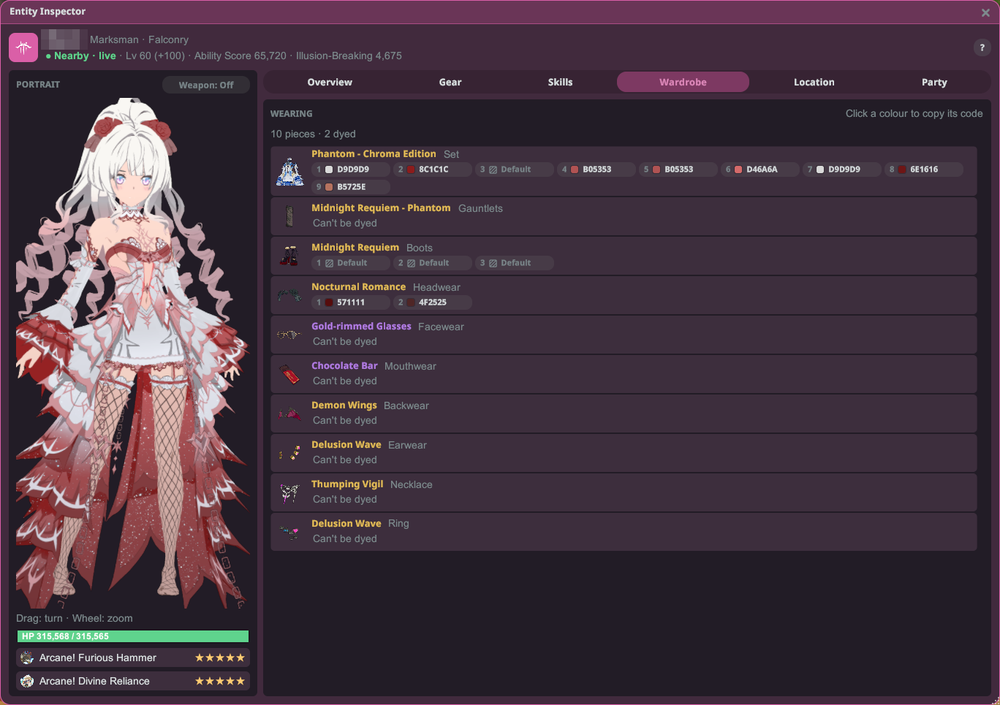
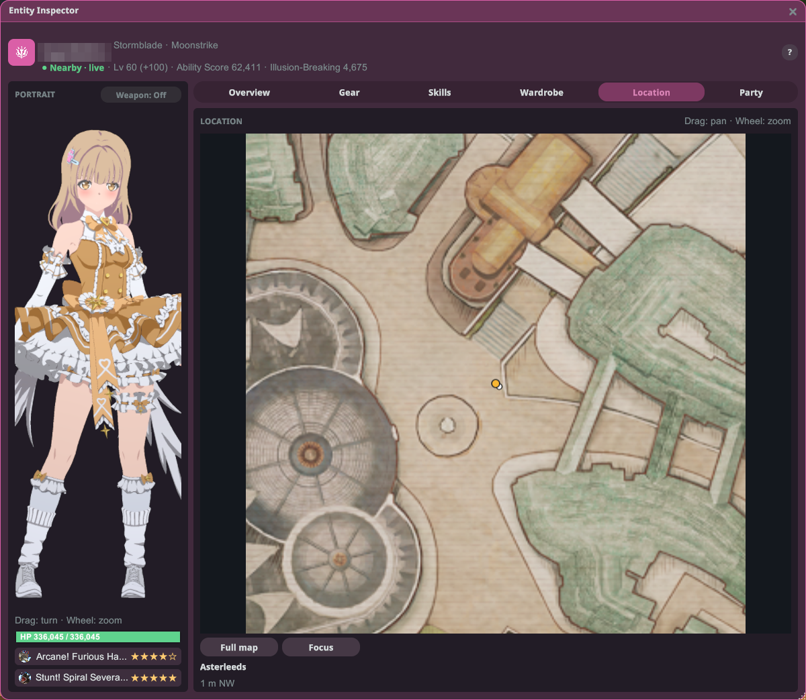

# Inspektur Entitas

Periksa pemain mana pun — stat, perlengkapan, skill, kostum, dan pewarnanya — dalam satu jendela yang bisa
kamu buka untuk siapa saja, termasuk dirimu sendiri.

## Cara membuka

1. Pasang plugin dan jalankan game dalam mode **Modded**.
2. Buka inspeksi dari salah satu tempat ini:
   - tombol **Inspect** di kartu profil pemain, atau
   - item **Inspect** di baris CombatMeter (jika CombatMeter terpasang).

## Header

Bagian atas jendela menampilkan nama pemain, class dan spec, level, Ability Score, dan Illusion-Breaking.
Sebuah status memberi tahu seberapa baru informasinya:

- **Dekat · langsung** — pemain ada di dekatmu, jadi semuanya diperbarui langsung.
- **Jauh · profil N menit lalu** — pemain jauh darimu; yang kamu lihat berasal dari profilnya.
- **Tampilan sesi** — kamu sedang melihat sesi yang tersimpan. Tutup untuk kembali ke tampilan langsung.

Di kiri, **potret** menampilkan pemain dalam 3D (**seret** untuk memutar, **roda mouse** untuk zoom),
dengan saklar **Senjata: On / Off**, bar HP (dengan shield), dan imagine miliknya.

## Tab

- **Ringkasan** — stat dikelompokkan dalam panel dua kolom, plus guild, party, gelar yang dipakai, dan
  poin koleksi fashion / tunggangan / skin senjata.
- **Perlengkapan** — senjata di barisnya sendiri di atas, bagian lain dalam grid. **Klik item** untuk
  melihat detailnya. Perlengkapanmu sendiri menampilkan gear score setelah upgrade, refine, dan tahap upgrade.
- **Skill** — Battle Imagine dan skill.
- **Lemari** — setiap bagian kostum dengan slot pewarnanya, bernomor seperti di layar pewarna game
  (**Bawaan** berarti belum diwarnai). **Klik warna** untuk menyalin kode warnanya.
- **Lokasi** — posisi pemain di peta. **Seret** untuk menggeser, **roda mouse** untuk zoom, **Peta penuh**
  dan **Fokus** untuk berpindah tampilan.
- **Party** — party pemain. **Klik anggota** untuk memeriksanya.

Tombol bulat **?** di kanan atas menampilkan bantuan singkat.

## Yang tidak dibagikan game

- Pemain lain hanya membagikan sebagian stat mereka, jadi hanya itu yang ditampilkan, dan bagian tanpa
  isi disembunyikan.
- HP dan imagine hanya tampil saat pemain ada di dekatmu. Skill dan perlengkapan muncul setelah kamu
  pernah berada di dekatnya.
- Game tidak membagikan tahap upgrade perlengkapan pemain lain. Bagian yang bisa di-upgrade menampilkan
  **+** setelah gear score (misalnya **GS 260+**), artinya bisa lebih tinggi.

## Catatan

- Memerlukan Stellar 2.32.0 atau yang lebih baru.
- Plugin ini tersedia dalam English, 日本語, ไทย, Bahasa Indonesia, Filipino, dan 한국어.
