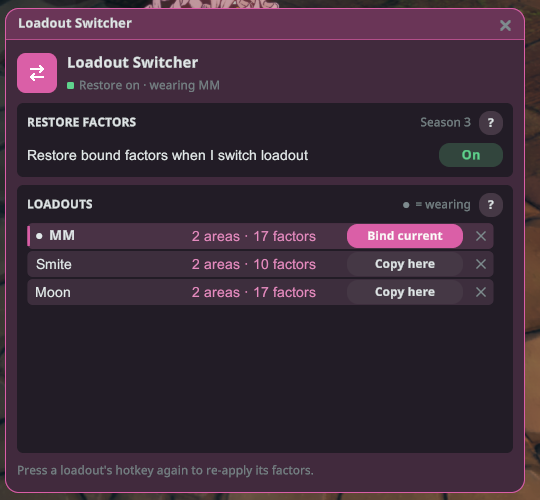

# LoadoutSwitcher

Lumipat sa pagitan ng mga naka-save mong in-game na loadout (Role Plans) gamit ang hotkey.

## Paano gamitin

1. I-install ang plugin at buksan ang laro sa mode na **May mod**.
2. I-save ang mga loadout mo sa laro gaya ng dati (Role Plans).
3. Buksan ang **Mga Setting ng Stellar → Mga Hotkey** at mag-bind ng mga key para sa
   **Ilapat ang Loadout 1** hanggang **Ilapat ang Loadout 10** (hindi pa naka-bind bilang
   default). Ina-apply ng hotkey na *n* ang *n*-na loadout sa naka-save mong listahan.

4. Pindutin ang hotkey habang nasa mundo — nililipat ng plugin sa pamamagitan ng sariling loadout
   flow ng laro.

## Ang window

Buksan ang window ng Loadout Switcher para makita ang status line sa itaas (bukas o sarado ang
restore, at ang loadout na suot mo), ang switch na **Restore ng factors**, at ang mga loadout mo.
May tuldok ang loadout na suot mo. Pindutin ang **?** button para sa tulong sa bahaging iyon.

## Pag-restore ng factors

Kayang tandaan ng bawat loadout ang isang Deep-Slumber setup (ang cultivate line at phantom
factors nito).

1. Isuot ang loadout, ayusin ang Deep-Slumber ayon sa gusto mo, at pindutin ang **I-bind ito** sa
   row ng loadout na iyon. Ipapakita ng row kung ilang area at factors ang naka-bind.
2. Gawing **Bukas** ang **Restore ng factors**. Kapag lumipat ka na sa isang loadout, mare-restore
   ang naka-bind nitong factors.
3. Kapag pinindot mo ang hotkey ng loadout na suot mo na, mare-restore ulit ang factors nito.

- Gumagana lang ang pag-restore sa **Season 3**. Sa ibang season, naka-off ito at sasabihin ito ng
  window. Nakatabi pa rin ang bindings mo, at gumagana pa rin ang paglipat ng loadout.
- Pindutin ang **✕** sa isang row para tanggalin ang binding nito. Mananatili ang loadout mismo.

## Pagkopya ng isang loadout

1. Isuot ang loadout na gusto mong kopyahin.
2. Pindutin ang **Kopya rito** sa row na gusto mong i-overwrite.
3. Magtatanong ang row ng "I-overwrite ang *row* gamit ang *suot*?" (halimbawa "I-overwrite ang
   Tank gamit ang DPS?"). Pindutin ang **Palitan**, o **I-cancel** para iwan ito nang ganoon.

- Kinokopya nito ang suot mo ngayon: gear, modules, skills, talents, Battle Imagines, at ang
  Deep-Slumber binding. Mananatiling pareho ang pangalan ng loadout.
- Kung may mga unsaved na pagbabago ka, o babaguhin ng kopya ang class ng loadout na iyon, may
  lalabas na babala sa footer bago ka mag-confirm.
- Kinukumpirma ito ng laro gamit ang sarili nitong mensahe na "Loadout saved successfully!". Kapag
  tumanggi ang laro (halimbawa habang nasa labanan), walang mababago.

## Mga Tip

- I-on ang **Huwag ipasa ang mga hotkey sa laro** sa itaas ng panel na Mga Hotkey para hindi rin
  ma-trigger ng mga naka-bind mong key ang mga aksyon ng laro habang lumilipat ka.

## Feedback

Gumagamit ang resulta ng paglipat ng native na notice banner ng laro: isang success banner kapag
na-apply ang plan, at isang guard notice kapag hindi pwedeng lumipat sa ngayon (halimbawa habang
may isa pang paglipat na gumagana pa, o hindi pa handa ang loadout API).
