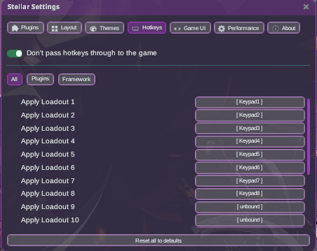

# LoadoutSwitcher

保存したゲーム内ロードアウト（ロールプラン）をホットキーで切り替えます。

## 使い方

1. プラグインをインストールし、**Mod有効**でゲームを起動します。
2. いつも通り、ゲーム内でロードアウト（ロールプラン）を保存します。
3. **Stellar 設定 → ホットキー**を開き、**ロードアウト1を適用**から**ロードアウト10を適用**までにキーを割り当てます（初期状態では未設定です）。ホットキー *n* は、保存したリストの *n* 番目のロードアウトを適用します。

4. ワールドでホットキーを押すと、ゲーム自体のロードアウト切り替えフローを通じてプラグインが切り替えを行います。

## ウィンドウ

ロードアウトスイッチャーのウィンドウを開くと、上部のステータス行（復元のオン/オフと、今装備しているロードアウト）、**要素の復元**スイッチ、ロードアウトの一覧が表示されます。今装備しているロードアウトには点が付きます。各セクションのヘルプは **?** ボタンで確認できます。

## 要素の復元

各ロードアウトに、Deep-Slumberの設定（育成ラインと要素）を記憶させることができます。

1. そのロードアウトを装備し、Deep-Slumberを好みの状態にしてから、その行の**現在をバインド**を押します。行にバインドしたエリア数と要素数が表示されます。
2. **要素の復元**を**オン**にします。これでロードアウトを切り替えると、バインドした要素が復元されます。
3. 今装備しているロードアウトのホットキーを押すと、その要素をもう一度復元します。

- 復元は**シーズン3**でのみ動作します。それ以外のシーズンではオフのままで、ウィンドウにその旨が表示されます。バインドは保持され、ロードアウトの切り替えは引き続き使えます。
- 行の **✕** を押すとバインドを解除します。ロードアウト自体は残ります。

## ロードアウトをコピーする

1. コピーしたいロードアウトを装備します。
2. 上書きしたい行で**ここにコピー**を押します。
3. 行に「*行*を*装備中*で上書きしますか？」（例：「TankをDPSで上書きしますか？」）と表示されます。**上書き**を押すか、そのままにする場合は**キャンセル**を押します。

- 今装備しているもの（装備、モジュール、スキル、天賦、バトルイマジン、Deep-Slumberのバインド）をそのままコピーします。ロードアウトの名前はそのまま維持されます。
- 未保存の変更がある場合や、コピーによってそのロードアウトのクラスが変わる場合は、確定する前にフッターに警告が表示されます。
- ゲームは独自の「Loadout saved successfully!」メッセージで確認します。ゲームが拒否した場合（例：戦闘中など）、何も変更されません。

## ヒント

- ホットキーパネルの上部にある**ホットキーをゲームに渡さない**をオンにしておくと、切り替え中に割り当てたキーがゲーム側のアクションも同時に発動することがなくなります。

## フィードバック

切り替え結果にはゲーム標準の通知バナーが使われます。プランが適用されたときは成功バナー、今は切り替えができないとき（例えば別の切り替えがまだ進行中、またはロードアウトAPIがまだ準備できていない場合）はガード通知が表示されます。
