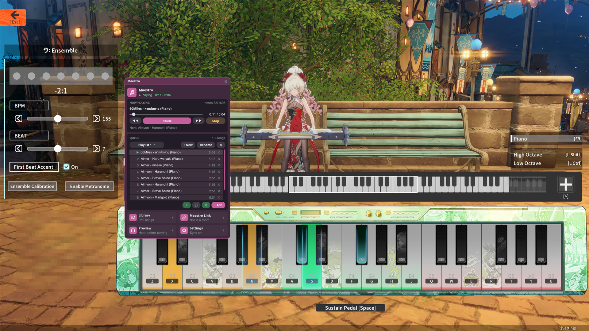
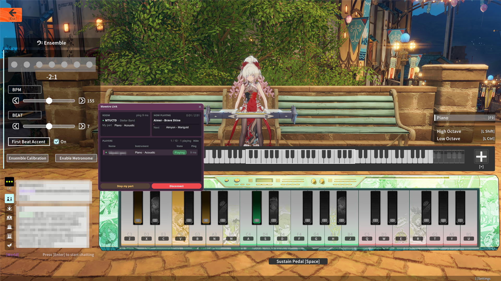
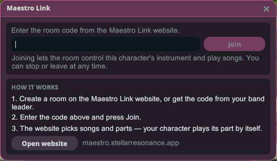
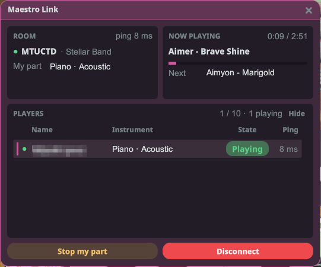
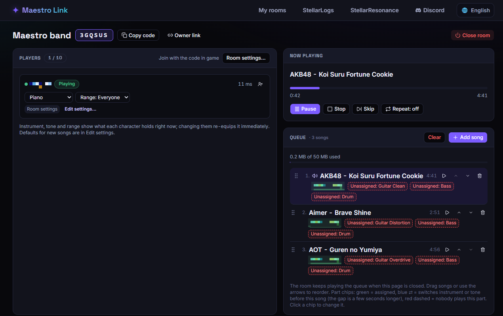
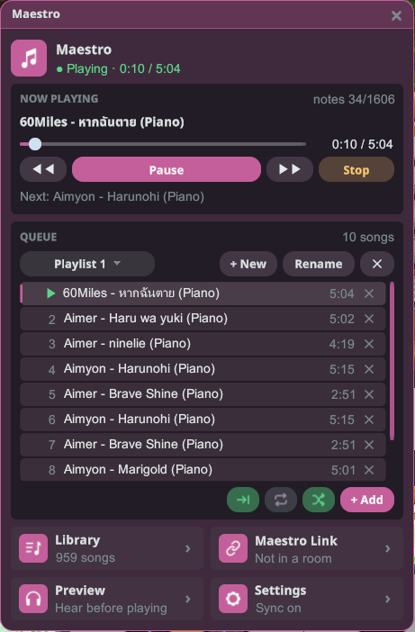
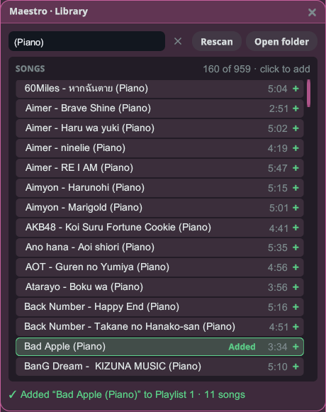
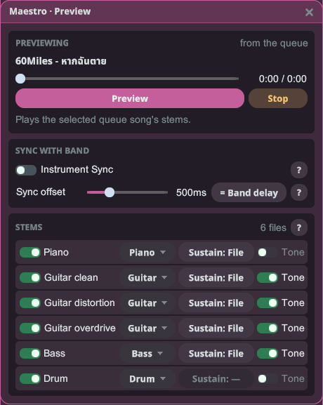
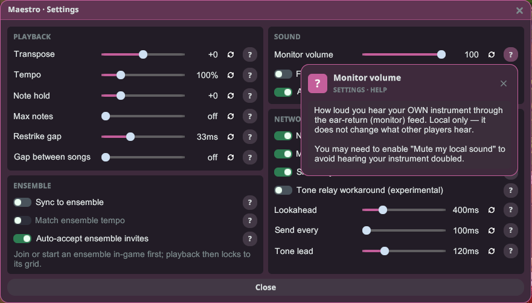
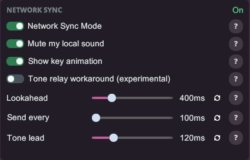

# Maestro

Star Resonance 시즌 3의 밴드(음악가) 악기용 MIDI 자동 연주 플러그인입니다. `.mid` 파일을 폴더에 넣고 곡을
고르면, Maestro가 소환한 악기로 혼자서든 그룹으로든 대신 연주해 줍니다 — 재생목록, 그룹 동기화, 로컬
사운드 미리듣기까지 지원합니다.



## 시작하기

1. 플러그인을 설치하고 게임을 **모드 적용**으로 실행합니다.
2. Stellar 런처(플러그인 그룹)에서 **Maestro**를 엽니다. 밴드 도구는 월드 안에서만 사용할 수 있습니다.
3. `.mid` / `.midi` 파일을 게임의 `midi\` 폴더에 넣습니다 — 이 폴더는 Maestro가 자동으로 만듭니다.
   **라이브러리**에서 **폴더 열기**를 누르면 바로 그 폴더가 열리고, **다시 검색**을 누르면 새로 넣은
   파일을 불러옵니다.
4. 게임 안에서 자유 연주 악기를 소환하고, **+ 추가**로 라이브러리에서 곡을 고른 뒤 **재생**을 누릅니다.

## Maestro Link — 웹사이트에서 밴드로 연주하기

Maestro Link를 쓰면 게임 내 합주 없이도 밴드 전체가 함께 연주할 수 있습니다. 밴드 리더가 웹사이트
[maestro.stellarresonance.app](https://maestro.stellarresonance.app)에서 방을 만들고 곡과 파트 담당을
정하면, 각 플레이어의 캐릭터가 알아서 악기를 장착하고 밴드 전체와 맞춰 자기 파트를 연주합니다.



### 방에 참가하기

1. **6자리 방 코드**를 준비합니다 — 웹사이트에서 방을 만들거나 밴드 리더에게 받으세요.
2. 게임 안에서 **Maestro** → **Maestro Link**를 엽니다.
3. 입력칸에 코드를 입력하고 **참가**를 누릅니다.
4. 끝입니다 — 방에서 곡이 재생되면 캐릭터가 자동으로 자기 파트를 연주합니다.

**사용 방법** 패널에 이 순서가 정리되어 있고, **웹사이트 열기**를 누르면 Maestro Link 사이트가 열립니다.



### 방에 있는 동안



- **방**에는 방 코드와 방 이름, 핑, 내가 맡은 파트가 표시됩니다.
- **재생 중**에는 현재 곡과 진행 상황, **다음 곡**이 표시됩니다.
- **플레이어**에는 방에 있는 모든 사람의 이름, 악기, 상태, 핑이 나옵니다. 상태는 **연주 중**, **준비됨**,
  **대기**, **문제** 중 하나입니다. *문제*는 지금 연주 중인 파트가 연주되지 못할 때만 표시됩니다 — 아직
  악기가 없는 것은 괜찮습니다. 다음 곡에서 Link가 알아서 장착해 줍니다. **숨기기**로 목록을 접을 수
  있습니다.
- **내 파트 멈추기**(주황색)를 누르면 밴드는 계속 연주하고 내 파트만 쉽니다. 버튼은 **내 파트 다시
  시작**으로 바뀝니다.
- **연결 끊기**(빨간색)로 방에서 나갑니다. 로그아웃하면 자동으로 연결이 끊깁니다.

### 웹사이트

밴드 진행은 웹사이트의 방 페이지에서 합니다. 참가한 플레이어 목록, **Now playing**(일시정지·정지·
건너뛰기·반복), 그리고 파트별 담당자를 고르는 곡 대기열이 있습니다. 한 파트를 여러 플레이어에게 맡길
수도 있고, 한 플레이어가 같은 악기의 여러 파트를 맡을 수도 있습니다. **Room settings**(방 설정)는 모든
플레이어에게 한 번에 적용되며, 플레이어마다 따로 조정할 수도 있습니다.



## 곡 재생하기

메인 창이 플레이어 본체입니다. 위쪽 **재생 중**에는 현재 곡과 진행 상황이 표시되고, ◀◀ / **재생**
(**일시정지**) / ▶▶ / **중지** 버튼과 다음에 나올 곡을 알려 주는 **다음:** 줄이 있습니다.



**대기열**

- 드롭다운에서 재생목록을 고르고, **+ 새로**, **이름 변경**, **✕**(재생목록 삭제)로 관리합니다.
- **곡을 드래그**해서 순서를 바꾸고, 각 줄의 **✕**로 곡을 뺄 수 있습니다.
- 다른 재생목록으로 바꿔도 재생 중인 곡은 멈추지 않습니다 — 다른 재생목록에서 곡을 고르고 **재생**을
  누를 때까지 계속 재생됩니다.
- 대기열 아래의 아이콘으로 **자동 다음 곡**, **반복**(꺼짐 / 전체 곡 / 한 곡), **셔플**을 켜고 끕니다.
  아이콘에 마우스를 올리면 이름과 설정이 **대기열** 제목에 표시됩니다.
- **셔플**은 재생목록의 모든 곡을 무작위 순서로 한 번씩 재생합니다. 반복이 꺼져 있으면 마지막 곡 후에
  멈추고, 전체 반복이면 한 바퀴마다 순서를 새로 섞습니다. **다음:** 줄에는 실제로 다음에 나올 곡이 항상
  표시됩니다.
- **+ 추가**를 누르면 라이브러리가 열립니다.

아래쪽 네 개의 카드로 **라이브러리**, **Maestro Link**, **미리 듣기**, **설정** 창을 엽니다. 각 카드에는
곡 수나 방 참가 여부 같은 간단한 상태도 표시됩니다.

## 곡 찾기



- 이름으로 **검색**하고(✕로 검색어 지우기), **다시 검색**으로 새 파일을 불러오고, **폴더 열기**로 MIDI
  폴더를 엽니다.
- **곡을 클릭**하면 현재 재생목록에 추가됩니다. 그 줄이 초록색으로 깜빡이며 **추가됨**이 표시되고,
  아래 줄에서도 *✓ “Bad Apple (Piano)”을(를) Playlist 1에 추가 · 11곡*처럼 확인할 수 있습니다.
- 재생은 한 번에 하나의 악기만 연주하므로, 연주하고 싶은 스템만 추가하면 됩니다.

## 재생 전 미리듣기

악기를 소환하지 않고도 **실제 게임 내 악기 소리**로 곡을 미리 들어볼 수 있습니다 — 미리듣기는 본인에게만
재생되므로 주변 사람에게는 들리지 않습니다.



- **미리 듣기** 영역에는 대기열에서 고른 곡과 진행 상황, **미리듣기**와 **중지** 버튼이 있습니다.
- **밴드와 동기화**: **악기 동기화**는 내 밴드 연주가 시작되기를 기다렸다가 함께 따라 재생합니다 — 직접
  연주할 파트는 음소거하세요. **동기화 오프셋**은 미리듣기를 늦춰서 밴드 소리와 맞춥니다. **= 밴드
  지연**을 누르면 알아서 맞춰 줍니다.
- **스템**에는 파일마다 한 줄씩 있고, 음소거 스위치, 악기, **서스테인** 모드, **톤** 스위치가 있어 곡이
  실제로 어떻게 들릴지 정확히 확인할 수 있습니다.

미리듣기에서는 멀티 스템 이름 규칙이 중요합니다: 한 곡의 각 파트에 같은 기본 이름을 붙이고 끝에 괄호로
악기 이름을 적으면, 그중 하나를 선택했을 때 미리듣기가 **전체 세트**를 불러옵니다.

```
Song (Piano).mid   Song (Guitar).mid   Song (Bass).mid   Song (Bass 2).mid   Song (Drum).mid
```

`(Bass 2)`처럼 중복된 이름은 같은 악기 음색의 별도 트랙이 됩니다.

## 곡별 설정 & 합주

세밀한 조정과 그룹 옵션은 모두 **설정** 카드에서 여는, 두 열로 된 하나의 창에 모여 있습니다. 모든 설정에는
동그란 **?** 버튼이 있어 누르면 짧은 설명이 열립니다 — 다시 누르거나 ✕를 누르면 닫힙니다. 슬라이더마다
기본값으로 되돌리는 **↺** 버튼도 있습니다.



- **재생**: 조옮김, 템포, 음표 유지, 최대 음표 수(동시에 낼 수 있는 음 수), 재타격 간격(기본값 33 ms —
  빠른 연타 음표도 빠지지 않음), 곡 사이 간격.
- **합주**: **합주에 동기화**는 그룹의 공통 박자(다운비트까지 카운트인)에 재생을 고정하고, **합주 템포에
  맞추기**는 합주의 BPM을 따르며, **합주 초대 자동 수락**은 수락을 대신 눌러 줍니다. 먼저 게임 안에서
  합주에 참가하거나 시작하세요.
- **사운드**: 모니터 볼륨, 서스테인 강제 적용, MIDI 악기 음색 적용.
- **네트워크 동기화**: **네트워크 동기화 모드**는 음표를 미리 전송하므로, 음표가 밀집해 있어도 주변
  청취자에게 더 안정적인 연주가 전달됩니다. 이 모드를 켜야 **내 로컬 소리 음소거**와 **키 애니메이션
  표시**도 쓸 수 있습니다. **선행 전송**, **전송 간격**, **톤 선행**으로 세밀하게 조정하세요. **음색
  릴레이 우회 (실험적)**는 아래 *알려진 제한 사항*에서 설명합니다.



## 합주로 연주하기

합주 모드는 파티 전체의 연주를 같은 박자에 고정해, 여러 플레이어가 같은 곡의 서로 다른 파트를 동기화된
상태로 함께 연주할 수 있게 합니다. 모두 **같은 파티**에 있어야 합니다.

1. **합주 동기화를 켭니다.** **설정**에서 모든 플레이어가 **합주에 동기화**를 켭니다. **합주 초대
   자동 수락**도 함께 켜두면 매번 수동으로 초대를 수락하지 않아도 됩니다.
2. **각 플레이어가 자신의 파트를 고르고 재생을 누릅니다.** 연주할 스템을 선택하고 재생을 누르면 — 바로
   시작하는 대신 Maestro가 대기하며 **"합주 시작을 기다리는 중…"**을 표시합니다.
3. **파티장이 게임 안에서 합주를 시작합니다.** 이것은 게임 자체의 합주 시작 기능입니다.
4. **모두가 동기화되어 연주합니다.** 대기하고 있던 모든 플레이어가 합주의 박자에 맞춰 다운비트에서
   함께 연주를 시작합니다.

풀 밴드 편성을 하려면, 각 플레이어가 같은 곡의 **서로 다른** 파트(기타, 베이스, 드럼, 피아노)를
대기열에 넣고, 원한다면 **합주 템포에 맞추기**를 켜서 재생이 합주의 BPM을 따르게 하세요. 미리
**미리 듣기**로 전체 세트가 어떻게 어우러지는지 들어보는 것도 좋습니다.

## MIDI 파일 준비하기

Maestro는 MIDI에 적힌 그대로 연주하므로, 약간의 준비만으로도 게임 내 악기에서 곡이 제대로 들리게 할
수 있습니다.

### 효과 (톤 & 주법)

설정에서 **MIDI 악기 음색 적용**을 켜면, Maestro는 **해당 스템 트랙에 지정된 악기(프로그램)**
에서 기타/베이스 효과를 결정합니다. DAW에서 해당 트랙의 General MIDI 악기를 설정하세요:

**기타 스템**

| 이 GM 악기를 지정하면 | 프로그램 번호 | 재생 효과 |
|---|:--:|---|
| Nylon / Steel / Jazz / Clean Electric Guitar | 25–28 | Clean |
| Muted Guitar | 29 | Muffled (palm-mute) |
| Overdriven Guitar | 30 | Overdrive |
| Distortion Guitar | 31 | Distortion |
| Guitar Harmonics | 32 | Harmonics |

**베이스 스템**

| 이 GM 악기를 지정하면 | 프로그램 번호 | 재생 효과 |
|---|:--:|---|
| Acoustic / Finger / Pick / Fretless Bass | 33–36 | Clean |
| Slap Bass 1 / 2 | 37 / 38 | Slap |
| Synth Bass 1 / 2 | 39 / 40 | Overdrive |

- 프로그램 번호는 DAW가 보여주는 **1~128** 값입니다. 확실하지 않다면 **악기 이름**으로 맞춰 보세요.
- 스템의 **메인 악기**만 읽으므로, 스템마다 악기를 하나로 유지하세요. 트랙 도중의 프로그램 체인지는
  그 지점부터 효과를 전환합니다.
- 효과는 **기타와 베이스에만** 적용되며 — 피아노와 드럼에는 적용되지 않습니다.
- 효과는 실제로 소환한 악기에 맞춰 제한됩니다. **베이스에는 디스토션이 없어** Overdrive로 대신
  재생되며, 소환한 악기가 지원하지 않는 주법은 일반 연주로 대체됩니다.
- **Overdrive / Distortion은 네트워크 동기화에서 본인에게만 들립니다** (아래 *알려진 제한 사항* 참고).
  Muffled, Harmonics, Slap은 모두에게 들립니다.

### 드럼

게임의 드럼 세트는 아래 키에 고정된 **9피스 키트**이며, Maestro는 적힌 음표를 그대로 연주합니다 —
General MIDI 드럼을 자동으로 변환하지 **않으므로**, 드럼 스템은 반드시 다음 키를 사용해야 합니다:

| MIDI 음표 | 파트 |
|:--:|---|
| 62 (D4) | 클로즈 하이햇 |
| 65 (F4) | 킥 |
| 69 (A4) | 플로어 탐 |
| 72 (C5) | 스네어 |
| 74 (D5) | 미드 탐 |
| 76 (E5) | 하이 탐 |
| 77 (F5) | 라이드 |
| 79 (G5) | 오픈 하이햇 |
| 81 (A5) | 크래시 |

이 키를 벗어난 음표는 소리가 나지 않습니다. 표준 General MIDI 드럼 트랙에서 시작한다면, 일반적인 GM
음표를 이 키로 다시 매핑하세요 — 킥(GM 35/36) → **F4**, 스네어(38/40) → **C5**, 클로즈 하이햇(42) →
**D4**, 오픈 하이햇(46) → **G5**, 라이드(51) → **F5**, 크래시(49) → **A5**, 탐 → **A4 / D5 / E5**.

### 추가 팁

- **음 높이당 하나의 음표:** 각 악기는 음 높이마다 하나의 성부만 낼 수 있으므로, 겹치는 동일한 두
  음표는 하나로 처리됩니다 — 유니즌이 겹치지 않도록 하세요.
- **음역대에 주의:** 악기가 연주할 수 있는 음역대를 벗어난 음표는 소리가 나지 않습니다. 파트를
  음역대 안으로 옮기려면 **조옮김**(설정)을 사용하세요.
- **음량은 재현되지 않습니다:** 모든 음표는 고정된 크기로 재생되므로, 벨로시티와 다이내믹은 반영되지
  않습니다.
- MIDI **타입 0 또는 1** 파일을 지원합니다.

## 알려진 제한 사항

**Overdrive / Distortion은 다른 플레이어에게 전달되지 않습니다 — 이는 게임 자체의 버그이며 Maestro가
고칠 수 있는 부분이 아닙니다.** 게임은 기타/베이스의 overdrive/distortion *톤*을 본인 클라이언트에서만
렌더링하며, 주변 사람에게는 전혀 전송하지 않습니다. 그래서 **네트워크 동기화가 켜져 있을 때**는 다른
모든 사람에게 Clean으로 들리고, 네트워크 동기화가 **꺼져 있어도** 디스토션은 *본인에게만* 들립니다 —
어느 모드에서도 다른 플레이어는 본인의 overdrive/distortion을 들을 수 없습니다. 설정의 **음색 릴레이 우회 (실험적)**를 켜면 톤을 다른 경로로 보내지만, 그 톤은 Stellar를 쓰는 청취자에게만 들리고 나머지
플레이어에게는 게임이 고칠 때까지 Clean으로 들립니다. *주법*(Muffled, Harmonics, Slap)은 영향을 받지
않으며 모두에게 들립니다. 디스토션이 중요한 곡이라면, 네트워크 동기화를 **꺼서** 적어도 본인에게는
제대로 들리도록 하세요.
