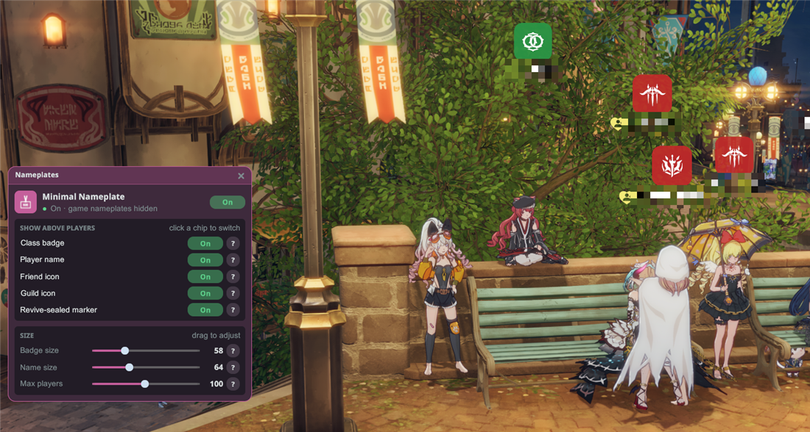

# ミニマルネームプレート

ゲームの頭上ネームプレートを、すっきりとしたロールカラーのクラスバッジと任意のプレイヤー名に置き換えます — ゲーム自身のHUD描画パスに直接描かれるため、くっきりと表示され、ワールドの地形の裏にも正しく隠れます。

## 使い方

1. プラグインをインストールし、**Mod有効**でゲームを起動します。
2. Stellarオーバーレイから**ネームプレート**ウィンドウを開き、ヘッダーのチップを**オン**にします。ヘッダーに**オン · ゲームのネームプレートを非表示**と表示されます。**オフ**にするとゲーム自身のネームプレートに戻ります（**オフ · ゲームのネームプレートを使用中**）。
3. **プレイヤーの上に表示**では、チップをクリックして各項目を**オン**／**オフ**に切り替えます。
   - **クラスバッジ** — 各プレイヤーの上に表示されるロールカラーのバッジ。
   - **プレイヤー名** — バッジの下に表示されるプレイヤー名（パーティーメンバーは水色）。
   - **フレンドアイコン** / **ギルドアイコン** — フレンドには小さなハート、ギルドメンバーには小さな盾を表示します。
   - **復活封印マーカー** — 下の「復活封印マーカー」を参照してください。
4. **サイズ**では、ドラッグで調整します。
   - **バッジサイズ** / **名前サイズ** — それぞれ独立してスケール調整できます。
   - **最大表示人数** — 近くのプレイヤーのうち、何人までネームプレートを表示するか。人の多い場所でFPSが下がる場合は小さくしてください。

各設定の横にある**?**ボタンを押すと、その設定の説明が表示されます。

## バッジの色

- **赤**・**緑**・**青** — プレイヤーのロール。
- **オレンジ** — ロールカラーのないクラス（以前は灰色で表示されていました）。
- **灰色** — プレイヤーが倒れています。倒れているプレイヤーは名前も赤色になります。

## 復活封印マーカー

ロールスキル**「Renewal Prayer」**やイマジン**「Arcane! Prayer of Life」**で蘇生されたプレイヤーには**「Weakened: Wish Sealed」**が付き、約60秒間（ナイトメアのパーティーダンジョンではさらに長く）その方法で再び蘇生できません。

その間に倒れると、バッジが紫色になり、名前も紫色で残り秒数付き（例：**プレイヤー (42s)**）で表示されます — ヒーラーは蘇生を無駄にせずに済みます。**復活封印マーカー**のチップでオフにできます。

## 動作

プレートはゲーム自身のネームプレート表示ルールに従います — グローバルHUDスイッチ（HideUI、カットシーン、フォトモード、メニュー）、タイプ別の頭上情報設定、エンティティごとの非表示設定がすべて適用されるため、ゲーム自体がプレートを表示しない場所では何も表示されません。

自分の頭上をすっきりさせておきたい場合は、自分のキャラクターに対するゲーム自身の頭上情報設定をオフにしてください — プレートはその設定に従います。
