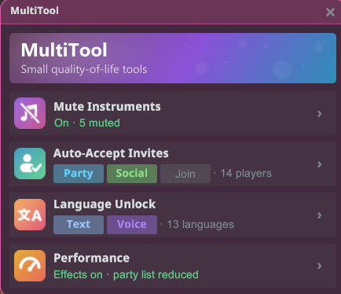
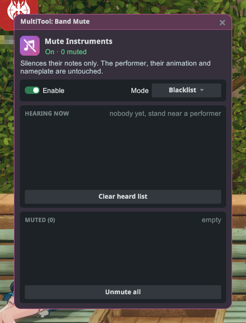
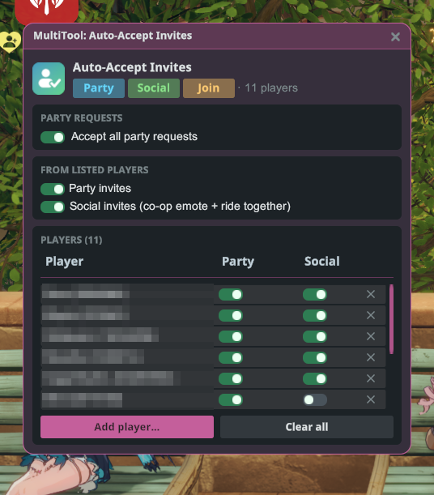
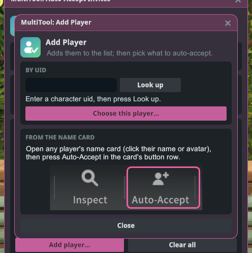
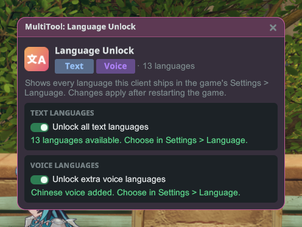
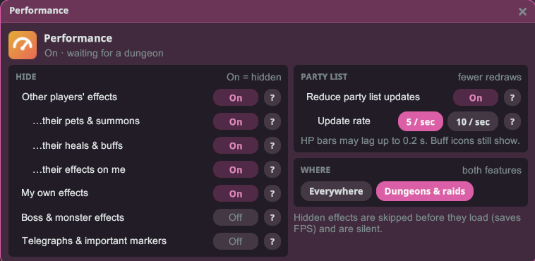

# MultiTool

Ilang maliliit na tool para gumaan ang laro, sa iisang window: i-mute ang mga instrumento ng ibang player,
awtomatikong tanggapin ang mga imbitasyon mula sa mga taong pinili mo, at i-unlock ang lahat ng wikang kasama sa game
client na ito.

## Pagsisimula

1. I-install ang plugin at i-launch ang laro nang **May mod**.
2. Mag-log in sa isang character, buksan ang Stellar menu at i-click ang **MultiTool**.
3. I-click ang card ng tool para buksan ito. Ipinapakita ng bawat card kung ano ang ginagawa ng tool na iyon ngayon.

## Mute Instruments (I-mute ang mga instrumento)

Patahimikin ang instrumento ng ibang player na tumutugtog sa malapit. Ang mga nota lang ang nawawala: ang tumutugtog,
ang animation niya at ang nameplate niya ay nananatiling gaya ng dati.

- **Enable** (I-on): ino-on o ino-off ang pag-mute.
- **Mode**: pinipili kung paano gagana ang listahan:
  - **Blacklist**: naka-mute ang mga player sa listahan mo, normal na tumutugtog ang iba.
  - **Whitelist**: naka-mute ang lahat maliban sa mga player sa listahan mo.
- **Hearing now** (Naririnig ngayon): nakalista ang lahat ng naririnig mong tumutugtog ngayon. I-click ang pangalan
  para idagdag ito sa listahan mo.
- **Muted** (Naka-mute) / **Allowed** (Pinapayagan): ang naka-save mong listahan. I-click ang pangalan para alisin
  ulit ito. Binubura ng **Unmute all** (I-unmute lahat) o **Clear allow-list** (Burahin ang allow-list) ang laman nito.

Nananatili ang listahan mo kahit isara mo ang laro, kaya ang player na na-mute mo ay naka-mute pa rin sa susunod na
tumugtog siya malapit sa iyo.

## Auto-Accept Invites (Awtomatikong pagtanggap ng imbitasyon)

Awtomatikong tanggapin ang mga imbitasyon, pero mula lang sa mga player na nasa listahan mo.

- **Accept all party requests** (Tanggapin lahat ng party request): inaaprubahan ang bawat request na sumali sa
  party mo, mula kahit kanino.
- **Party invites** (Mga imbitasyon sa party): tinatanggap ang mga imbitasyon sa party mula sa mga player sa listahan.
- **Social invites** (Mga social na imbitasyon): tinatanggap ang mga imbitasyon sa co-op emote at sa pagsakay nang
  magkasama mula sa mga player sa listahan.
- May sariling **Party** at **Social** na switch ang bawat player sa listahan. Alisin ang isang player gamit ang **✕**
  sa row niya, o burahin ang buong listahan gamit ang **Clear all** (Burahin lahat).

### Pagdagdag ng player

- **From the name card** (Mula sa name card): buksan ang name card ng kahit sinong player (i-click ang pangalan o
  avatar niya) at pindutin ang **Auto-Accept** sa hanay ng mga button ng card. Madadagdag siya sa listahan mo at
  magbubukas ang isang maliit na window kung saan pipiliin mo kung ano ang tatanggapin mula sa kanya.
- **By UID** (Gamit ang UID): i-click ang **Add player…** (Magdagdag ng player), i-type ang UID niya, pindutin ang
  **Look up** (Hanapin), tapos ang **Choose this player…** (Piliin ang player na ito).

## Language Unlock (Pag-unlock ng wika)

Ipakita ang lahat ng wika ng text at boses na laman ng game client na ito sa **Mga Setting › Wika** ng laro, hindi
lang ang mga inaalok sa rehiyon mo.

- **Unlock all text languages** (I-unlock lahat ng wika ng text): idinadagdag ang bawat wika ng text sa listahan ng
  wika ng laro.
- **Unlock extra voice languages** (I-unlock ang dagdag na wika ng boses): idinadagdag ang mga wika ng boses na nasa
  client mo.
- Magkakabisa ang mga pagbabago pagkatapos mong i-restart ang laro. Saka mo piliin ang wika sa sariling setting ng
  laro.

## Performance

Mas maayos na laban sa mga siksikang dungeon at raid. Itago ang mga skill effect ng ibang player, at hindi gaanong madalas i-redraw ang party list.

**Hide (Itago)** (kapag On ang switch, nakatago ang ganoong uri ng effect):

- **Other players' effects (Effects ng ibang player)**: itinatago ang mga skill effect na ginamit ng ibang player. Batay ito sa kung sino ang gumamit ng skill, kaya nakikita pa rin ang atake ng boss na tumama sa ibang player. May tatlong row sa ilalim para i-fine-tune:
  - **…their pets & summons (Mga pet at summon nila)**: itago rin ang mga pet, summon at mga projectile na pinapakawalan nila.
  - **…their heals & buffs (Mga heal at buff nila)**: itago rin ang mga healing circle at support zone. Iwanang Off para makita mo pa rin kung saan tatayo.
  - **…their effects on me (Mga effect nila sa akin)**: itago rin ang heal, shield at iba pang effect na inilagay nila sa iyo.
- **My own effects (Sarili kong effects)**: itinatago ang visuals ng sarili mong mga skill.
- **Boss & monster effects (Effects ng boss at monster)**: itinatago ang visuals ng sariling skill ng boss at mga monster.
- **Telegraphs & important markers (Mga babala at mahalagang marker)**: mga babala ng atake ng boss, danger zone at aiming circle.
  ⚠️ Kapag in-On ito, maitatago ang mga babala ng boss at puwedeng hindi na malaro ang raid. Iwanang Off.

Laging nakikita ang mga marka sa sahig ng raid at dungeon. Wala ring tunog ang mga nakatagong effect.

**Party list**: ang **Reduce party list updates (Bawasan ang update ng party list)** ay nire-redraw ang HP bar at buff icon ng party list nang hanggang **10** o **5** beses lang bawat segundo. Pinakamalaki ang tulong nito sa raid. Puwedeng ma-late ang HP bar nang hanggang 0.1 s (o 0.2 s sa 5 / sec), at lumalabas pa rin ang mga buff icon.

Pinipili ng **Where (Saan)** kung gagana ang dalawang feature **Everywhere (Kahit saan)** o sa **Dungeons & raids (Dungeon at raid lang, default)**. Lahat ay nagsisimulang Off, kaya i-On ang gusto mo.

## Mga tala

- Bumubukas lang ang MultiTool habang nasa mundo ka ng laro, at nagsasara ang mga window nito kapag nag-log out ka.
- Ang naririnig mo lang ang naaapektuhan ng pag-mute. Normal pa ring naririnig ng ibang player ang isa't isa.
