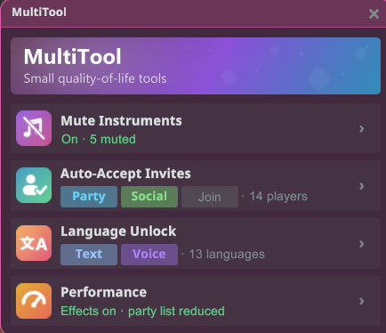
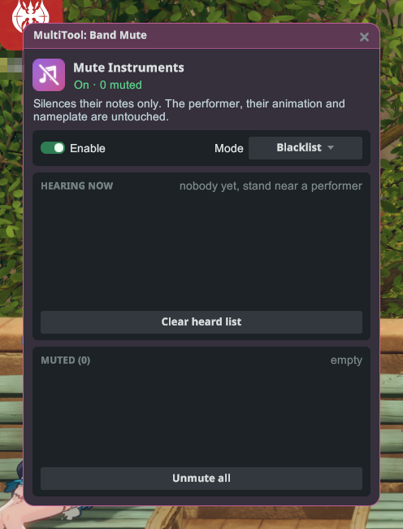
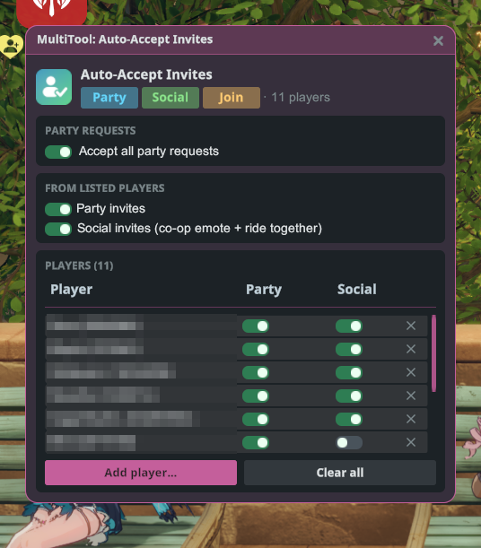
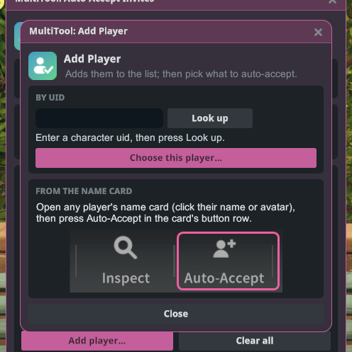
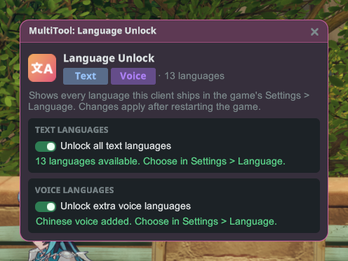
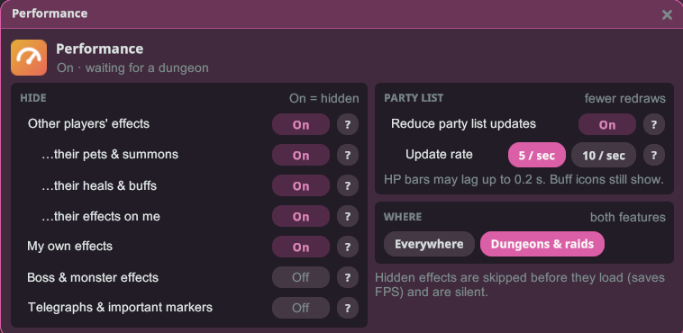

# MultiTool

Beberapa alat kecil yang bikin main lebih nyaman, dalam satu jendela: bisukan instrumen pemain lain, terima undangan
secara otomatis dari orang yang kamu pilih, dan buka semua bahasa yang ada di klien game ini.

## Memulai

1. Pasang plugin-nya lalu jalankan game dalam mode **Dengan mod**.
2. Masuk ke karakter, buka menu Stellar, lalu klik **MultiTool**.
3. Klik kartu alat untuk membukanya. Tiap kartu menunjukkan apa yang sedang dilakukan alat itu saat ini.

## Mute Instruments (Bisukan instrumen)

Senyapkan instrumen pemain lain yang sedang tampil di dekatmu. Hanya nadanya yang hilang: pemainnya, animasinya, dan
papan namanya tetap seperti biasa.

- **Enable** (Aktifkan) menyalakan atau mematikan pembisuan.
- **Mode** memilih cara kerja daftarmu:
  - **Blacklist** (Daftar hitam): pemain di daftarmu dibisukan, yang lain bermain seperti biasa.
  - **Whitelist** (Daftar putih): semua orang dibisukan kecuali pemain di daftarmu.
- **Hearing now** (Terdengar sekarang) menampilkan semua orang yang sedang kamu dengar bermain. Klik nama untuk
  menambahkannya ke daftarmu.
- **Muted** (Dibisukan) / **Allowed** (Diizinkan) adalah daftar tersimpanmu. Klik nama untuk menghapusnya lagi.
  **Unmute all** (Bunyikan semua) atau **Clear allow-list** (Kosongkan daftar izin) mengosongkan daftar.

Daftarmu tetap tersimpan meski game ditutup, jadi pemain yang kamu bisukan tetap terbisukan saat mereka bermain di
dekatmu lagi.

## Auto-Accept Invites (Terima undangan otomatis)

Terima undangan secara otomatis, tapi hanya dari pemain yang ada di daftarmu.

- **Accept all party requests** (Terima semua permintaan party): menyetujui setiap permintaan bergabung ke party-mu,
  dari siapa pun.
- **Party invites** (Undangan party): terima undangan party dari pemain di daftar.
- **Social invites** (Undangan sosial): terima ajakan emote bersama dan ajakan naik tunggangan bersama dari pemain di
  daftar.
- Tiap pemain di daftar punya sakelar **Party** dan **Social** (Sosial) sendiri. Hapus pemain dengan **✕** di
  barisnya, atau kosongkan daftar dengan **Clear all** (Hapus semua).

### Menambahkan pemain

- **From the name card** (Dari kartu nama): buka kartu nama pemain mana pun (klik nama atau avatarnya) lalu tekan
  **Auto-Accept** di deretan tombol kartu itu. Pemain itu masuk ke daftarmu, dan jendela kecil terbuka untuk memilih
  apa saja yang diterima darinya.
- **By UID** (Lewat UID): klik **Add player…** (Tambah pemain), ketik UID-nya, tekan **Look up** (Cari), lalu
  **Choose this player…** (Pilih pemain ini).

## Language Unlock (Buka bahasa)

Tampilkan semua bahasa teks dan suara yang ada di klien game ini di **Pengaturan › Bahasa** milik game, bukan hanya
yang tersedia di wilayahmu.

- **Unlock all text languages** (Buka semua bahasa teks) menambahkan semua bahasa teks ke daftar bahasa game.
- **Unlock extra voice languages** (Buka bahasa suara tambahan) menambahkan bahasa suara yang ada di klienmu.
- Perubahan berlaku setelah game dimulai ulang. Setelah itu, pilih bahasanya di pengaturan game itu sendiri.

## Performance (Performa)

Pertarungan lebih mulus di dungeon dan raid yang ramai. Sembunyikan efek skill pemain lain, dan gambar ulang daftar party lebih jarang.

**Hide (Sembunyikan)** (sakelar yang On menyembunyikan jenis efek itu):

- **Other players' effects (Efek pemain lain)**: menyembunyikan efek skill yang dipakai pemain lain. Ini dilihat dari siapa yang memakai skill, jadi serangan bos yang mengenai pemain lain tetap terlihat. Tiga baris di bawahnya untuk penyesuaian:
  - **…their pets & summons (Pet dan panggilan)**: ikut sembunyikan pet, panggilan, dan proyektil yang mereka tembakkan.
  - **…their heals & buffs (Heal dan buff)**: ikut sembunyikan lingkaran heal dan area dukungan. Biarkan Off agar tetap tahu di mana harus berdiri.
  - **…their effects on me (Efek mereka padaku)**: ikut sembunyikan heal, perisai, dan efek lain yang mereka berikan padamu.
- **My own effects (Efekku sendiri)**: menyembunyikan visual skill milikmu.
- **Boss & monster effects (Efek bos dan monster)**: menyembunyikan visual skill bos dan monster itu sendiri.
- **Telegraphs & important markers (Peringatan dan penanda penting)**: peringatan serangan bos, zona bahaya, dan lingkaran bidik.
  ⚠️ Menyalakan ini menyembunyikan peringatan bos, sehingga raid bisa jadi tidak bisa dimainkan. Biarkan Off.

Penanda lantai raid dan dungeon selalu terlihat. Efek yang disembunyikan juga tanpa suara.

**Party list (Daftar party)**: **Reduce party list updates (Kurangi pembaruan daftar party)** menggambar ulang bar HP dan ikon buff di daftar party paling banyak **10** atau **5** kali per detik. Paling terasa di raid. Bar HP bisa telat sampai 0,1 detik (atau 0,2 detik di 5 / sec), dan ikon buff tetap tampil.

**Where (Di mana)** memilih apakah kedua fitur bekerja **Everywhere (Di mana saja)** atau hanya di **Dungeons & raids (Dungeon dan raid, bawaan)**. Semuanya mulai dalam keadaan Off, jadi nyalakan yang kamu mau.

## Catatan

- MultiTool hanya bisa dibuka saat kamu berada di dunia game, dan jendelanya tertutup saat kamu logout.
- Pembisuan hanya memengaruhi apa yang kamu dengar. Pemain lain tetap saling mendengar seperti biasa.
