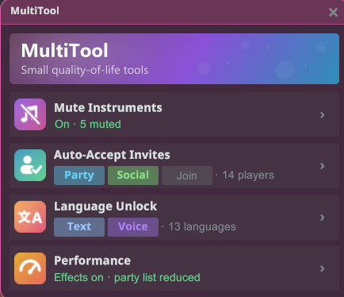
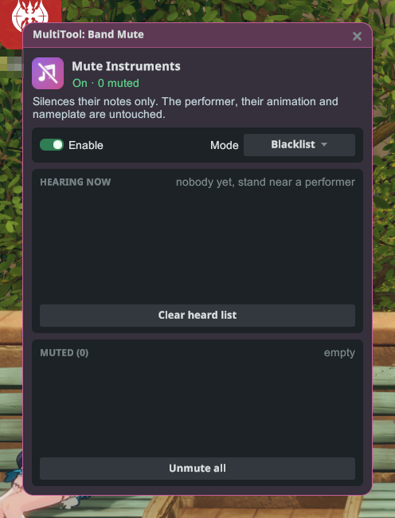
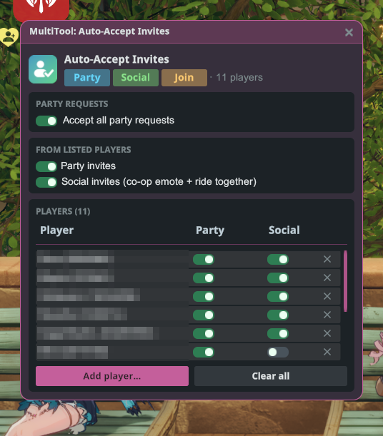
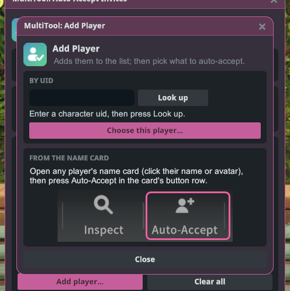
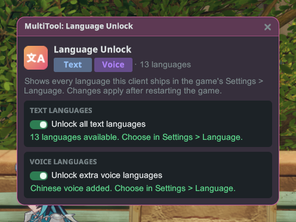
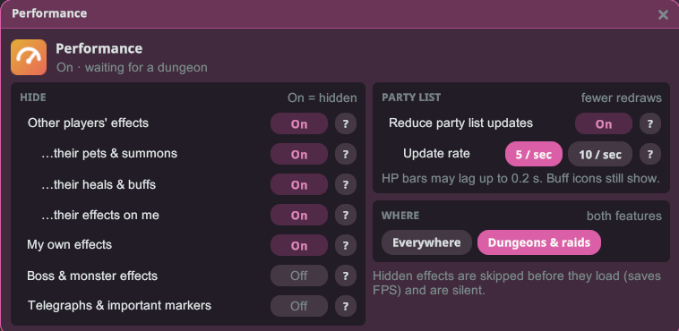

# MultiTool

ちょっと便利な小さなツールを、1つのウィンドウにまとめました。他のプレイヤーの楽器をミュートしたり、選んだ相手からの招待を自動で承認したり、このゲームクライアントに入っているすべての言語を解放したりできます。

## はじめに

1. プラグインをインストールし、ゲームを**Mod有効**で起動します。
2. キャラクターでログインし、Stellarメニューを開いて**MultiTool**をクリックします。
3. ツールのカードをクリックすると開きます。各カードには、そのツールが今どう動いているかが表示されます。

## Mute Instruments（楽器ミュート）

近くで演奏している他のプレイヤーの楽器の音を消します。消えるのは音だけで、演奏者本人やモーション、ネームプレートはそのまま表示されます。

- **Enable**（有効化）でミュートのオン・オフを切り替えます。
- **Mode**（モード）でリストの使い方を選びます。
  - **Blacklist**（ブラックリスト）：リストにいるプレイヤーをミュートし、それ以外の人はいつもどおり聞こえます。
  - **Whitelist**（ホワイトリスト）：リストにいるプレイヤー以外を全員ミュートします。
- **Hearing now**（今聞こえている演奏）には、今演奏が聞こえているプレイヤーが全員表示されます。名前をクリックするとリストに追加されます。
- **Muted**（ミュート中）／**Allowed**（許可）は保存されたリストです。名前をクリックするとリストから外れます。
  **Unmute all**（すべてミュート解除）または **Clear allow-list**（許可リストを消去）を押すと、リストが空になります。

リストは次回以降も保存されるので、ミュートしたプレイヤーは次に近くで演奏したときもミュートされたままです。

## Auto-Accept Invites（招待の自動承認）

招待を自動で承認します。ただし、リストに登録したプレイヤーからの招待だけです。

- **Accept all party requests**（すべてのパーティ申請を承認）：誰からでも、パーティへの参加申請をすべて承認します。
- **Party invites**（パーティ招待）：リストのプレイヤーからのパーティ招待を承認します。
- **Social invites**（ソーシャル招待）：リストのプレイヤーからの、2人で行うエモートや相乗りの誘いを承認します。
- リストの各プレイヤーには、それぞれ **Party**（パーティ）と **Social**（ソーシャル）のスイッチがあります。プレイヤーを外すにはその行の **✕** を、リストを空にするには **Clear all**（すべて消去）を押します。

### プレイヤーを追加する

- **From the name card**（名刺から）：プレイヤーの名刺を開き（名前かアバターをクリック）、名刺のボタン列にある **Auto-Accept** を押します。リストに追加され、その相手から何を承認するかを選ぶ小さなウィンドウが開きます。
- **By UID**（UIDで）：**Add player…**（プレイヤーを追加）をクリックし、相手のUIDを入力して **Look up**（検索）を押し、続けて **Choose this player…**（このプレイヤーを選択）を押します。

## Language Unlock（言語の解放）

お住まいの地域で提供されている言語だけでなく、このゲームクライアントに入っているすべてのテキスト言語と音声言語を、ゲームの**設定 › 言語**に表示します。

- **Unlock all text languages**（すべてのテキスト言語を解放）：すべてのテキスト言語をゲームの言語リストに追加します。
- **Unlock extra voice languages**（追加の音声言語を解放）：クライアントに入っている音声言語を追加します。
- 変更はゲームを再起動すると反映されます。その後、ゲーム本体の設定で言語を選んでください。

## Performance（パフォーマンス）

混雑したダンジョンやレイドでの戦闘を軽くします。他のプレイヤーのスキルエフェクトを隠したり、パーティリストの更新回数を減らしたりできます。

**Hide（非表示）**（スイッチをOnにすると、その種類のエフェクトが隠れます）：

- **Other players' effects（他のプレイヤーのエフェクト）**：他のプレイヤーが使ったスキルエフェクトを隠します。誰がスキルを使ったかで判断するので、他のプレイヤーに当たったボスの攻撃は表示されたままです。下の3つの項目で細かく調整できます：
  - **…their pets & summons（ペットと召喚物）**：ペット、召喚物、それらが撃つ弾も隠します。
  - **…their heals & buffs（回復とバフ）**：回復サークルや支援エリアも隠します。立ち位置を見失わないよう、Offのままがおすすめです。
  - **…their effects on me（自分にかかるエフェクト）**：あなたにかけられた回復やシールドなども隠します。
- **My own effects（自分のエフェクト）**：自分のスキルの見た目を隠します。
- **Boss & monster effects（ボスとモンスターのエフェクト）**：ボスやモンスター自身のスキルの見た目を隠します。
- **Telegraphs & important markers（予兆と重要なマーカー）**：ボスの攻撃予告、危険エリア、照準サークル。
  ⚠️ Onにするとボスの攻撃予告が見えなくなり、レイドが攻略できなくなることがあります。Offのままにしてください。

レイドやダンジョンの床マーカーは常に表示されます。隠れたエフェクトは音も鳴りません。

**Party list（パーティリスト）**：**Reduce party list updates（パーティリストの更新を減らす）**をOnにすると、パーティリストのHPバーとバフアイコンの更新が毎秒最大**10**回または**5**回になります。レイドで特に効果があります。HPバーは最大0.1秒（5 / secでは0.2秒）遅れることがありますが、バフアイコンは表示されます。

**Where（範囲）**で、両方の機能を**Everywhere（どこでも）**か**Dungeons & raids（ダンジョンとレイドのみ、初期設定）**で使うかを選べます。最初はすべてOffなので、使いたいものをOnにしてください。

## 補足

- MultiToolはワールドにいるときだけ開けます。ログアウトするとウィンドウは閉じます。
- ミュートは自分に聞こえる音にだけ影響します。他のプレイヤー同士では、いつもどおり聞こえています。
