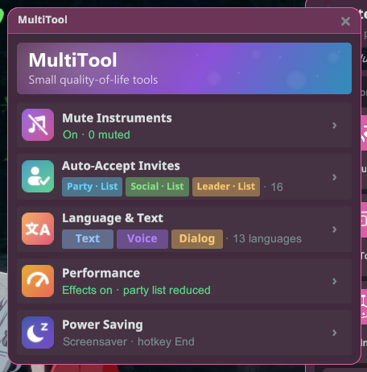
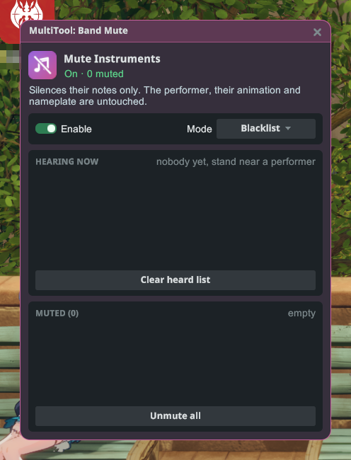
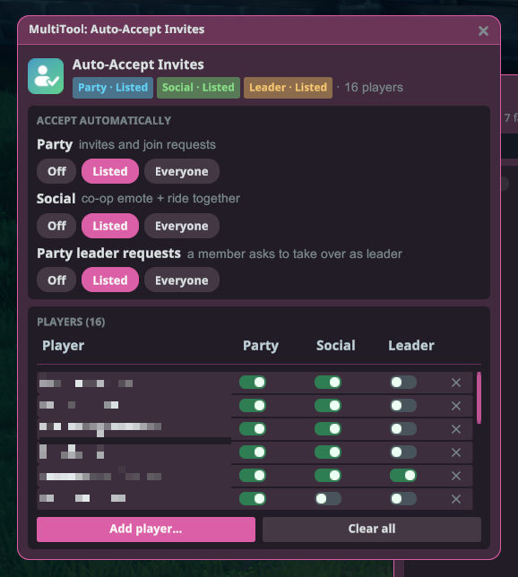
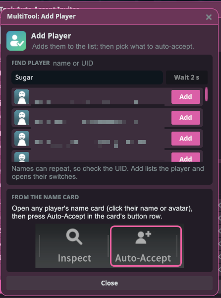
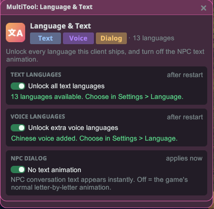
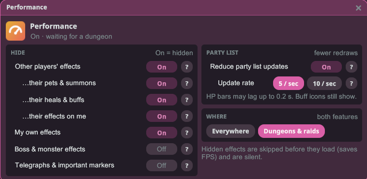
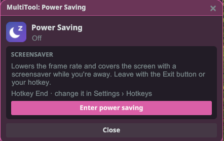

# MultiTool

작고 편리한 도구 몇 가지를 창 하나에 모았습니다. 다른 플레이어의 악기 소리를 음소거하고, 직접 고른 사람의 초대를 자동으로
수락하고, 이 게임 클라이언트에 들어 있는 모든 언어를 잠금 해제하고, NPC 대화를 바로 표시하고, 전투를 더 부드럽게 하고,
자리를 비울 때 화면 보호기를 켤 수 있습니다.

## 시작하기

1. 플러그인을 설치하고 게임을 **모드 적용**으로 실행하세요.
2. 캐릭터로 로그인한 뒤 Stellar 메뉴를 열고 **MultiTool**을 클릭합니다.
3. 도구 카드를 클릭하면 열립니다. 각 카드에는 그 도구가 지금 어떻게 작동하고 있는지 표시됩니다.

## Mute Instruments(악기 음소거)

근처에서 연주하는 다른 플레이어의 악기 소리를 끕니다. 소리만 꺼지고, 연주하는 플레이어와 모션, 이름표는 그대로 보입니다.

- **Enable**(켜기)로 음소거를 켜고 끕니다.
- **Mode**(모드)로 목록의 작동 방식을 고릅니다.
  - **Blacklist**(블랙리스트): 목록에 있는 플레이어를 음소거하고, 나머지는 평소대로 들립니다.
  - **Whitelist**(화이트리스트): 목록에 있는 플레이어를 뺀 모두를 음소거합니다.
- **Hearing now**(지금 들리는 연주)에는 지금 연주가 들리는 플레이어가 모두 표시됩니다. 이름을 클릭하면 목록에 추가됩니다.
- **Muted**(음소거됨) / **Allowed**(허용됨)는 저장된 목록입니다. 이름을 클릭하면 목록에서 빠집니다.
  **Unmute all**(모두 음소거 해제) 또는 **Clear allow-list**(허용 목록 비우기)를 누르면 목록이 비워집니다.

목록은 다음 접속 때도 유지되므로, 음소거한 플레이어는 다음에 근처에서 연주해도 계속 음소거됩니다.

## Auto-Accept Invites(초대 자동 수락)

초대와 신청을 자동으로 수락합니다. 종류마다 세 가지 중에서 고릅니다: **Off**(직접 응답), **Listed**(목록에 있는 플레이어만), **Everyone**(누구든).

- **Party**(파티): 파티 초대, 그리고 내 파티 참가 신청.
- **Social**(소셜): 함께하는 감정 표현과 같이 타기 초대.
- **Party leader requests**(파티장 신청): 내가 파티장일 때 파티원이 파티장을 넘겨 달라고 하는 신청.
- 목록의 플레이어마다 **Party**, **Social**, **Leader** 스위치가 따로 있으며, 해당 종류가 **Listed**일 때 쓰입니다. 해당 줄의 **✕**로 플레이어를 빼거나, **Clear all**(모두 지우기)로 목록을 비웁니다.
- 수락하면 게임의 초대 카드가 저절로 닫힙니다.

### 플레이어 추가하기

- **From the name card**(명함에서): 플레이어의 명함을 열고(이름이나 아바타를 클릭) 명함 버튼 줄에서
  **Auto-Accept**를 누릅니다. 목록에 추가되고, 그 플레이어에게서 무엇을 수락할지 고르는 작은 창이 열립니다. 처음에는 모든 스위치가 꺼져 있습니다.
- **이름 또는 UID로**: **Add player…**(플레이어 추가)를 클릭하고 이름 일부나 UID를 입력한 뒤 **Search**(검색)를 누릅니다. 이름은 겹칠 수 있으니 UID를 확인하고 **Add**(추가)를 누르세요. 게임이 검색 빈도를 제한하므로 검색 사이에 몇 초 기다려야 합니다.

## Language & Text(언어와 텍스트)

내 지역에서 제공되는 언어뿐 아니라, 이 게임 클라이언트에 들어 있는 모든 텍스트 언어와 음성 언어를 게임의
**설정 › 언어**에 표시합니다. NPC 대화 텍스트를 바로 표시할 수도 있습니다.

- **Unlock all text languages**(모든 텍스트 언어 잠금 해제): 모든 텍스트 언어를 게임의 언어 목록에 추가합니다.
- **Unlock extra voice languages**(추가 음성 언어 잠금 해제): 클라이언트에 들어 있는 음성 언어를 추가합니다.
- 언어 변경은 게임을 다시 시작하면 적용됩니다. 그런 다음 게임 설정에서 언어를 고르세요.
- **No text animation**(텍스트 애니메이션 끄기, **NPC dialog** 안): NPC 대사가 한 글자씩 나오지 않고 바로 전체가
  표시됩니다. 다음 대사부터 적용되며 다시 시작할 필요가 없습니다. 기본값은 꺼짐입니다.

## Performance(성능)

붐비는 던전과 레이드에서 전투를 더 부드럽게 만듭니다. 다른 플레이어의 스킬 이펙트를 숨기고, 파티 목록을 덜 자주 갱신합니다.

**Hide(숨기기)** (스위치를 On으로 하면 그 종류의 이펙트가 숨겨집니다):

- **Other players' effects(다른 플레이어의 이펙트)**: 다른 플레이어가 사용한 스킬 이펙트를 숨깁니다. 누가 스킬을 썼는지로 판단하므로, 다른 플레이어에게 맞은 보스 공격은 그대로 보입니다. 아래 세 항목으로 세부 조정할 수 있습니다:
  - **…their pets & summons(펫과 소환수)**: 펫, 소환수, 그리고 그들이 쏘는 투사체도 숨깁니다.
  - **…their heals & buffs(회복과 버프)**: 회복 장판과 지원 구역도 숨깁니다. 설 자리를 계속 보려면 Off로 두세요.
  - **…their effects on me(나에게 건 이펙트)**: 나에게 걸린 회복, 보호막 등도 숨깁니다.
- **My own effects(내 이펙트)**: 내 스킬의 시각 효과를 숨깁니다.
- **Boss & monster effects(보스와 몬스터 이펙트)**: 보스와 몬스터 자신의 스킬 시각 효과를 숨깁니다.
- **Telegraphs & important markers(예고와 중요 표식)**: 보스 공격 예고, 위험 구역, 조준 원.
  ⚠️ On으로 하면 보스 공격 예고가 숨겨져 레이드를 진행할 수 없게 될 수 있습니다. Off로 두세요.

레이드와 던전의 바닥 표식은 항상 보입니다. 숨겨진 이펙트는 소리도 나지 않습니다.

**Party list(파티 목록)**: **Reduce party list updates(파티 목록 갱신 줄이기)**를 켜면 파티 목록의 HP 바와 버프 아이콘을 초당 최대 **10**번 또는 **5**번만 다시 그립니다. 레이드에서 가장 효과가 큽니다. HP 바가 최대 0.1초(5 / sec에서는 0.2초) 늦을 수 있으며, 버프 아이콘은 그대로 표시됩니다.

**Where(적용 범위)**에서 두 기능을 **Everywhere(어디서나)** 또는 **Dungeons & raids(던전과 레이드만, 기본값)** 중 어디서 쓸지 고릅니다. 처음에는 모두 Off이니 원하는 것을 켜세요.

## Power Saving(절전)

자리를 비울 때 게임의 화면 보호기를 켭니다. 프레임 레이트를 낮추고 화면을 덮습니다.

- **Enter power saving**(절전 시작)을 누르면 바로 시작합니다.
- 단축키로 켜고 끕니다. 기본값은 **End**이며 **Settings › Hotkeys**에서 바꿀 수 있습니다.
- 끝내려면 화면 보호기의 **Exit** 버튼이나 단축키를 누르세요. 로그아웃해도 끝납니다.

## 참고

- MultiTool은 월드에 있을 때만 열리며, 로그아웃하면 창이 닫힙니다.
- 음소거는 내가 듣는 소리에만 적용됩니다. 다른 플레이어들끼리는 평소대로 들립니다.
