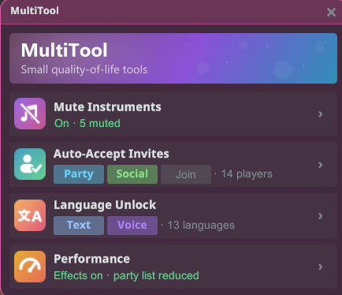
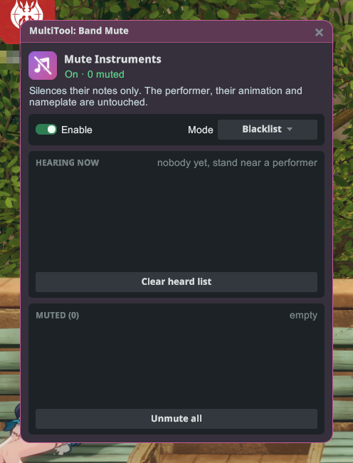
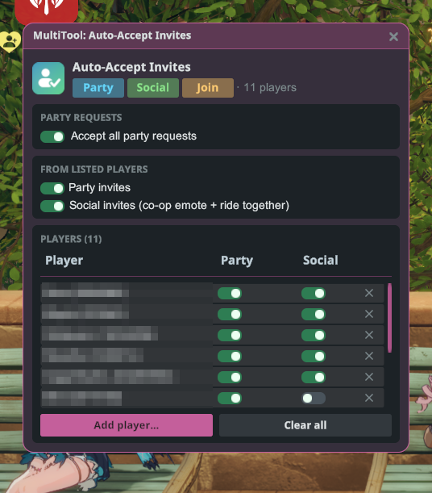
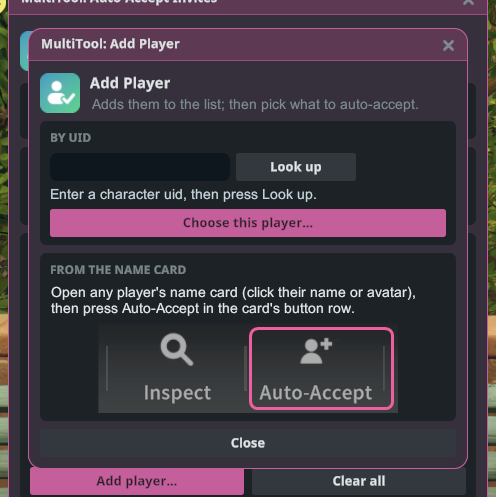
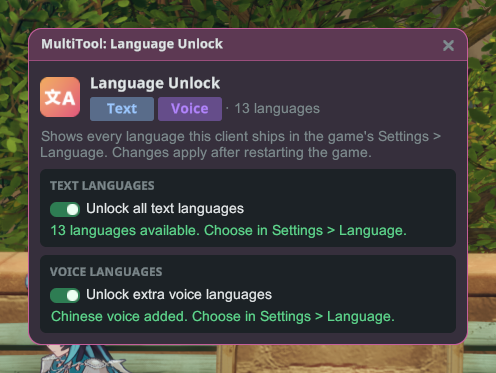
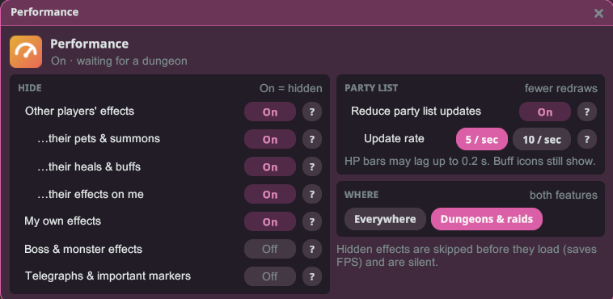

# MultiTool

A handful of small quality-of-life tools in one window: mute other players' instruments, auto-accept
invites from the people you choose, and unlock every language this game client ships.

## Getting started

1. Install the plugin and launch the game **Modded**.
2. Log in to a character, open the Stellar menu and click **MultiTool**.
3. Click a tool card to open it. Each card shows what that tool is doing right now.

## Mute Instruments

Silence the instruments of other players who are performing nearby. Only their notes go quiet: the
performer, their animation and their nameplate stay exactly as they are.

- **Enable** turns muting on or off.
- **Mode** picks how the list works:
  - **Blacklist**: the players on your list are muted, everyone else plays as normal.
  - **Whitelist**: everyone is muted except the players on your list.
- **Hearing now** lists everyone you can hear playing right now. Click a name to add it to your list.
- **Muted** / **Allowed** is your saved list. Click a name to take it off again.
  **Unmute all** (or **Clear allow-list**) empties it.

Your list is kept between sessions, so a player you muted stays muted the next time they play near you.

## Auto-Accept Invites

Accept invites automatically, but only from the players you list.

- **Accept all party requests** approves every request to join your party, from anyone.
- **Party invites**: accept party invites from listed players.
- **Social invites**: accept co-op emotes and ride-together invites from listed players.
- Each player on the list has their own **Party** and **Social** switches. Remove a player with the
  **✕** on their row, or empty the list with **Clear all**.

### Adding a player

- **From the name card**: open any player's name card (click their name or avatar) and press
  **Auto-Accept** in the card's button row. They're added to your list and a small window opens where
  you pick what to accept from them.
- **By UID**: click **Add player…**, type their UID, press **Look up**, then **Choose this player…**.

## Language Unlock

Show every text and voice language this game client contains in the game's
**Settings › Language**, not just the ones offered in your region.

- **Unlock all text languages** adds every text language to the game's language list.
- **Unlock extra voice languages** adds the voice languages your client has.
- Changes take effect after you restart the game. Then pick the language in the game's own settings.

## Performance

Smoother fights in crowded dungeons and raids. Hide other players' skill effects, and redraw the
party list less often.

**Hide** (a switch that is On hides that kind of effect):

- **Other players' effects**: hides the skill effects other players cast. It goes by who cast the
  skill, so a boss attack that lands on another player still shows. Three rows fine-tune it:
  - **…their pets & summons**: also hide their pets, summons and the projectiles they fire.
  - **…their heals & buffs**: also hide their healing circles and support zones. Leave this Off to
    keep seeing where to stand.
  - **…their effects on me**: also hide heals, shields and other effects they put on you.
- **My own effects**: hides your own skill visuals.
- **Boss & monster effects**: hides the boss's and monsters' own skill visuals.
- **Telegraphs & important markers**: boss attack warnings, danger zones and aiming circles.
  ⚠️ Turning this On hides boss warnings, which can make raids unplayable. Leave it Off.

Raid and dungeon ground marks always stay visible. Hidden effects are also silent.

**Party list**: **Reduce party list updates** redraws the party list's HP bars and buff icons at most
**10** or **5** times per second. This helps most in raids. HP bars may lag up to 0.1 s (or 0.2 s at
5 / sec), and buff icons still show.

**Where** picks whether both features work **Everywhere** or only in **Dungeons & raids** (the
default). Everything starts Off, so turn on what you want.

## Notes

- MultiTool opens only while you're in the world, and its windows close when you log out.
- Muting only affects what you hear. Other players still hear each other as normal.
