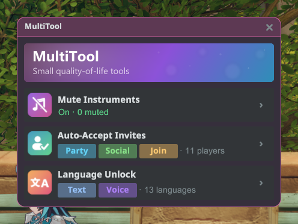
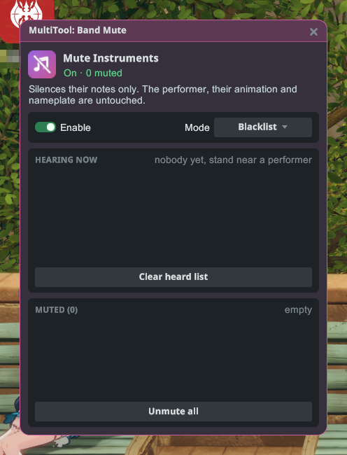
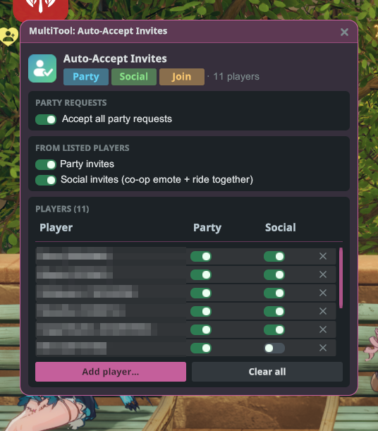
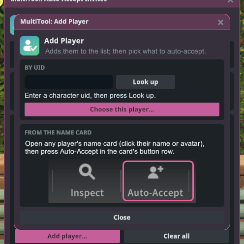
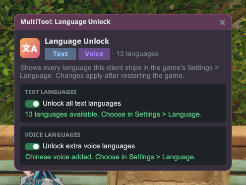

# MultiTool

เครื่องมือเล็ก ๆ ที่ช่วยให้เล่นสะดวกขึ้น รวมไว้ในหน้าต่างเดียว: ปิดเสียงเครื่องดนตรีของผู้เล่นคนอื่น ตอบรับคำเชิญอัตโนมัติจากคนที่คุณเลือก
และปลดล็อกทุกภาษาที่มีอยู่ในไคลเอนต์เกมนี้

## เริ่มต้นใช้งาน

1. ติดตั้งปลั๊กอินแล้วเปิดเกมแบบ **ใช้ม็อด**
2. ล็อกอินเข้าตัวละคร เปิดเมนู Stellar แล้วคลิก **MultiTool**
3. คลิกการ์ดเครื่องมือเพื่อเปิด การ์ดแต่ละใบจะแสดงว่าเครื่องมือนั้นกำลังทำอะไรอยู่ตอนนี้

## Mute Instruments (ปิดเสียงเครื่องดนตรี)

ปิดเสียงเครื่องดนตรีของผู้เล่นคนอื่นที่กำลังเล่นดนตรีอยู่ใกล้ ๆ เงียบเฉพาะเสียงโน้ตเท่านั้น ตัวผู้เล่น ท่าทาง และป้ายชื่อของเขายังแสดงเหมือนเดิมทุกอย่าง

- **Enable** (เปิดใช้) ใช้เปิดหรือปิดการปิดเสียง
- **Mode** (โหมด) ใช้เลือกว่ารายชื่อจะทำงานแบบไหน:
  - **Blacklist** (บัญชีดำ): ปิดเสียงผู้เล่นในรายชื่อของคุณ คนอื่นเล่นได้ตามปกติ
  - **Whitelist** (บัญชีขาว): ปิดเสียงทุกคน ยกเว้นผู้เล่นในรายชื่อของคุณ
- **Hearing now** (กำลังได้ยิน) แสดงทุกคนที่คุณได้ยินกำลังเล่นอยู่ตอนนี้ คลิกชื่อเพื่อเพิ่มลงในรายชื่อของคุณ
- **Muted** (ปิดเสียงแล้ว) / **Allowed** (อนุญาต) คือรายชื่อที่บันทึกไว้ คลิกชื่อเพื่อเอาออกอีกครั้ง
  **Unmute all** (เปิดเสียงทั้งหมด) หรือ **Clear allow-list** (ล้างรายชื่อที่อนุญาต) จะล้างรายชื่อทั้งหมด

รายชื่อของคุณจะถูกเก็บไว้แม้ปิดเกมไปแล้ว ผู้เล่นที่คุณปิดเสียงไว้จะยังถูกปิดเสียงในครั้งต่อไปที่เขาเล่นดนตรีใกล้คุณ

## Auto-Accept Invites (ตอบรับคำเชิญอัตโนมัติ)

ตอบรับคำเชิญให้อัตโนมัติ แต่เฉพาะจากผู้เล่นที่อยู่ในรายชื่อของคุณเท่านั้น

- **Accept all party requests** (อนุมัติคำขอเข้าปาร์ตี้ทั้งหมด): อนุมัติทุกคำขอเข้าร่วมปาร์ตี้ของคุณ ไม่ว่าจะมาจากใคร
- **Party invites** (คำเชิญปาร์ตี้): ตอบรับคำเชิญเข้าปาร์ตี้จากผู้เล่นในรายชื่อ
- **Social invites** (คำเชิญโซเชียล): ตอบรับคำชวนทำท่าทางคู่และคำชวนขี่พาหนะด้วยกันจากผู้เล่นในรายชื่อ
- ผู้เล่นแต่ละคนในรายชื่อมีสวิตช์ **Party** (ปาร์ตี้) และ **Social** (โซเชียล) เป็นของตัวเอง เอาผู้เล่นออกด้วย **✕** ในแถวของเขา
  หรือล้างรายชื่อทั้งหมดด้วย **Clear all** (ล้างทั้งหมด)

### การเพิ่มผู้เล่น

- **From the name card** (จากนามบัตร): เปิดนามบัตรของผู้เล่นคนไหนก็ได้ (คลิกชื่อหรือรูปโปรไฟล์ของเขา) แล้วกด
  **Auto-Accept** ในแถวปุ่มของนามบัตร เขาจะถูกเพิ่มลงในรายชื่อของคุณ และจะมีหน้าต่างเล็ก ๆ เปิดขึ้นให้คุณเลือกว่าจะตอบรับอะไรจากเขาบ้าง
- **By UID** (ด้วย UID): คลิก **Add player…** (เพิ่มผู้เล่น) พิมพ์ UID ของเขา กด **Look up** (ค้นหา) แล้วกด
  **Choose this player…** (เลือกผู้เล่นคนนี้)

## Language Unlock (ปลดล็อกภาษา)

แสดงทุกภาษาข้อความและภาษาเสียงที่มีอยู่ในไคลเอนต์เกมนี้ใน **ตั้งค่า › ภาษา** ของเกม
ไม่ใช่แค่ภาษาที่เปิดให้ใช้ในภูมิภาคของคุณ

- **Unlock all text languages** (ปลดล็อกภาษาข้อความทั้งหมด) เพิ่มทุกภาษาข้อความลงในรายการภาษาของเกม
- **Unlock extra voice languages** (ปลดล็อกภาษาเสียงเพิ่มเติม) เพิ่มภาษาเสียงที่มีอยู่ในไคลเอนต์ของคุณ
- การเปลี่ยนแปลงจะมีผลหลังจากรีสตาร์ทเกม จากนั้นเลือกภาษาในการตั้งค่าของเกมเอง

## หมายเหตุ

- MultiTool เปิดได้เฉพาะตอนที่คุณอยู่ในโลกของเกม และหน้าต่างของมันจะปิดเมื่อคุณล็อกเอาต์
- การปิดเสียงมีผลเฉพาะกับเสียงที่คุณได้ยินเท่านั้น ผู้เล่นคนอื่นยังได้ยินกันตามปกติ
