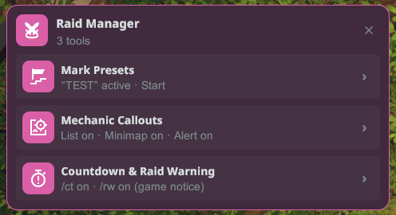
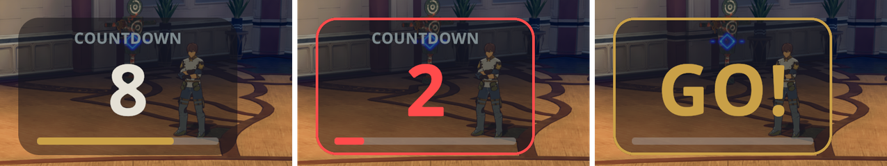
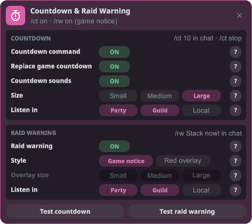
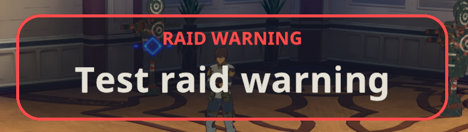
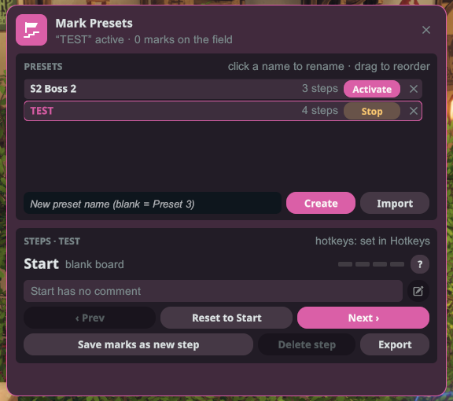
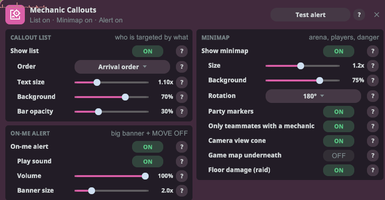
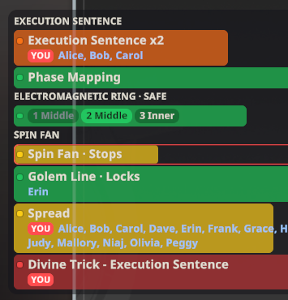
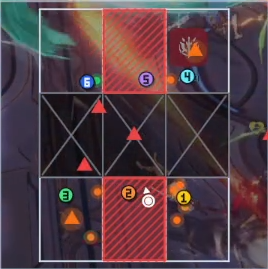
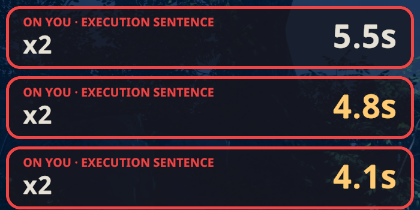

# Manajer Raid

Alat koordinasi raid yang ditampilkan sebagai overlay HUD — kompatibel dengan konvensi raid-call
ZDPS yang sudah digunakan statik-mu.

Buka **Manajer Raid** dari launcher. Ada tiga kartu, dan masing-masing langsung menunjukkan status
saat ini: **Preset Mark**, **Panggilan Mekanik**, dan **Hitung Mundur & Peringatan Raid**.

Setiap pengaturan punya tanda **?** di sebelahnya yang menjelaskan fungsinya.

## Hitung Mundur & Peringatan Raid

1. Instal plugin lalu jalankan game dalam mode **Dengan mod**.
2. Ketik `/ct <seconds>` di chat untuk memulai countdown pull. Countdown tampil sebagai kartu: judul
   **HITUNG MUNDUR**, sisa detik, dan bar yang menyusut. Kartu berubah kuning amber di 5 detik terakhir,
   merah dengan cincin di 3 detik terakhir, lalu menampilkan **GO!**. Warnanya mengikuti tema kamu.
   `/ct stop` membatalkannya.
3. Ketik `/rw <message>` untuk menampilkan peringatan raid ke semua orang yang menjalankan plugin
   ini.

Saat ketua party menekan tombol hitung mundur bawaan game, kamu melihat kartu yang sama, bukan teks
game, pas dengan bunyi beep game.

Buka **Hitung Mundur & Peringatan Raid** untuk mengaturnya:

- Nyalakan atau matikan **Perintah hitung mundur** dan **Peringatan raid**, lalu pilih chat mana
  yang didengarkan (**Party**, **Guild**, **Lokal**).
- **Ganti hitung mundur game** (aktif secara default) — menampilkan kartu ini saat ketua party memulai
  hitung mundur bawaan game. Suara game tetap berbunyi. Matikan untuk kembali ke tampilan game.
- **Suara hitung mundur** (aktif secara default) — `/ct` dan **Uji hitung mundur** memutar bunyi beep
  hitung mundur dan bunyi mulai dari game.
- Pilih **Ukuran** countdown: **Kecil**, **Sedang**, atau **Besar**.
- **Gaya** — **Notifikasi game** (default) menampilkan `/rw` sebagai banner notifikasi bawaan game
  beserta suaranya; **Overlay merah** menampilkannya di kartu yang sama dengan cincin merah dan nama
  pengirim (**PERINGATAN RAID · Pemain**), dengan **Ukuran overlay** tersendiri.
- **Uji hitung mundur** dan **Uji peringatan raid** menampilkan pratinjau keduanya tanpa mengirim
  apa pun ke chat.

Pindahkan countdown ke mana saja di editor tata letak HUD — contohnya muncul di sana selama kamu
mengedit.

## Preset Mark

Simpan marker dungeon yang kamu tempatkan dan muat ulang seluruh layout-nya dalam satu klik —
sebagai urutan fase bertahap. Buka dari kartu **Preset Mark**:

**Membuat preset**

1. Ketik nama dan tekan **Buat** (kosongkan untuk nama otomatis), lalu **Aktifkan**.
2. Di dalam dungeon, tempatkan marker untuk fase pertama, lalu tekan **Simpan mark sebagai langkah baru**.
3. Tempatkan marker fase berikutnya dan tekan **Simpan mark sebagai langkah baru** lagi — ulangi
   untuk setiap fase.

**Menggunakannya saat bertarung**

- **Berikutnya ›** / **‹ Sebelumnya** berpindah antar langkah, membersihkan papan dan menempatkan
  marker fase tersebut.
- **Reset ke Awal** kembali ke **Awal** yang kosong.
- Ikat **Preset Mark: Langkah sebelumnya**, **Preset Mark: Reset ke Start**, dan **Preset Mark:
  Langkah berikutnya** ke tombolmu sendiri di **Pengaturan Stellar → Hotkey** (belum diikat secara
  default).

Simpan preset terpisah untuk tiap raid dan **Aktifkan** yang sedang kamu jalani (tekan **Hentikan**
untuk mematikannya). Penempatan marker berfungsi di dalam dungeon.

**Mengatur preset**

- Klik nama preset untuk mengganti namanya, lalu tekan Enter.
- Seret preset ke atas atau ke bawah untuk mengubah urutan daftar.
- Tombol **✕** di sebuah baris menghapus preset setelah kamu mengonfirmasi.
- Klik ikon **pensil** di sebelah langkah saat ini untuk menambahkan catatan — misalnya "P2 —
  kumpul di barat". Catatan ini juga muncul di pop-up saat kamu berpindah ke langkah tersebut.

**Membagikan preset**

1. Aktifkan preset-nya dan tekan **Ekspor**, lalu **Salin**.
2. Kirim kode itu ke grupmu.
3. Mereka tekan **Impor**, lalu **Tempel** dan **Impor**. Mereka akan mendapatkan seluruh preset —
   setiap langkah, marker, dan catatan.

## Panggilan Mekanik

Lihat sekilas siapa yang ditargetkan oleh mekanik boss mana — sebagai daftar, minimap, dan peringatan
besar saat kamu yang kena. Buka dari kartu **Panggilan Mekanik**:

**Konten yang didukung**

- Raid Forgotten Dreamwild — Clash!, Brutal!, dan Purge!
- Cursed Radiant Tomb
- Sea-Ringed Reef
- Towering Ruin
- Tina's Mindrealm

Di luar konten ini, panggilan tetap kosong.

**Daftar Panggilan** — satu kartu ringkas. Setiap baris mekanik menyusut menuju saat kena dengan warna
mekaniknya, dan mendapat cincin merah di 3 detik terakhir. Pemain yang ditargetkan ada di baris di bawah
mekanik, dengan **KAMU** paling depan berwarna merah. Timer menampilkan detik bulat dari 10 detik ke atas,
dan satu angka desimal di bawahnya. Di raid, urutan cincin elektromagnetik tampil sebagai langkah
bernomor: langkah yang selesai diredupkan dan langkah saat ini disorot, beserta hitung mundur ke langkah itu.

Pengaturan: urutan (**Urutan kemunculan**, **Paling mendesak dulu**, atau **Urutan tabel**), ukuran teks,
**Latar** (default 70%), dan **Opasitas bar** untuk bar yang menyusut (default 30%).

**Minimap** — party-mu di arena, diwarnai sesuai mekanik, dengan marker party dan area bahaya. Di raid,
minimap juga menampilkan damage lantai, urutan menekan kristal, langkah cincin elektromagnetik
yang bernomor, garis terjangan golem, titik berhentinya kipas yang berputar, dan garis laser meriam.

Opsional di pengaturan minimap: kerucut kamera yang menunjukkan arah pandanganmu, peta bawaan game di bawahnya, opasitas latar belakang, dan rotasi peta.

**Peringatan saat terkena** — kartu bercincin saat mekanik menargetkanmu: nama mekanik, apa yang harus
dilakukan, dan hitung mundur. Hingga 3 kartu bertumpuk jika beberapa mekanik mengenaimu sekaligus.
**MENJAUH** muncul saat kamu berdiri di petak bahaya, dan pada fase cincin di raid, peringatan memberi tahu
cincin mana yang harus kamu tuju. Suara bersifat opsional dengan volume tersendiri; gunakan
**Uji peringatan** untuk pratinjau. (Nonaktif secara default.)

Pindahkan daftar, minimap, dan peringatan ke mana saja di editor tata letak HUD.

## Catatan

- Kedua overlay tetap terlihat saat menu game (ESC) terbuka.
