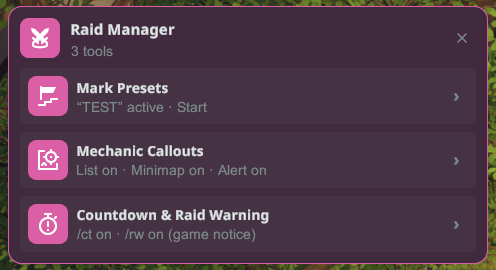
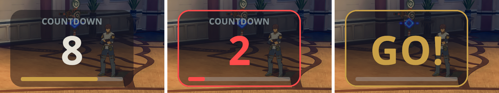
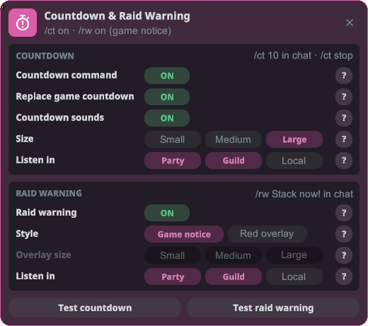
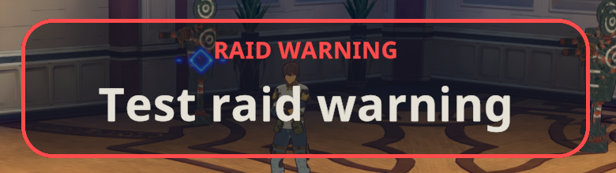
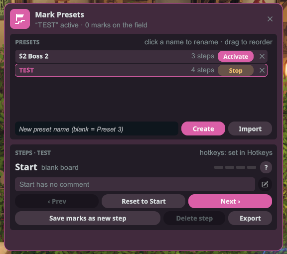
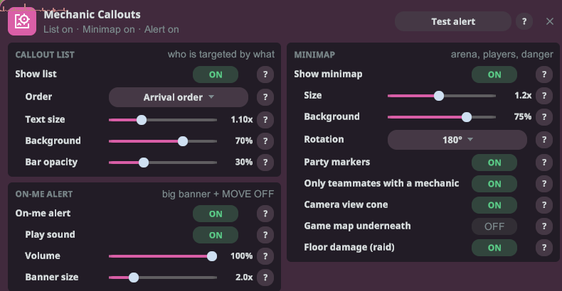
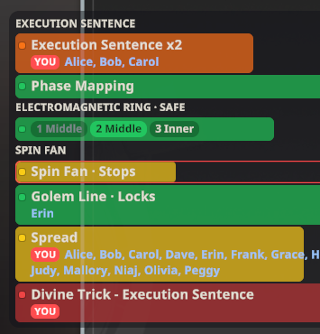
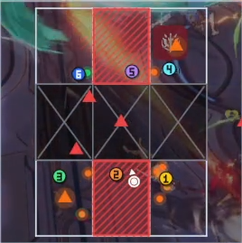
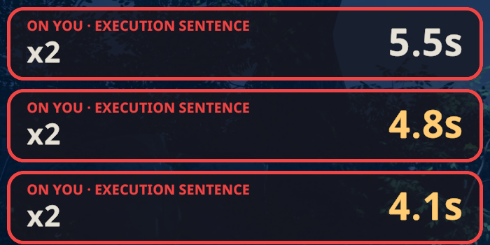

# レイドマネージャー

HUDオーバーレイとして表示されるレイド調整ツール — あなたのスタティックがすでに使っているZDPSのレイドコール慣習と互換性があります。

ランチャーから**レイドマネージャー**を開きます。3枚のカードがあり、それぞれ現在の状態がひと目でわかります:
**マーカープリセット**、**ギミック通知**、**カウントダウン & レイド警告**。

各設定の横にある **?** で、その設定の内容を確認できます。

## カウントダウン & レイド警告

1. プラグインをインストールし、**Mod有効**でゲームを起動します。
2. チャットで `/ct <seconds>` と入力すると、プルカウントダウンが始まります。**カウントダウン**の見出し、残り秒数、減っていくバーが付いたカードで表示されます。残り5秒で琥珀色に、残り3秒でリング付きの赤になり、最後に **GO!** と表示されます。色はテーマに合わせて変わります。`/ct stop` で取り消せます。
3. チャットで `/rw <message>` と入力すると、このプラグインを使用している全員にレイド警告のコールアウトを表示します。

パーティーリーダーがゲーム本来のカウントダウンボタンを押すと、ゲームの文字の代わりに同じカードが、ゲームのカウント音に合わせて表示されます。

**カウントダウン & レイド警告**を開いて設定します:

- **カウントダウンコマンド**と**レイド警告**のオン/オフを切り替え、反応するチャット（**パーティー**、**ギルド**、**ローカル**）を選びます。
- **ゲームのカウントダウンを置き換え**（初期状態でオン） — パーティーリーダーがゲーム本来のカウントダウンを始めたときに、このカードを表示します。ゲームの効果音はそのまま鳴ります。オフにするとゲーム本来の表示に戻ります。
- **カウントダウン音**（初期状態でオン） — `/ct` と**カウントダウンをテスト**で、ゲームのカウント音と開始音を鳴らします。
- カウントダウンの**サイズ**を**小**・**中**・**大**から選びます。
- **表示方法** — **ゲーム通知**（デフォルト）では `/rw` をゲーム本来の通知バナーとして効果音付きで表示します。**赤い表示**では同じカードに赤いリングと送信者の名前（**レイド警告 · プレイヤー**）を付けて表示し、**表示サイズ**を個別に設定できます。
- **カウントダウンをテスト**と**レイド警告をテスト**で、チャットに何も送らずに両方をプレビューできます。

カウントダウンは HUD レイアウトエディターで好きな位置に移動できます — 編集中はサンプルが表示されます。

## マーカープリセット

配置したダンジョンマーカーを保存し、レイアウト全体をワンクリックで読み込み直せます — 複数ステップのフェーズシーケンスとして。**マーカープリセット**カードから開きます。

**プリセットを作成する**

1. 名前を入力して**作成**を押し（空欄なら名前が自動で付きます）、**有効化**します。
2. ダンジョンで最初のフェーズのマーカーを配置し、**マーカーを新しいステップとして保存**を押します。
3. 次のフェーズのマーカーを配置し、もう一度**マーカーを新しいステップとして保存**を押します — 各フェーズごとに繰り返します。

**戦闘中の使い方**

- **次へ ›** / **‹ 前へ**でステップを移動し、盤面をクリアしてそのフェーズのマーカーを配置します。
- **スタートに戻す**で空の**スタート**に戻ります。
- **マーカープリセット: 前のステップ**、**マーカープリセット: スタートにリセット**、**マーカープリセット: 次のステップ**を、**Stellar 設定 → ホットキー**でお好きなキーに割り当てます（初期状態では未設定です）。

レイドごとに別々のプリセットを用意し、今プレイしているレイドのプリセットを**有効化**します（オフにするには**停止**を押します）。マーカー配置はダンジョン内で機能します。

**プリセットを整理する**

- プリセット名をクリックすると名前を変更でき、Enter で確定します。
- プリセットを上下にドラッグすると、リストの順番を並べ替えられます。
- 行の **✕** を押すと、確認のあとでプリセットが削除されます。
- 現在のステップの横にある**鉛筆**アイコンをクリックするとメモを追加できます — 例:「P2 — 西側で集合」。このメモは、そのステップに移動したときのポップアップにも表示されます。

**プリセットを共有する**

1. プリセットを有効化し、**書き出し**を押してから**コピー**を押します。
2. コードをグループに送ります。
3. 相手は**読み込む**を押し、**貼り付け**を押してから**読み込む**を押します。すべてのステップ・マーカー・メモを含むプリセット全体を受け取れます。

## ギミック通知

どのボスギミックが誰を狙っているかをひと目で確認できます — リスト、ミニマップ、そして自分が対象のときは大きなアラートで。**ギミック通知**カードから開きます。

**対応コンテンツ**

- Forgotten Dreamwild（レイド） — Clash!、Brutal!、Purge!
- Cursed Radiant Tomb
- Sea-Ringed Reef
- Towering Ruin
- Tina's Mindrealm

これら以外では、通知は空のままです。

**通知リスト** — コンパクトな1枚のカードです。各ギミックの行はギミックの色で着弾に向かって減っていき、残り3秒で赤いリングが付きます。対象プレイヤーはギミックの下の行に表示され、**あなた**が赤で先頭に来ます。タイマーは10秒以上は秒単位、10秒未満は小数点以下1桁で表示します。レイドでは電磁リングの順番が番号付きのステップで表示されます。終わったステップは暗く、現在のステップは強調され、そこまでのカウントダウンも表示されます。

設定：並び順（**到着順**・**緊急度の高い順**・**ギミック表の順**）、文字サイズ、**背景**（初期値70%）、減っていくバーの**バーの不透明度**（初期値30%）。

**ミニマップ** — アリーナ上のパーティーをギミックごとに色分けして表示し、パーティーマーカーと危険エリアも示します。レイドでは床ダメージ、クリスタルを押す順番、番号付きの電磁リングのステップ、ゴーレムの突進ライン、回転する扇が止まる位置、キャノンのレーザーラインも表示します。

ミニマップ設定では、カメラの向きを示すカメラコーン、下に表示するゲーム本来のマップ、背景の不透明度、マップの回転も設定できます。

**自分対象アラート** — ギミックの対象になると、ギミック名、取るべき行動、カウントダウンを載せたリング付きのカードを表示します。同時に複数のギミックに狙われたときは最大3枚まで重なります。危険床に立つと**離れて**を表示し、レイドのリングフェーズでは、どのリングへ移動すればよいかを知らせます。効果音は任意で、音量も個別に設定できます。**アラートをテスト**でプレビューできます。（初期状態ではオフです。）

リスト、ミニマップ、アラートは HUD レイアウトエディターで好きな位置に移動できます。

## 補足

- ゲームメニュー（ESC）を開いていても、両方のオーバーレイは表示されたままです。
