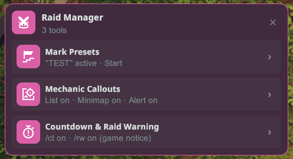
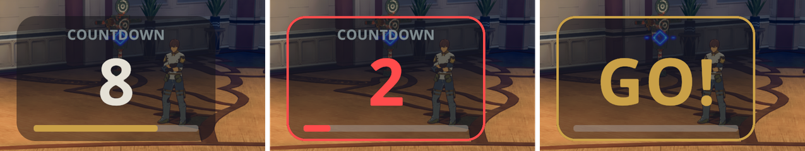
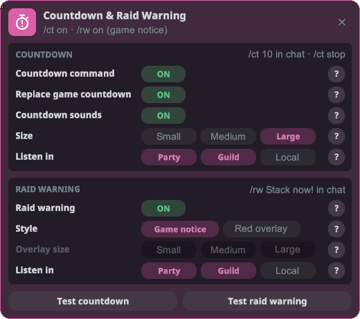
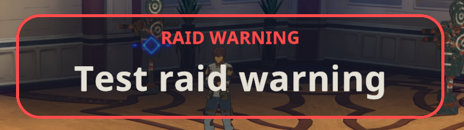
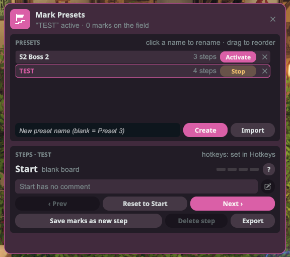
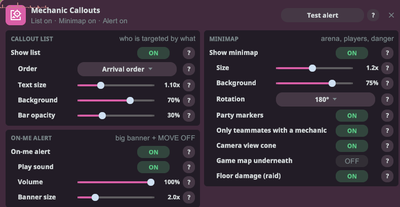
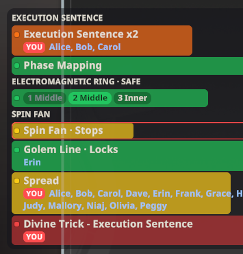
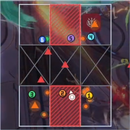
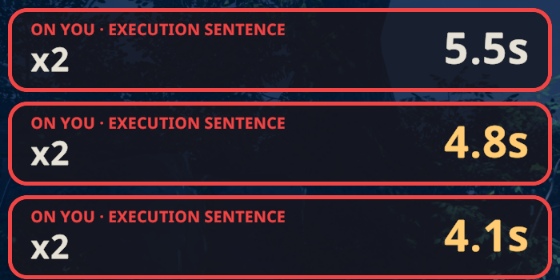

# 레이드 매니저

HUD 오버레이로 표시되는 레이드 조율 도구입니다 — 여러분의 공격대가 이미 쓰고 있는 ZDPS
레이드 콜 관례와 호환됩니다.

런처에서 **레이드 매니저**를 여세요. 카드가 세 장 있으며, 각 카드에서 현재 상태를 한눈에 볼 수 있습니다:
**표식 프리셋**, **기믹 알림**, **카운트다운 & 레이드 경고**.

모든 설정 옆에는 그 설정이 무엇을 하는지 설명하는 **?**가 있습니다.

## 카운트다운 & 레이드 경고

1. 플러그인을 설치하고 **모드 적용** 상태로 게임을 실행하세요.
2. 채팅에 `/ct <seconds>`를 입력해 풀 카운트다운을 시작합니다. **카운트다운** 제목, 남은 초, 줄어드는 바가
   있는 카드로 표시됩니다. 마지막 5초는 호박색, 마지막 3초는 테두리가 있는 빨간색으로 바뀌고, 끝나면
   **GO!**가 표시됩니다. 색은 테마를 따릅니다. `/ct stop`으로 취소할 수 있습니다.
3. 채팅에 `/rw <message>`를 입력해 이 플러그인을 사용하는 모든 사람에게 레이드 경고 알림을
   띄웁니다.

파티장이 게임 자체 카운트다운 버튼을 누르면, 게임 글자 대신 같은 카드가 게임 효과음에 맞춰
표시됩니다.

**카운트다운 & 레이드 경고**를 열어 설정합니다:

- **카운트다운 명령**과 **레이드 경고**를 켜거나 끄고, 반응할 채팅(**파티**, **길드**, **주변**)을
  고릅니다.
- **게임 카운트다운 대체**(기본값 켜짐) — 파티장이 게임 자체 카운트다운을 시작하면 이 카드를 표시합니다.
  게임 효과음은 그대로 재생됩니다. 끄면 게임 자체 표시로 돌아갑니다.
- **카운트다운 효과음**(기본값 켜짐) — `/ct`와 **카운트다운 테스트**에서 게임의 카운트다운 효과음과 시작
  효과음을 재생합니다.
- 카운트다운 **크기**를 **작게**, **보통**, **크게** 중에서 고릅니다.
- **표시 방식** — **게임 알림**(기본값)은 `/rw`를 게임 자체의 알림 배너와 효과음으로 표시하고,
  **빨간 오버레이**는 같은 카드에 빨간 테두리와 보낸 사람 이름(**레이드 경고 · 플레이어**)을 붙여 표시하며
  **오버레이 크기**를 따로 설정할 수 있습니다.
- **카운트다운 테스트**와 **레이드 경고 테스트**로 채팅에 아무것도 보내지 않고 둘 다 미리 볼 수 있습니다.

카운트다운은 HUD 레이아웃 편집기에서 원하는 위치로 옮길 수 있습니다 — 편집하는 동안 샘플이 표시됩니다.

## 표식 프리셋

배치한 던전 표식을 저장하고 전체 배치를 클릭 한 번으로 다시 불러올 수 있습니다 — 여러 단계로
이어진 시퀀스로 말이죠. **표식 프리셋** 카드에서 엽니다.

**프리셋 만들기**

1. 이름을 입력하고 **생성**을 누른 뒤(비워 두면 이름이 자동으로 정해집니다) **활성화**합니다.
2. 던전에서 첫 번째 단계의 표식을 배치한 다음 **표식을 새 단계로 저장**을 누릅니다.
3. 다음 단계의 표식을 배치하고 다시 **표식을 새 단계로 저장**을 누릅니다 — 각 단계마다 반복합니다.

**전투 중 사용하기**

- **다음 ›** / **‹ 이전**으로 단계를 이동하며, 보드를 지우고 해당 단계의 표식을 배치합니다.
- **시작으로 초기화**를 누르면 비어 있는 **시작** 상태로 돌아갑니다.
- **표식 프리셋: 이전 단계**, **표식 프리셋: 시작으로 초기화**, **표식 프리셋: 다음 단계**를
  **Stellar 설정 → 단축키**에서 원하는 키에 지정하세요(기본값은 지정되어 있지 않습니다).

레이드마다 별도의 프리셋을 유지하고, 지금 진행 중인 레이드의 프리셋을 **활성화**하세요(끄려면
**중지**를 누릅니다). 표식 배치는 던전에서 작동합니다.

**프리셋 정리하기**

- 프리셋 이름을 클릭해 이름을 바꾼 뒤 Enter를 누릅니다.
- 프리셋을 위아래로 끌어 목록 순서를 바꿀 수 있습니다.
- 행의 **✕**를 누르면 확인 후 프리셋이 삭제됩니다.
- 현재 단계 옆의 **연필** 아이콘을 클릭하면 메모를 추가할 수 있습니다 — 예: "2페이즈 — 서쪽
  집결". 이 메모는 해당 단계로 이동할 때 뜨는 팝업에도 표시됩니다.

**프리셋 공유하기**

1. 프리셋을 활성화하고 **내보내기**를 누른 다음 **복사**를 누릅니다.
2. 코드를 그룹원에게 전달합니다.
3. 그룹원은 **가져오기**를 누른 다음 **붙여넣기**와 **가져오기**를 누릅니다. 그러면 모든
   단계, 표식, 메모를 포함한 프리셋 전체를 그대로 받게 됩니다.

## 기믹 알림

어떤 보스 기믹이 누구를 노리는지 한눈에 확인하세요 — 목록, 미니맵, 그리고 내가 대상일 때 크게 뜨는
경고로 보여 줍니다. **기믹 알림** 카드에서 엽니다.

**지원 콘텐츠**

- Forgotten Dreamwild 레이드 — Clash!, Brutal!, Purge!
- Cursed Radiant Tomb
- Sea-Ringed Reef
- Towering Ruin
- Tina's Mindrealm

그 외 콘텐츠에서는 알림이 비어 있습니다.

**알림 목록** — 하나의 간결한 카드입니다. 각 기믹 줄은 기믹 색으로 적중 시점을 향해 줄어들고, 마지막
3초에는 빨간 테두리가 생깁니다. 대상 플레이어는 기믹 아래 줄에 표시되며 **나**가 빨간색으로 맨 앞에
옵니다. 타이머는 10초 이상은 초 단위로, 그 아래는 소수점 한 자리로 표시합니다. 레이드에서는 전자기 링
순서가 번호가 매겨진 단계로 표시되며, 끝난 단계는 흐리게, 현재 단계는 강조되고 그 단계까지의
카운트다운도 보여 줍니다.

설정: 정렬(**발생 순**, **긴급한 순**, **기믹 표 순**), 글자 크기, **배경**(기본 70%), 줄어드는 바의
**바 불투명도**(기본 30%).

**미니맵** — 전장 위의 파티원을 기믹별 색으로 표시하고, 파티 표식과 위험 지역도 보여 줍니다. 레이드에서는
바닥 피해, 크리스탈을 누르는 순서, 번호가 매겨진 전자기 링 단계, 골렘의 돌진 경로, 회전하는 부채꼴이 멈출 위치, 포대의 레이저 경로도 표시합니다.

미니맵 설정에서 카메라가 바라보는 방향 표시, 아래에 깔리는 게임 자체 지도, 배경 불투명도, 지도 회전도 설정할 수 있습니다.

**내 대상 경고** — 기믹이 나를 대상으로 하면 기믹 이름, 해야 할 행동, 카운트다운이 담긴 테두리 카드를
표시합니다. 여러 기믹이 동시에 노리면 최대 3장까지 쌓입니다. 위험 타일 위에 서 있으면 **벗어나세요**를
표시하고, 레이드의 링 페이즈에서는 어느 링으로 이동해야 하는지 알려 줍니다. 효과음은 선택 사항이며
음량을 따로 설정할 수 있습니다. **경고 테스트**로 미리 볼 수 있습니다. (기본값은 꺼짐.)

목록, 미니맵, 경고는 HUD 레이아웃 편집기에서 원하는 위치로 옮길 수 있습니다.

## 참고

- 게임 메뉴(ESC)가 열려 있어도 두 오버레이 모두 계속 표시됩니다.
