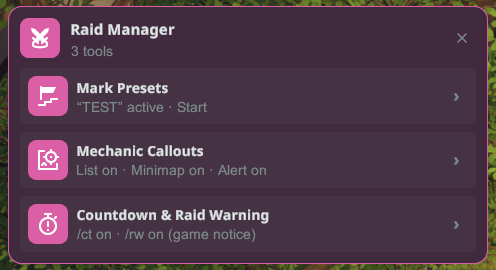
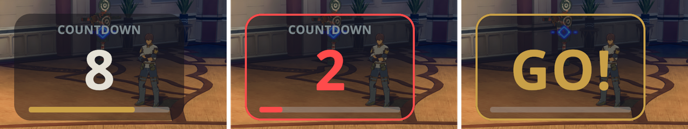
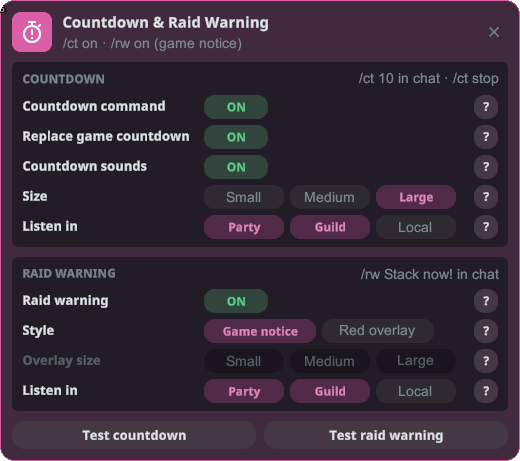
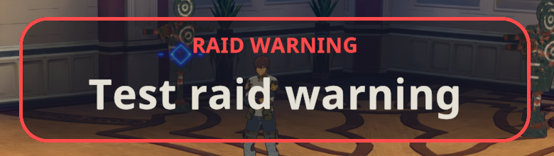
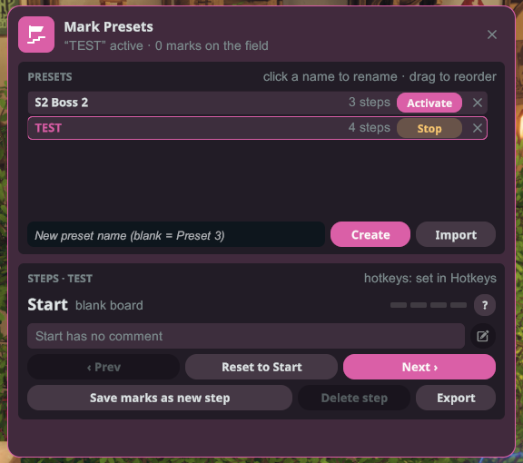
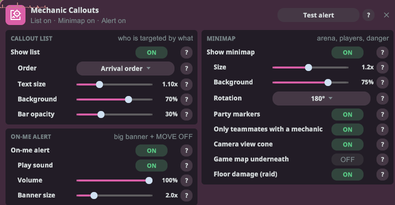
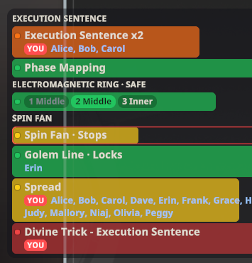
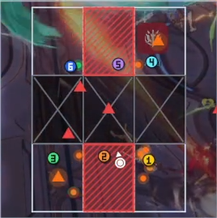
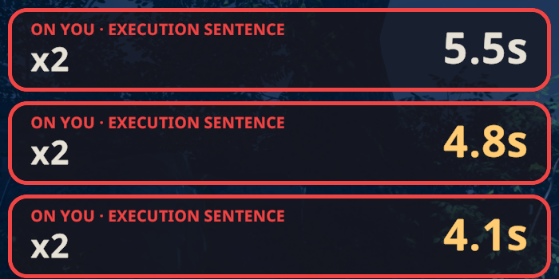

# Raid Manager

Raid coordination tools shown as a HUD overlay — compatible with the ZDPS raid-call
conventions your statics already use.

Open **Raid Manager** from the launcher. It has three cards, and each one shows its current state at a glance:
**Mark Presets**, **Mechanic Callouts** and **Countdown & Raid Warning**.

Every setting has a **?** next to it that explains what it does.

## Countdown & Raid Warning

1. Install the plugin and launch the game **Modded**.
2. Type `/ct <seconds>` in chat to start a pull countdown. It shows as a card: a **COUNTDOWN** caption,
   the seconds left and a bar that drains. It turns amber in the last 5 seconds, red with a ring in the
   last 3, then shows **GO!**. Its colours follow your theme. `/ct stop` cancels it.
3. Type `/rw <message>` to flash a raid-warning callout to everyone running the plugin.

When your party leader presses the game's own countdown button, you see the same card instead of the
game's text, in time with the game's beeps.

Open **Countdown & Raid Warning** to set them up:

- Turn **Countdown command** and **Raid warning** on or off, and pick which chats they listen in
  (**Party**, **Guild**, **Local**).
- **Replace game countdown** (on by default) — shows the card when the party leader starts the game's
  own countdown. The game's sounds still play. Turn it off to get the game's look back.
- **Countdown sounds** (on by default) — `/ct` and **Test countdown** play the game's countdown beeps
  and its start sound.
- Choose the countdown **Size**: **Small**, **Medium** or **Large**.
- **Style** — **Game notice** (default) shows `/rw` as the game's own notice banner with its sound;
  **Red overlay** shows it on the same card with a red ring and the sender's name
  (**RAID WARNING · Player**), with its own **Overlay size**.
- **Test countdown** and **Test raid warning** preview both without sending anything to chat.

Move the countdown anywhere in the HUD layout editor — a sample shows there while you edit.

## Mark Presets

Save the dungeon markers you place and reload the whole layout in one click — as multi-step
phase sequences. Open it from the **Mark Presets** card:

**Build a preset**

1. Type a name and press **Create** (leave it blank for an automatic name), then **Activate** it.
2. In a dungeon, place your markers for the first phase, then press **Save marks as new step**.
3. Place the next phase's markers and press **Save marks as new step** again — repeat for each phase.

**Use it during the fight**

- **Next ›** / **‹ Prev** move through the steps, clearing the board and placing that phase's markers.
- **Reset to Start** returns to the blank **Start**.
- Bind **Mark Presets: Previous step**, **Mark Presets: Reset to Start** and **Mark Presets: Next step**
  to your own keys in **Stellar Settings → Hotkeys** (they start unbound).

Keep a separate preset for each raid and **Activate** the one you're running (press **Stop** to turn it
off). Marker placement works in dungeons.

**Organise your presets**

- Click a preset's name to rename it, then press Enter.
- Drag a preset up or down to reorder the list.
- The **✕** on a row deletes the preset after you confirm.
- Click the **pencil** next to the current step to add a note — e.g. "P2 — stack west". The note also
  shows in the pop-up when you move to that step.

**Share a preset**

1. Activate the preset and press **Export**, then **Copy**.
2. Send the code to your group.
3. They press **Import**, then **Paste** and **Import**. They get the whole preset —
   every step, marker and note.

## Mechanic Callouts

See at a glance who is targeted by which boss mechanic — as a list, a minimap and a big alert when
it's you. Open it from the **Mechanic Callouts** card:

**Supported content**

- Forgotten Dreamwild raid — Clash!, Brutal! and Purge!
- Cursed Radiant Tomb
- Sea-Ringed Reef
- Towering Ruin
- Tina's Mindrealm

Outside these, the callouts stay empty.

**Callout List** — one compact card. Each mechanic row drains toward the hit in the mechanic's colour,
with a red ring in the last 3 seconds. The players it targets are on a line underneath, with **YOU**
first in red. Timers show whole seconds from 10 s up and one decimal below that. In the raid, the
electromagnetic ring order shows as numbered steps: finished steps are dimmed and the current step is
highlighted, with a countdown to it.

Settings: the order (**Arrival order**, **Most urgent first** or **Table order**), the text size,
**Background** (70% by default) and **Bar opacity** for the draining bars (30% by default).

**Minimap** — your party on the arena, coloured by mechanic, with party markers and danger areas.
In the raid it also shows floor damage, the crystal press order, the numbered electromagnetic ring steps, the golem dash lines, where the spinning fan will stop and the cannon laser lines.

Optional in the minimap settings: a camera cone showing where you're looking, the game's own map underneath, background opacity and map rotation.

**On-me alert** — a ringed card when a mechanic targets you: the mechanic's name, what to do and a
countdown. Up to 3 stack when several mechanics hit you at once. **MOVE OFF** shows when you stand on a
danger tile, and in the raid's ring phases it tells you which ring to move to. Sound is optional, with
its own volume; use **Test alert** to preview. (Off by default.)

Move the list, minimap and alerts anywhere in the HUD layout editor.

## Notes

- Both overlays stay visible when the game menu (ESC) is open.
