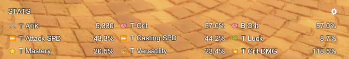
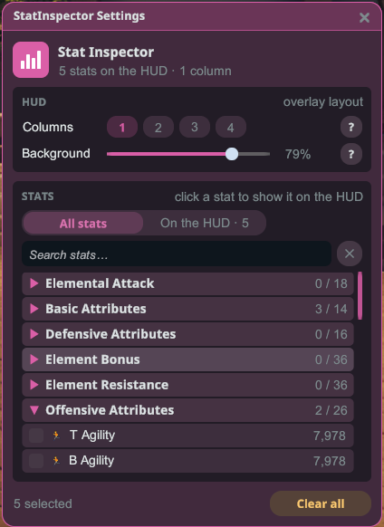
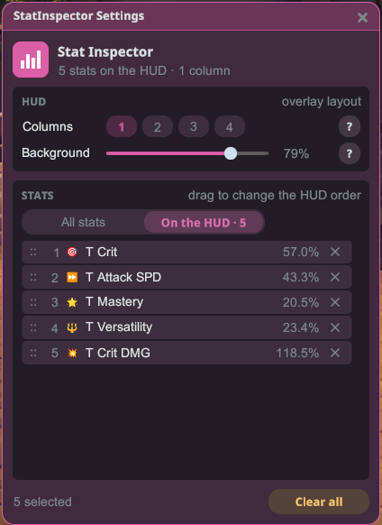

# 능력치 보기

내 캐릭터의 실시간 능력치를 화면에 — 원하는 능력치만, 원하는 순서로 보여주는 간단한 미니 HUD입니다.

## 사용 방법

1. 플러그인을 설치하고 게임을 **모드 적용**으로 실행합니다.
2. Stellar 오버레이 또는 미니 HUD의 톱니바퀴에서 능력치 보기를 엽니다. **전체 능력치**에서 능력치를 클릭하면 미니 HUD에 추가됩니다(다시 클릭하면 제거). 검색창으로 빠르게 찾을 수 있습니다.

3. **HUD 표시**를 열면 선택한 능력치가 미니 HUD에 보이는 순서대로 나옵니다. 행을 드래그해 순서를 바꾸고, ✕로 제거합니다.

4. **HUD** 항목에서 미니 HUD의 **열 수**를 고르고, 게임 화면 위에서 숫자가 잘 안 보이면 **배경** 슬라이더를 올리세요.
5. 미니 HUD는 HUD 레이아웃 편집기에서 옮깁니다. 편집기에서는 실제 크기로 표시되며, 아직 아무것도 고르지 않았다면 예시 능력치가 표시됩니다. 위치와 표시/숨김 상태는 재실행 후에도 그대로 기억됩니다.

## 팁

- 수치가 실시간으로 갱신되므로, 장비나 모듈을 바꿨을 때 실제로 수치가 어떻게 변하는지 확인할 때 유용합니다.
- **모두 지우기**는 미니 HUD의 능력치를 모두 제거하기 전에 한 번 더 확인합니다.
- **?** 버튼을 누르면 각 설정의 설명을 볼 수 있습니다.
