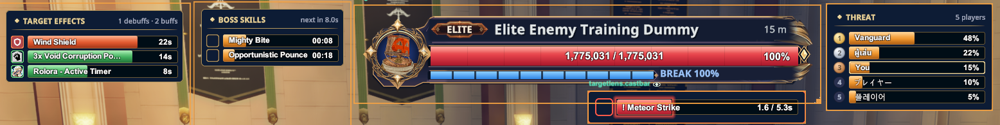
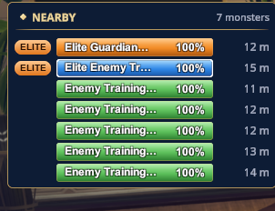
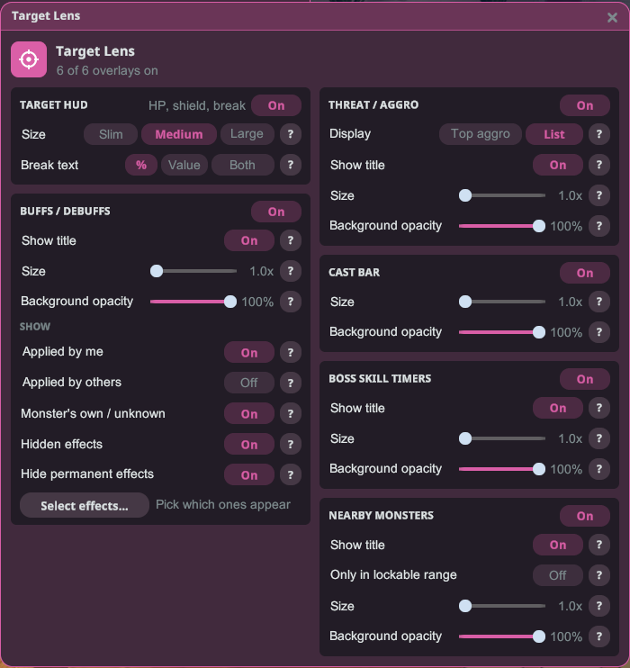
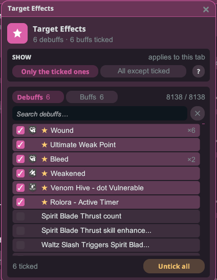

# Target Lens

Kilalanin ang iyong target. Binabasa ng Target Lens ang kasalukuyan mong combat target at
inilalatag ang lahat ng mahalaga — ang HP nito, shield, at break gauge, ang mga buff at debuff
dito, kung sino ang may hawak ng aggro, ang susunod na mapanganib na skill ng boss, ang cast bar
nito, at ang mga monster sa paligid mo — bilang malinis na overlay na pwedeng i-drag.

## Pagsisimula

1. I-install ang plugin at buksan ang laro sa mode na **May mod**.
2. Buksan ang overlay ng launcher at i-click ang **Target Lens** para buksan ang settings nito.
3. Mag-target ng kahit ano habang nasa labanan — awtomatikong lalabas ang mga overlay. I-drag ang
   kahit anong overlay para ilipat ito at i-drag ang gilid nito para baguhin ang laki; naaalala
   ang mga posisyon.

## Ang mga overlay

- **HUD ng Target** — isang boss-style na bar na may **portrait** ng monster (silhouette kapag
  wala), ang pangalan nito na may tag na **BOSS** / **ELITE**, ang distansya, ang **HP** bar na may
  trail na nagpapakita ng kamakailang damage, ang **shield** ("armor") na may halaga nito sa tabi
  ng HP, at ang **break / stagger gauge** — asul habang bumababa, at gintong **BASAG** na may
  countdown kapag na-break ang target.
- **Mga Epekto ng Target** — sariling window na naglilista ng mga buff at debuff sa target, bawat
  isa may icon at natitirang oras. Minamarkahan ng **★** ang sarili mong mga epekto. **I-click ang
  isang row** para makita ang paglalarawan ng epektong iyon.
- **Threat / Aggro** — kung sino ang tinututukan ng boss at ang **% threat** ng bawat player; ang
  sarili mong row ay naka-highlight.
- **Mga Timer ng Skill ng Boss** — isang live na **countdown** papunta sa mapanganib na skill ng
  boss, para makareact ka sa tamang oras. Lalabas lang sa mga laban sa boss na gumagamit nito.
- **Cast Bar** — ang cast/channel ng target, napupuno habang nagka-cast ito; ang mga mapanganib na
  cast ay naka-highlight.
- **Mga Malapit na Monster** — listahan ng mga kalaban sa paligid mo, nauuna ang mga boss at elite,
  tapos ayon sa distansya.

## Mga Malapit na Monster

Ipinapakita ng bawat row ang tag na **BOSS** / **ELITE** (para sa boss at elite), tapos ang
pangalan at totoong HP ng monster sa loob ng bar na may kulay ayon sa rank (**pula** boss,
**orange** elite, **berde** normal), at ang distansya nito sa kanan.

- **I-click ang isang row para mag-lock on sa monster na iyon** — kapareho ng lock-on ng sariling
  lock key ng laro. I-click ulit ang row para i-release ito.
- Nagiging **asul** ang row ng **kasalukuyan mong target**, at may gintong **padlock** ang monster
  na **naka-lock on** ka.
- I-on ang **Sa abot ng lock lang** para ilista lang ang mga monster na sapat ang lapit para
  ma-lock on at manatiling naka-lock. Nakadepende ang distansya sa class mo at ipinapakita ito sa
  metro sa tabi ng opsyon.
- I-drag ang ibabang gilid ng window para magpakita ng mas marami o mas kaunting row.

## Settings

May sariling seksyon ang bawat overlay na may **On / Off** na switch sa header nito. Bawat opsyon
ay may **?** na button na nagpapaliwanag kung ano ang ginagawa nito. Ang mga opsyon na hindi
naaangkop sa ngayon — halimbawa, ang mga opsyon ng **Buff / Debuff** habang naka-off ang overlay
na iyon — ay nagiging kulay-abo sa halip na mawala.

Sa ilalim ng **HUD ng Target**:

- **Laki** — **Payat**, **Katamtaman** o **Malaki** na boss bar.
- **Teksto ng break** — kung ano ang ipinapakita ng label ng break gauge. **%**: kung gaano kapuno
  ang gauge. **Halaga**: ang kasalukuyan / max na puntos ng gauge. **Pareho**: ang % sa kanan at
  ang puntos na nakasulat sa gauge (sa **Payat**, masyadong manipis ang gauge kaya parang
  **Halaga** ang ipinapakita ng **Pareho**).

Ang bawat iba pang overlay ay may slider na **Laki** at slider na **Opacity ng background** (kung
gaano kakapal ang madilim na plate at gintong singsing nito; itinatago ito ng 0%).

Sa ilalim ng **Buff / Debuff → Ipakita**, piliin kung aling mga epekto ang lalabas:

- **Inilagay ko** — ang sarili mong mga epekto (may markang ★).
- **Inilagay ng iba** — mga epekto mula sa ibang players.
- **Sa monster / di-kilala** — ang sariling buff ng boss at mga epekto na hindi matukoy ang
  pinagmulan.
- **Mga nakatagong epekto** — mga epekto na karaniwang hindi ipinapakita ng laro.
- **Itago ang permanenteng epekto** — huwag isama ang mga epekto na hindi nauubos.

## Pumili ng epekto

I-click ang **Pumili ng epekto…** para piliin nang eksakto kung aling mga buff at debuff ang
lalabas.

- May sariling tab ang **Debuffs** at **Buffs**, at bawat isa ay may sariling search box.
- Piliin ang **Mga napili lang** para ipakita lang ang mga epektong tinik mo, o **Lahat maliban sa
  napili** para itago ang mga epektong tinik mo. Sariling pagpipilian ang naaalala ng bawat tab.
- Minamarkahan ng **★** ang mga rekomendadong epekto. Nauuna sa listahan ang mga napiling epekto,
  sunod ang mga rekomendado, tapos ang iba pa.
- Inaalis ng **Alisin lahat** ang lahat ng tsek sa kasalukuyang tab pagkatapos mong kumpirmahin.

## Mga Tip

- **I-lock ang HUD sa isang target** — mag-assign ng key sa hotkey na "I-lock ang HUD sa
  kasalukuyang target" sa hotkey settings ng launcher. Pindutin ito habang nasa labanan para i-pin
  ang mga overlay sa kasalukuyan mong target, para patuloy itong ipakita habang nakikipaglaban ka
  sa iba; pindutin ulit para i-release. Awtomatiko itong nawawala kapag namatay ang target. Binabago
  lang nito ang ipinapakita ng mga overlay — para mag-lock on mismo sa laro, i-click ang row ng
  monster sa **Mga Malapit na Monster**.
- **Laki ng bawat overlay** — ang listahan ng epekto, listahan ng threat/aggro, cast bar, mga timer
  ng skill ng boss, at listahan ng mga malapit na monster ay may sarili-sariling slider ng laki at
  opacity ng background, at puwede mong itago ang title ng kahit anong overlay.
- **Ilagay ang mga overlay nang walang laban** — sa pag-edit ng layout, may sample na row ang mga
  overlay, kaya puwede mo silang ilipat at baguhin ang laki bago ka magkaroon ng target.
- Opsyonal ang lahat — i-on o i-off ang kahit anong overlay mula sa seksyon nito sa settings.
- Gamitin ang **"I-reset lahat ng HUD"** ng launcher para ibalik ang bawat overlay sa default nitong
  posisyon.
- Naka-localize sa **English, Japanese, Thai, Indonesian, Filipino, at Korean** — sinusunod nito
  ang wika ng launcher.
