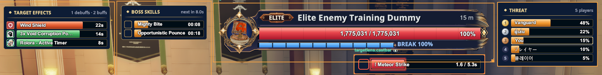
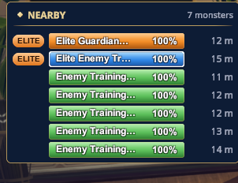
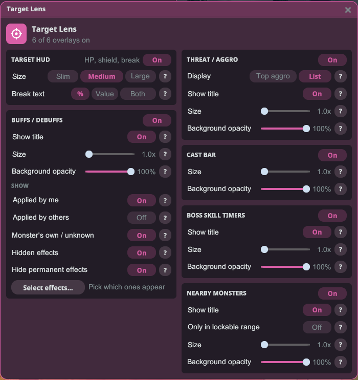
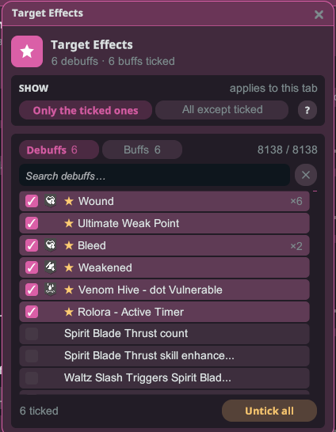

# Target Lens

Kenali targetmu. Target Lens membaca target pertarunganmu saat ini dan menampilkan semua hal
penting — HP, shield, dan gauge break-nya, buff dan debuff pada target, siapa yang memegang
aggro, skill mematikan berikutnya dari bos, cast bar-nya, dan monster di sekitarmu — sebagai
overlay yang rapi dan bisa diseret.

## Memulai

1. Instal plugin lalu jalankan game dalam mode **Dengan mod**.
2. Buka overlay launcher dan klik **Target Lens** untuk membuka pengaturannya.
3. Target sesuatu saat bertarung — overlay akan muncul secara otomatis. Seret overlay mana pun
   untuk memindahkannya dan seret tepinya untuk mengubah ukuran; posisinya akan diingat.

## Overlay

- **HUD Target** — bar bergaya bos dengan **potret** monster (siluet jika tidak ada), namanya
  dengan tag **BOS** / **ELIT**, jaraknya, bar **HP** dengan jejak yang menunjukkan damage terbaru,
  **shield**-nya ("armor") dengan jumlahnya di samping HP, dan **gauge break / stagger** — biru
  saat berkurang, dan emas bertuliskan **HANCUR** dengan hitung mundur saat target ter-break.
- **Efek Target** — jendela tersendiri berisi daftar buff dan debuff pada target, masing-masing
  dengan ikon dan sisa waktunya. Efekmu sendiri ditandai dengan **★**. **Klik sebuah baris** untuk
  melihat deskripsi efek tersebut.
- **Ancaman / Aggro** — siapa yang menjadi fokus bos dan **% ancaman** setiap pemain; barismu
  sendiri akan disorot.
- **Pengatur Waktu Skill Bos** — **hitung mundur** langsung ke skill berbahaya bos, agar kamu bisa
  bereaksi tepat waktu. Muncul selama pertarungan bos yang menggunakan fitur ini.
- **Bilah Cast** — cast/channel target, terisi seiring prosesnya; cast berbahaya ditandai dengan
  warna khusus.
- **Monster Terdekat** — daftar musuh di sekitarmu, bos dan elit lebih dulu, lalu berdasarkan jarak.

## Monster Terdekat

Setiap baris menampilkan tag **BOSS** / **ELITE** (untuk bos dan elit), lalu nama dan HP asli
monster di dalam bilah yang diwarnai sesuai rank (**merah** bos, **oranye** elit, **hijau** biasa),
dengan jaraknya di sebelah kanan.

- **Klik sebuah baris untuk mengunci monster itu** — sama seperti kunci target dengan tombol kunci
  bawaan game. Klik baris itu lagi untuk melepaskannya.
- Baris **target saat ini** berubah menjadi **biru**, dan monster yang sedang **kamu kunci**
  menampilkan **gembok** emas.
- Aktifkan **Hanya dalam jarak kunci** untuk menampilkan hanya monster yang cukup dekat untuk
  dikunci dan tetap terkunci. Jaraknya tergantung class-mu dan ditampilkan dalam meter di samping
  opsi tersebut.
- Seret tepi bawah jendela untuk menampilkan lebih banyak atau lebih sedikit baris.

## Pengaturan

Setiap overlay punya bagiannya sendiri dengan sakelar **Aktif / Mati** di judulnya. Setiap opsi
punya tombol **?** yang menjelaskan fungsinya. Opsi yang sedang tidak berlaku — misalnya opsi
**Buff / Debuff** saat overlay itu dimatikan — akan berwarna abu-abu, bukan menghilang.

Di **HUD Target**:

- **Ukuran** — bar bos **Ramping**, **Sedang**, atau **Besar**.
- **Teks break** — apa yang ditampilkan label gauge break. **%**: seberapa penuh gauge-nya.
  **Nilai**: poin gauge saat ini / maksimum. **Keduanya**: % di kanan dan poinnya tertulis di atas
  gauge (pada ukuran **Ramping** gauge terlalu tipis, jadi **Keduanya** tampil seperti **Nilai**).

Setiap overlay lainnya punya slider **Ukuran** dan slider **Opasitas latar** (seberapa pekat pelat
gelap dan cincin emasnya; 0% menyembunyikannya).

Di **Buff / Debuff → Tampilkan**, pilih efek mana yang muncul:

- **Dari saya** — efekmu sendiri (ditandai ★).
- **Dari orang lain** — efek dari pemain lain.
- **Milik monster / tak dikenal** — buff milik bos sendiri dan efek yang sumbernya tidak bisa
  diketahui.
- **Efek tersembunyi** — efek yang biasanya tidak ditampilkan oleh game.
- **Sembunyikan efek permanen** — tidak menampilkan efek yang tidak pernah habis.

## Pilih efek

Klik **Pilih efek…** untuk memilih persis buff dan debuff mana yang muncul.

- **Debuff** dan **Buff** punya tab masing-masing, dan setiap tab punya kotak pencarian sendiri.
- Pilih **Hanya yang dicentang** untuk menampilkan hanya efek yang kamu centang, atau **Selain
  yang dicentang** untuk menyembunyikan efek yang kamu centang. Setiap tab menyimpan pilihannya
  sendiri.
- Efek yang direkomendasikan ditandai dengan **★**. Efek yang dicentang ditampilkan paling atas,
  lalu efek yang direkomendasikan, lalu sisanya.
- **Hapus centang** menghapus semua centang di tab saat ini setelah kamu mengonfirmasi.

## Tips

- **Kunci HUD ke target** — tetapkan tombol untuk hotkey "Kunci HUD ke target saat ini" di
  pengaturan hotkey launcher. Tekan saat bertarung untuk mengunci overlay ke targetmu saat ini,
  sehingga tetap menampilkan musuh itu selagi kamu melawan musuh lain; tekan lagi untuk
  melepaskannya. Terlepas otomatis saat target mati. Ini hanya mengubah apa yang ditampilkan
  overlay — untuk mengunci target di dalam game, klik baris monster di **Monster Terdekat**.
- **Ukuran tiap overlay** — daftar efek, daftar ancaman/aggro, cast bar, pengatur waktu skill bos,
  dan daftar monster terdekat masing-masing punya slider ukuran dan opasitas latar sendiri, dan
  kamu bisa menyembunyikan judul overlay mana pun.
- **Atur overlay tanpa bertarung** — saat mengedit tata letak, overlay menampilkan baris contoh,
  jadi kamu bisa memindahkan dan mengubah ukurannya sebelum punya target.
- Semuanya opsional — aktifkan atau nonaktifkan overlay mana pun dari bagiannya di pengaturan.
- Gunakan **"Atur ulang semua HUD"** di launcher untuk mengembalikan semua overlay ke posisi
  bawaannya.
- Dilokalkan dalam **Bahasa Inggris, Jepang, Thailand, Indonesia, Filipino, dan Korea** —
  mengikuti bahasa launcher.
