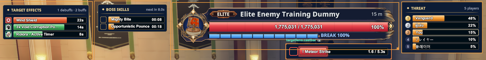
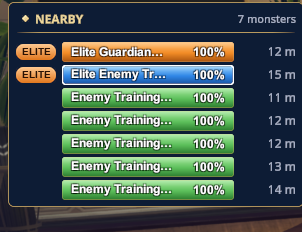
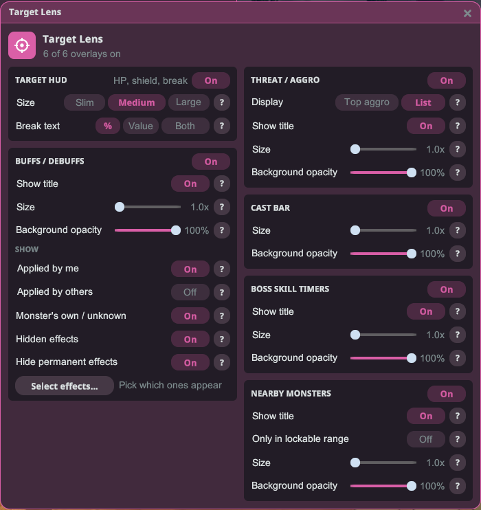
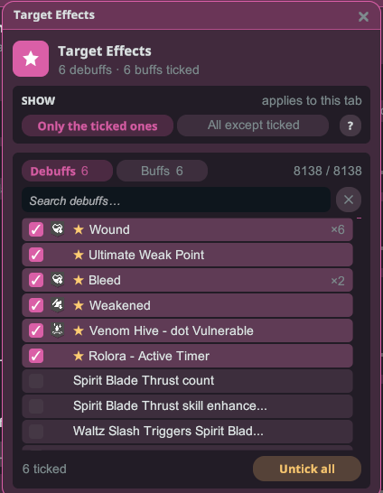

# Target Lens

ターゲットを把握する。Target Lensは現在の戦闘ターゲットを読み取り、重要な情報をすべて表示します — HP、シールド、ブレイクゲージ、ターゲットに付与されたバフ・デバフ、ヘイトを稼いでいるプレイヤー、ボスの次の危険なスキル、詠唱バー、そして周囲のモンスターまで — ドラッグ可能なすっきりしたオーバーレイとして。

## はじめに

1. プラグインをインストールし、**Mod有効**でゲームを起動します。
2. ランチャーオーバーレイを開き、**Target Lens**をクリックして設定を開きます。
3. 戦闘中に何かをターゲットすると、オーバーレイが自動的に表示されます。オーバーレイをドラッグすると移動、端をドラッグするとリサイズでき、位置は記憶されます。

## オーバーレイ

- **ターゲットHUD** — ボス風のバーに、モンスターの**ポートレート**（ない場合はシルエット）、**ボス** / **エリート**タグ付きの名前、距離、直近のダメージを示す残像付きの**HP**バー、HPの横に量が出る**シールド**（「アーマー」）、そして**ブレイク（スタッガー）ゲージ**を表示します。ゲージは減っている間は青、ブレイク中は金色の**ブレイク中**とカウントダウンになります。
- **ターゲット効果** — 専用ウィンドウで、ターゲットに付与されたバフとデバフをアイコンと残り時間付きで一覧表示。自分が付与した効果には**★**が付きます。**行をクリック**すると、その効果の説明が表示されます。
- **ヘイト / アグロ** — ボスが誰に集中しているか、各プレイヤーの**ヘイト％**を表示。自分の行はハイライトされます。
- **ボススキルタイマー** — ボスの危険なスキルまでの**カウントダウン**をリアルタイムで表示し、間に合うように対応できます。これを使うボス戦でのみ表示されます。
- **詠唱バー** — ターゲットのチャネリング／詠唱を、進行とともに埋まる形で表示。危険な詠唱は強調されます。
- **近くのモンスター** — 周囲の敵の一覧。ボスとエリートが先頭で、その後は距離順に並びます。

## 近くのモンスター

各行には **BOSS** / **ELITE** タグ（ボスとエリートのみ）があり、ランクで色分けされたバー（**赤**＝ボス、**オレンジ**＝エリート、**緑**＝通常）の中にモンスターの名前と実際のHPが表示され、右側に距離が表示されます。

- **行をクリックするとそのモンスターにロックオン**します — ゲーム本来のロックキーと同じロックオンです。もう一度クリックすると解除されます。
- **現在のターゲット**の行は**青**になり、**ロックオン中**のモンスターには金色の**南京錠**が表示されます。
- **ロック可能な範囲のみ**をオンにすると、ロックオンでき、ロックを維持できる距離にいるモンスターだけを一覧に表示します。距離はクラスによって異なり、オプションの横にメートル単位で表示されます。
- ウィンドウの下端をドラッグすると、表示する行数を増減できます。

## 設定

各オーバーレイには専用のセクションがあり、見出しに**オン / オフ**スイッチがあります。すべてのオプションには機能を説明する**?**ボタンがあります。現在適用されないオプション（例：**バフ / デバフ**をオフにしているときのそのオプション）は、消えるのではなくグレー表示になります。

**ターゲットHUD**の設定：

- **サイズ** — ボスバーの大きさを**スリム**・**ふつう**・**大きい**から選びます。
- **ブレイク表示** — ブレイクゲージのラベルに何を出すか。**%**：ゲージの残り具合。**数値**：ゲージの現在 / 最大ポイント。**両方**：右側に%、ゲージ上にポイントを表示（**スリム**ではゲージが細すぎるため、**両方**は**数値**と同じ表示になります）。

その他のオーバーレイには、それぞれ**サイズ**スライダーと**背景の不透明度**スライダー（暗いプレートと金色の枠の濃さ。0%で非表示）があります。

**バフ / デバフ → 表示する効果**で、どの効果を表示するかを選びます。

- **自分が付与** — 自分が付与した効果（★ 付き）。
- **他人が付与** — 他のプレイヤーが付与した効果。
- **モンスター自身 / 不明** — ボス自身のバフや、発生源が判別できない効果。
- **隠し効果** — ゲームが通常は表示しない効果。
- **永続効果を隠す** — 時間切れにならない効果を除外します。

## 効果を選択

**効果を選択…**をクリックすると、表示するバフとデバフを正確に選べます。

- **デバフ**と**バフ**はそれぞれ専用のタブがあり、タブごとに検索ボックスがあります。
- **チェックしたものだけ**を選ぶとチェックした効果だけを表示し、**チェック以外すべて**を選ぶとチェックした効果を非表示にします。選択はタブごとに保持されます。
- おすすめの効果には**★**が付きます。チェックした効果が先頭に並び、次におすすめの効果、その後に残りが並びます。
- **すべて外す**は、確認後に現在のタブのチェックをすべて外します。

## ヒント

- **HUDをターゲットにロック** — ランチャーのホットキー設定で「現在のターゲットにHUDをロック」にキーを割り当てます。戦闘中に押すと、オーバーレイが現在のターゲットに固定され、他の敵と戦っている間もその敵を表示し続けます。もう一度押すと解除されます。ターゲットが死亡すると自動的に解除されます。これはオーバーレイの表示内容を変えるだけです — ゲーム内で実際にロックオンするには、**近くのモンスター**でモンスターの行をクリックしてください。
- **オーバーレイごとのサイズ調整** — 効果リスト、ヘイト/アグロ一覧、詠唱バー、ボススキルタイマー、近くのモンスター一覧にはそれぞれ専用のサイズスライダーと背景の不透明度スライダーがあり、各オーバーレイのタイトルを非表示にすることもできます。
- **戦闘なしで配置** — レイアウト編集中はオーバーレイにサンプル行が表示されるので、ターゲットがいなくても移動やサイズ調整ができます。
- すべての機能はオプションです — 設定の各セクションから、どのオーバーレイでもオン・オフを切り替えられます。
- ランチャーの**「HUDをすべてリセット」**を使うと、すべてのオーバーレイをデフォルトの位置に戻せます。
- **英語、日本語、タイ語、インドネシア語、フィリピノ語、韓国語**に対応しており、ランチャーの言語設定に従います。
