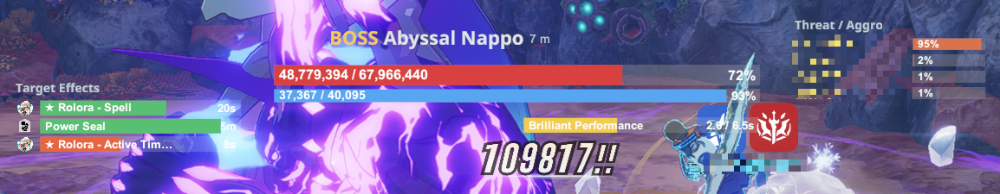
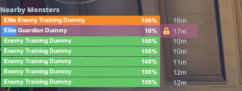
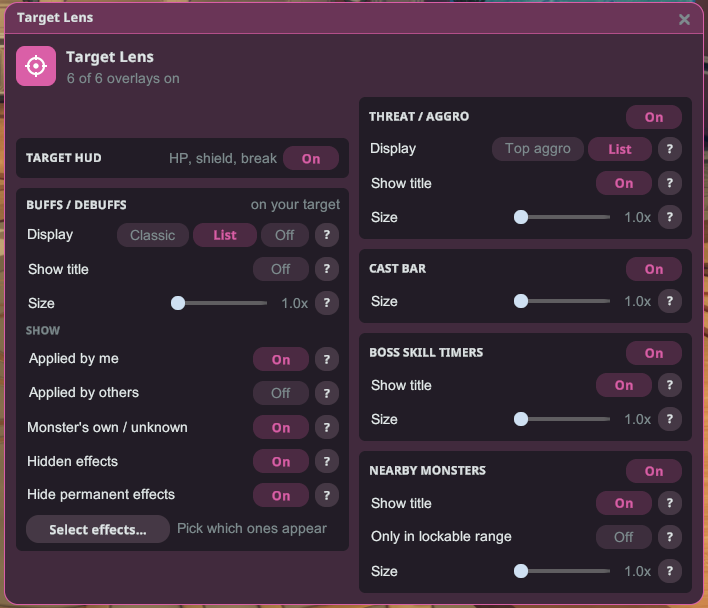
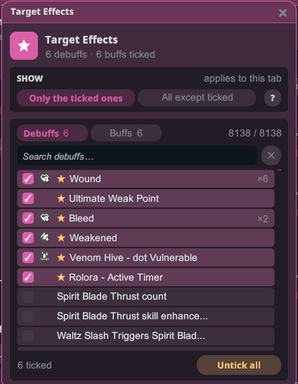

# Target Lens

รู้จักเป้าหมายของคุณ Target Lens จะอ่านเป้าหมายการต่อสู้ปัจจุบันของคุณและจัดวางทุกสิ่งที่สำคัญ — พลังชีวิตของมัน โล่ และเกจเบรก บัฟและดีบัฟที่ติดอยู่บนมัน ใครกำลังถืออักโกรอยู่ สกิลอันตรายถัดไปของบอส แถบร่ายเวทของมัน และมอนสเตอร์รอบตัวคุณ — เป็นโอเวอร์เลย์ที่สะอาดตาและลากได้

## เริ่มต้นใช้งาน

1. ติดตั้งปลั๊กอินแล้วเปิดเกมแบบ**ใช้ม็อด**
2. เปิดโอเวอร์เลย์ของลอนเชอร์แล้วคลิก**Target Lens**เพื่อเปิดการตั้งค่า
3. เลือกเป้าหมายขณะต่อสู้ — โอเวอร์เลย์จะปรากฏขึ้นเอง ลากโอเวอร์เลย์ใดก็ได้เพื่อย้ายตำแหน่ง และลากที่ขอบเพื่อปรับขนาด ตำแหน่งจะถูกจดจำไว้

## โอเวอร์เลย์

- **HUD เป้าหมาย** — **พลังชีวิต**ของเป้าหมาย, **โล่** ("เกราะ"), **เกจเบรก (สะดุด)**ของบอส, รวมถึงชื่อ ระดับ และระยะห่าง
- **เอฟเฟกต์เป้าหมาย** — บัฟและดีบัฟที่ติดอยู่บนเป้าหมาย พร้อมไอคอนและเวลาที่เหลือ เอฟเฟกต์ของคุณเองจะมีเครื่องหมาย**★**กำกับ
- **ความเกลียดชัง / อักโกร** — บอสกำลังสนใจใคร และ**% ความเกลียดชัง**ของผู้เล่นแต่ละคน แถวของคุณจะถูกไฮไลต์
- **ตัวจับเวลาสกิลบอส** — **นับถอยหลัง**แบบเรียลไทม์ก่อนที่บอสจะใช้สกิลอันตราย เพื่อให้คุณรับมือได้ทัน ปรากฏเฉพาะในการต่อสู้บอสที่ใช้ฟีเจอร์นี้
- **แถบร่ายเวท** — การร่ายเวท/การร่ายต่อเนื่องของเป้าหมาย เติมขึ้นขณะร่าย การร่ายที่อันตรายจะถูกเน้นสี
- **มอนสเตอร์ใกล้เคียง** — รายการศัตรูรอบตัวคุณ บอสและอีลิทจะอยู่ก่อน จากนั้นเรียงตามระยะห่าง

## มอนสเตอร์ใกล้เคียง

แต่ละแถวจะแสดงชื่อและพลังชีวิตของมอนสเตอร์ภายในแถบที่ใช้สีตามระดับ (**แดง** บอส, **ส้ม** อีลิท, **เขียว** ทั่วไป) พร้อมระยะห่างทางด้านขวา

- **คลิกที่แถวเพื่อล็อกเป้ามอนสเตอร์ตัวนั้น** — เป็นการล็อกเป้าแบบเดียวกับปุ่มล็อกของเกม คลิกแถวนั้นอีกครั้งเพื่อปลดล็อก
- แถวของ**เป้าหมายปัจจุบัน**จะเปลี่ยนเป็นสี**น้ำเงิน** และมอนสเตอร์ที่คุณ**ล็อกเป้าอยู่**จะแสดง**แม่กุญแจ**สีทอง
- เปิด**เฉพาะในระยะที่ล็อกได้**เพื่อแสดงเฉพาะมอนสเตอร์ที่อยู่ใกล้พอจะล็อกเป้าและล็อกค้างไว้ได้ ระยะนี้ขึ้นอยู่กับคลาสของคุณ และจะแสดงเป็นเมตรข้างตัวเลือก
- ลากขอบล่างของหน้าต่างเพื่อแสดงแถวมากขึ้นหรือน้อยลง

## การตั้งค่า

โอเวอร์เลย์แต่ละตัวมีส่วนของตัวเอง พร้อมสวิตช์**เปิด / ปิด**ที่หัวข้อ ทุกตัวเลือกมีปุ่ม**?**ที่อธิบายว่าตัวเลือกนั้นทำอะไร ตัวเลือกที่ยังใช้ไม่ได้ในขณะนั้น — เช่น ขนาดรายการขณะแสดงเอฟเฟกต์แบบไทล์คลาสสิก — จะเป็นสีเทาแทนที่จะหายไป

ใต้**บัฟ / ดีบัฟ → การแสดงผล** คุณสามารถเลือกวิธีแสดงเอฟเฟกต์ได้

- **คลาสสิก** — ไทล์ขนาดกะทัดรัดภายใน HUD เป้าหมาย
- **รายการ** — หน้าต่างแยกที่ปรับขนาดได้ โดยแต่ละแถวคือหนึ่งเอฟเฟกต์ (ไอคอน ชื่อ และเวลา)
- **ปิด** — ซ่อนการแสดงเอฟเฟกต์ทั้งหมด

ใต้**แสดง** เลือกว่าจะให้เอฟเฟกต์ใดปรากฏ

- **ที่ฉันใส่** — เอฟเฟกต์ของคุณเอง (มีเครื่องหมาย ★)
- **ที่ผู้อื่นใส่** — เอฟเฟกต์จากผู้เล่นคนอื่น
- **ของมอนสเตอร์เอง / ไม่ทราบ** — บัฟที่บอสใส่ให้ตัวเอง และเอฟเฟกต์ที่ไม่สามารถระบุแหล่งที่มาได้
- **เอฟเฟกต์ที่ซ่อนอยู่** — เอฟเฟกต์ที่ปกติเกมจะไม่แสดงให้เห็น
- **ซ่อนเอฟเฟกต์ถาวร** — ไม่แสดงเอฟเฟกต์ที่ไม่มีวันหมดเวลา

## เลือกเอฟเฟกต์

คลิก**เลือกเอฟเฟกต์…**เพื่อเลือกว่าจะให้บัฟและดีบัฟตัวไหนแสดงบ้าง

- **ดีบัฟ**และ**บัฟ**มีแท็บแยกกัน และแต่ละแท็บมีช่องค้นหาของตัวเอง
- เลือก**เฉพาะที่ติ๊กไว้**เพื่อแสดงเฉพาะเอฟเฟกต์ที่คุณติ๊ก หรือ**ทั้งหมด ยกเว้นที่ติ๊ก**เพื่อซ่อนเอฟเฟกต์ที่คุณติ๊ก แต่ละแท็บจะจำตัวเลือกของตัวเองไว้
- เอฟเฟกต์ที่แนะนำจะมีเครื่องหมาย**★**กำกับ เอฟเฟกต์ที่ติ๊กไว้จะอยู่บนสุด ตามด้วยเอฟเฟกต์ที่แนะนำ แล้วจึงเป็นที่เหลือ
- **ล้างทั้งหมด**จะเอาติ๊กออกทั้งหมดในแท็บปัจจุบันหลังจากคุณยืนยัน

## เคล็ดลับ

- **ล็อก HUD ไว้กับเป้าหมาย** — กำหนดปุ่มให้กับปุ่มลัด "ล็อก HUD ไว้กับเป้าหมายปัจจุบัน" ในการตั้งค่าปุ่มลัดของลอนเชอร์ กดขณะต่อสู้เพื่อตรึงโอเวอร์เลย์ไว้กับเป้าหมายปัจจุบัน ทำให้ยังคงแสดงศัตรูตัวนั้นต่อไปแม้คุณจะสู้กับตัวอื่นอยู่ กดอีกครั้งเพื่อปลดล็อก มันจะปลดล็อกเองเมื่อเป้าหมายตาย สิ่งนี้เปลี่ยนแค่สิ่งที่โอเวอร์เลย์แสดงเท่านั้น — หากต้องการล็อกเป้าในตัวเกมจริง ให้คลิกแถวของมอนสเตอร์ใน**มอนสเตอร์ใกล้เคียง**
- **ปรับขนาดแต่ละโอเวอร์เลย์** — รายการเอฟเฟกต์ รายการความเกลียดชัง / อักโกร แถบร่ายเวท ตัวจับเวลาสกิลบอส และรายการมอนสเตอร์ใกล้เคียง แต่ละตัวมีสไลเดอร์ปรับขนาดของตัวเอง และคุณสามารถซ่อนหัวข้อของโอเวอร์เลย์ใดก็ได้
- ทุกอย่างเป็นตัวเลือกเสริม — สลับเปิด/ปิดโอเวอร์เลย์ใดก็ได้จากส่วนของมันในการตั้งค่า
- ใช้**"รีเซ็ต HUD ทั้งหมด"**ของลอนเชอร์เพื่อคืนค่าโอเวอร์เลย์ทั้งหมดกลับไปยังตำแหน่งเริ่มต้น
- รองรับภาษา**อังกฤษ ญี่ปุ่น ไทย อินโดนีเซีย ฟิลิปปินส์ และเกาหลี** — โดยจะตามภาษาของลอนเชอร์
