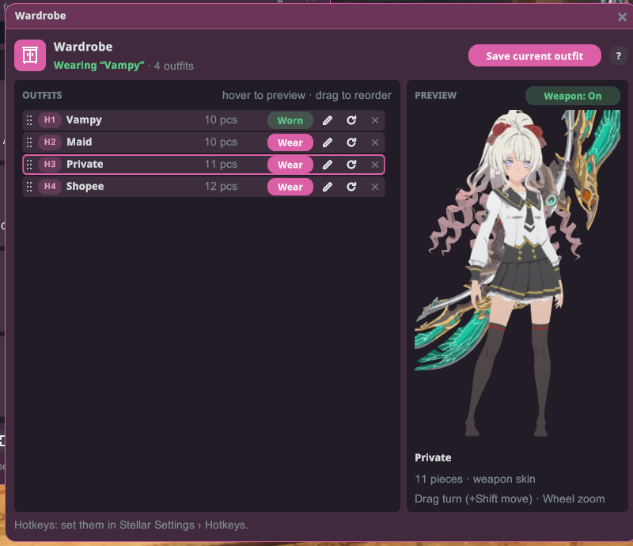

# ตู้เสื้อผ้า

บันทึกชุดที่คุณสวมใส่และสลับไปมาได้ทันที — ด้วยคลิกเดียวหรือปุ่มลัด — พร้อมพรีวิว 3D แบบสดของแต่ละชุด

## วิธีใช้งาน

1. ติดตั้งปลั๊กอินแล้วเปิดเกมแบบ**ใช้ม็อด**
2. แต่งตัวในเกมตามที่คุณชอบ จากนั้นเปิด**ตู้เสื้อผ้า**จากลอนเชอร์ Stellar (หรือผูกปุ่มลัด**เปิดตู้เสื้อผ้า**) แล้วคลิก**บันทึกชุดปัจจุบัน**ที่มุมขวาบน ชุดจะถูกเพิ่มลงในรายการของตัวละครนั้น
3. เปลี่ยนชุดในเกม แล้วนำชุดที่บันทึกไว้กลับมา:
   - คลิก**สวม**ที่แถวของชุดนั้น หรือ
   - กดปุ่มลัด — 8 ชุดแรกในรายการจะตรงกับ**ใช้ชุด 1**–**ใช้ชุด 8** (ผูกปุ่มได้ที่**การตั้งค่า Stellar › ปุ่มลัด** ค่าเริ่มต้นยังไม่ได้ผูกปุ่ม)

ปุ่มกลม **?** ข้าง**บันทึกชุดปัจจุบัน**จะแสดงคำอธิบายสั้น ๆ บรรทัดด้านบนจะบอกว่าคุณสวมชุดที่บันทึกไว้ชุดไหนอยู่ และมีชุดทั้งหมดกี่ชุด

## รายการชุด

แต่ละแถวแสดงจากซ้ายไปขวา:

- **ที่จับสำหรับลาก** — ลากแถวขึ้นหรือลงเพื่อเปลี่ยนลำดับ 8 แถวแรกคือช่องปุ่มลัด
- **ป้ายปุ่มลัด** — ปุ่มที่คุณผูกไว้กับช่องนั้น (เช่น **F1**) ถ้ายังไม่ได้ผูกปุ่มจะแสดง **H1**–**H8** ส่วนแถวหลังแถวที่ 8 จะแสดงแค่หมายเลข
- **ชื่อ**และ**จำนวนชิ้น** (เช่น "12 ชิ้น")
- **สวม** — สวมชุดนี้ ชุดที่คุณสวมอยู่ตอนนี้จะแสดง**สวมอยู่**แทน คลิก**สวมอยู่**เพื่อสวมชุดนั้นอีกครั้ง (เช่น หลังจากเปลี่ยนสีย้อม)
- **ดินสอ** — เปลี่ยนชื่อชุด กด **Enter** หรือ **✓** เพื่อบันทึกชื่อ หรือ **✕** เพื่อยกเลิก
- **รีเฟรช** — แทนที่ชุดนี้ด้วยชุดที่คุณสวมอยู่ตอนนี้ โดยคงชื่อและตำแหน่งเดิมไว้ และจะให้คุณยืนยันด้วย**แทนที่**ก่อน
- **✕** — ลบชุด และจะให้คุณยืนยันด้วย**ลบ**ก่อน

ขณะที่กำลังเปลี่ยนชื่อหรือรอการยืนยัน แถวอื่น ๆ จะรอจนกว่าคุณจะทำเสร็จ

## พรีวิว

วางเมาส์เหนือแถวใดก็ได้เพื่อดูชุดนั้นบนโมเดล 3D แบบสดของตัวละครคุณ **ลาก**เพื่อหมุน **Shift+ลาก**เพื่อเลื่อน และใช้**ล้อเมาส์**เพื่อซูม

พรีวิวจะแสดงชุดตรงตามที่บันทึกไว้ รวมถึงชิ้นที่ชุดนั้นซ่อนไว้ ชิป **อาวุธ: เปิด / ปิด** ใช้แสดงหรือซ่อนอาวุธบนโมเดล ถ้าชุดมีสกินอาวุธที่บันทึกไว้ อาวุธจะแสดงด้วยสกินนั้น

## การแสดงและซ่อนชิ้น

แต่ละชุดจะจำชิ้นที่คุณซ่อนไว้ (เช่น หมวก) และซ่อนอีกครั้งเมื่อคุณสวมชุดนั้น ชุดที่บันทึกไว้ก่อนเวอร์ชัน 1.5.0 ยังไม่มีข้อมูลนี้: สวมชุดนั้นโดยตั้งการแสดง/ซ่อนชิ้นตามที่ต้องการ แล้วกด**รีเฟรช** → **แทนที่**ที่แถวของชุดนั้นหนึ่งครั้ง

## หมายเหตุ

- ชุดถูกบันทึกแยก**ตามตัวละคร**
- การสลับใช้ระบบแฟชั่นของเกมเอง ซึ่งมีกฎของตัวเอง (เช่น คุณไม่สามารถเปลี่ยนชุดขณะต่อสู้ได้) — เกมจะแสดงแบนเนอร์หากไม่สามารถสลับได้ในตอนนี้
- ปลั๊กอินรองรับ English, 日本語, ไทย, Bahasa Indonesia, Filipino และ 한국어
